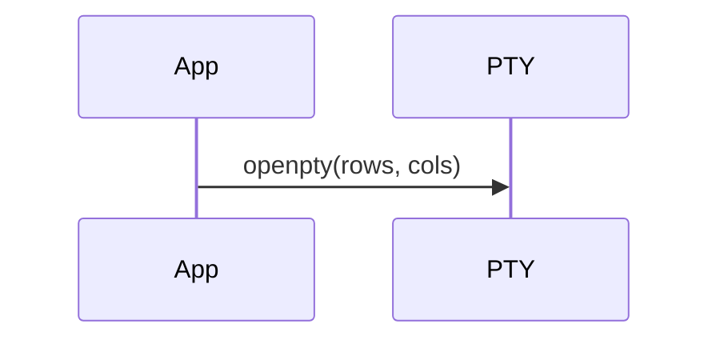

# Eocon Orchestrator Swarm — Plan File Format

Plan files in this workspace use **`.plan.mdx`**: YAML frontmatter for machine-readable metadata, plus an MDX body for rich, structured, reviewable technical planning.

This format is inspired by [BuilderIO/skills](https://github.com/BuilderIO/skills) (`/visual-plan`, `/visual-recap`) and adapted for local, source-controlled plans that do not require a hosted Plan MCP server.

---

## File Naming

- Extension: `.plan.mdx`
- Location: `.cursor/plans/` (or project-specific `plans/` directories)
- Pattern: `<slug>_<hash>.plan.mdx`
  - `slug` — short kebab-case plan identifier.
  - `hash` — 8-character hex suffix for uniqueness.

Example: `foundation_orchestrator_rust_cc4e7c03.plan.mdx`

---

## YAML Frontmatter Schema

Every plan MUST begin with YAML frontmatter delimited by `---`.

```yaml
---
name: Foundation Orchestrator Rust
overview: |
  One-paragraph summary of what the plan does and why it matters.
kind: plan                      # plan | recap | question
status: draft                   # draft | approved | in_progress | completed | archived
formatVersion: 1
isProject: false                # true when the plan owns a whole project/repo
priority: P1                    # optional: P0 | P1 | P2
owner: agent                    # optional: who authored/owns the plan
createdAt: "2026-06-18"         # optional ISO date
updatedAt: "2026-06-18"         # optional ISO date
tags:                           # optional
  - rust
  - ratatui
  - orchestrator
todos:
  - id: scaffold
    content: Create orchestrator/ Rust crate with ratatui, crossterm, portable-pty, vte, clap, color-eyre deps.
    status: pending             # pending | in_progress | done | blocked | skipped
  - id: tui-lifecycle
    content: Implement src/tui.rs raw mode + alt screen RAII guard and panic hook.
    status: pending
---
```

### Required fields

- `name` — human-readable plan title.
- `overview` — one-paragraph summary of scope and objective.
- `kind` — `plan` for forward planning, `recap` for post-implementation review, `question` for visual intake.
- `formatVersion` — current version is `1`.

### Recommended fields

- `status` — lifecycle state.
- `isProject` — `true` if the plan spans an entire project.
- `todos` — implementation checklist with unique `id`, `content`, and `status`.
- `tags` — search/filter keywords.

### Optional fields

- `priority`, `owner`, `createdAt`, `updatedAt`, `dueDate`, `reviewers`.

---

## MDX Body

The body is valid MDX. It is a sequence of standard Markdown sections and optional MDX block components. Because the body is MDX, plain Markdown headings, lists, code blocks, tables, and mermaid diagrams all work without change.

### Section Rhythm

A robust plan follows this top-to-bottom rhythm:

1. **Decision context / Summary** — why this plan exists and what changed.
2. **Epic Brief** — summary paragraph, context & problem, who's affected, where in the product, what changes.
3. **Reference Knowledge Base** — docs, notebooks, or skills to read first.
4. **Verified Integration Facts** — codebase facts the plan relies on (files, line numbers, contracts).
5. **Core Flows** — trigger + numbered steps + artifact output structure + mermaid diagram.
6. **Tech Plan** — architectural approach, decisions, validation notes, failure modes, data model, component architecture.
7. **Implementation Plan** — preamble, observations, approach, numbered steps, data flow summary, files modified.
8. **Open Questions** (if any) — bottom `question-form` for unresolved decisions.
9. **Plan Audit** — post-implementation table comparing plan steps to actual outcomes.

### Supported MDX Blocks

Use these block components for richer structure. All components are self-closing or explicitly closed.

#### `<RichText>`

Prose container. Use for any Markdown section that needs explicit block boundaries or renderer styling.

```mdx
<RichText>
## Decision context

Why this plan exists and what it changes.
</RichText>
```

#### `<Callout tone="decision">`

A settled decision or important warning.

```mdx
<Callout tone="decision">
Use a PTY (`portable-pty`) to preserve the agent's native fancy UI and avoid `/dev/tty` conflicts.
</Callout>
```

`tone`: `decision` | `warning` | `info` | `risk`.

#### `<Code filename="src/app.rs" language="rust">`

Plain code block with metadata.

```mdx
<Code filename="src/app.rs" language="rust">
{`enum Phase { Idle, Init, Build, Test, Complete, Failed, Aborted }`}
</Code>
```

#### `<AnnotatedCode filename="src/app.rs" language="rust">`

Code with anchored margin notes for the load-bearing lines.

```mdx
<AnnotatedCode filename="src/app.rs" language="rust" annotations={[
  { lines: "12-18", note: "UI thread owns App; worker threads never touch it." }
]}>
{`struct App {
    phase: Phase,
    child: Option<Box<dyn Child + Send>>,
}`}
</AnnotatedCode>
```

#### `<Diagram>`

Architecture or data-flow diagram. Prefer `data.html` / `data.css` with renderer-owned primitives, or `mermaid` for simple graphs.

```mdx
<Diagram type="mermaid">
{`graph TD
    MAIN[main.rs] --> RUN[lib::run]
    RUN --> APP[app.rs]`}
</Diagram>
```

#### `<Tabs>`

Group multiple code blocks, diagrams, or wireframes.

```mdx
<Tabs tabs={[
  { label: "Before", children: <Code>...</Code> },
  { label: "After", children: <Code>...</Code> }
]} />
```

#### `<Columns>`

Side-by-side comparison.

```mdx
<Columns columns={[
  { label: "Before", children: <RichText>Old schema...</RichText> },
  { label: "After", children: <RichText>New schema...</RichText> }
]} />
```

#### `<Checklist>`

Structured checklist.

```mdx
<Checklist items={[
  { id: "1", label: "Scaffold crate", checked: false },
  { id: "2", label: "Implement TUI lifecycle", checked: false }
]} />
```

#### `<QuestionForm>`

Bottom-of-document unresolved decisions.

```mdx
<QuestionForm title="Open Questions" questions={[
  { id: "q1", title: "Which PTY crate?", mode: "single", options: [
    { id: "portable-pty", label: "portable-pty", recommended: true },
    { id: "tui-term", label: "tui-term" }
  ]}
]} />
```

#### `<Wireframe>`

UI mockup block. Follow BuilderIO wireframe quality rules: plain semantic HTML, `--wf-*` tokens, no `<html>`/`<style>`/`<script>` tags, no hard-coded hex colors, no `font-family`, realistic product content.

```mdx
<Wireframe surface="desktop" title="Main orchestrator UI">
{`<div style="display:flex;flex-direction:column;gap:12px;padding:16px;height:100%">
  <h1>Foundation Orchestrator</h1>
  <div class="wf-card">Build running...</div>
</div>`}
</Wireframe>
```

---

## Mermaid Diagrams

Mermaid diagrams stay valid in `.mdx` as fenced code blocks with language `mermaid`:

```mdx

```

Renderers that support Mermaid will display them; others fall back to the source block.

---

## Migration from `.plan.md`

Use the migration script:

```bash
python3 Eocon-Orchestrator-swarm/scripts/migrate_plans.py .cursor/plans
```

The script:
1. Reads each `.plan.md` file.
2. Parses and normalizes YAML frontmatter.
3. Adds `kind: plan`, `formatVersion: 1`, and `status: draft` if missing.
4. Writes the body unchanged as MDX.
5. Outputs `.plan.mdx` files.
6. Does **not** delete the original `.plan.md` files by default (use `--replace` to move them to `.plan.md.bak`).

---

## Local Validation

Before committing a plan file:

1. Confirm the YAML frontmatter parses with any YAML parser.
2. Confirm the MDX body is well-formed (no unclosed JSX tags).
3. Confirm every `todos` item has a unique `id`.
4. Confirm the `name` and `overview` are present.

A future validator may be added under `Eocon-Orchestrator-swarm/scripts/validate_plans.py`.

---

## Relationship to BuilderIO Skills

This format borrows the block discipline from BuilderIO's `/visual-plan` and `/visual-recap` skills but keeps everything local and source-controlled:

- Plans are source artifacts, not hosted database objects.
- YAML frontmatter replaces SaaS-specific plan IDs for machine readability.
- MDX blocks are the authoring surface instead of the hosted Plan MCP connector.
- Mermaid diagrams replace some `diagram` blocks for simplicity.
- Wireframe quality rules are preserved for UI mockups.

When the hosted Plan MCP connector is available, plans can be exported to or imported from it by converting between this local MDX format and the connector's block schema.
