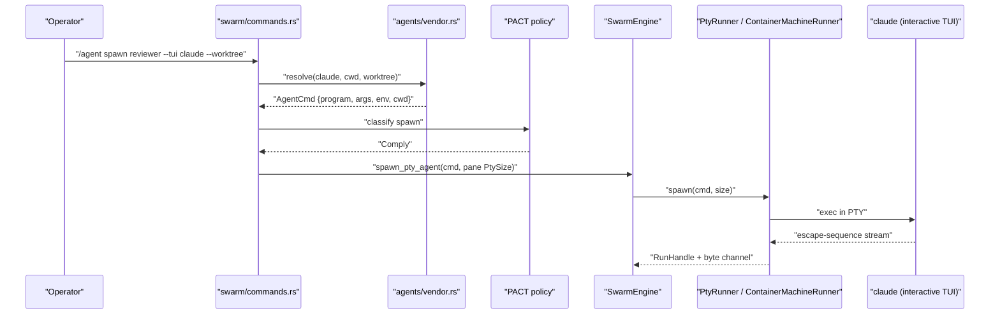
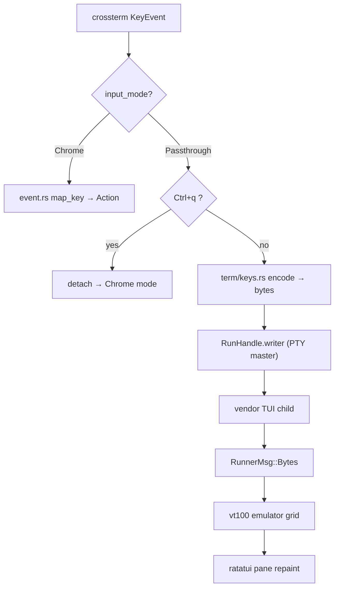
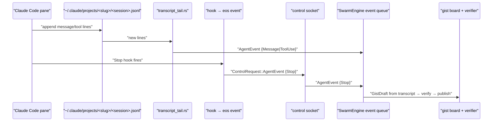
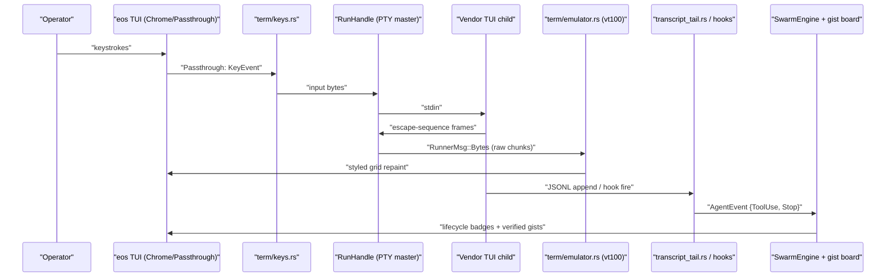

# Plan: Embedded Vendor TUI — Serve Agent Harnesses Inside the Swarm TUI

Host project: `file:Dev/Tools/Eocon-Orchestrator-swarm/orchestrator/` (Rust ratatui TUI, binary `eos`)
Tech Plan: See [Tech Plan](tech-plan.md) for full architectural detail.
Loops: See [loop.md](loop.md) for implementer/verifier prompts.

---

## Section 1: Epic Brief

### Summary

The Eocon Orchestrator Swarm (`eos`) today drives vendor coding agents — Claude Code, Codex, Gemini CLI, Kimi Code — as one-shot piped subprocesses (`file:Dev/Tools/Eocon-Orchestrator-swarm/orchestrator/src/chat.rs`): a prompt goes in on argv/stdin, text streams back line-by-line, and every interactive capability the vendor harness ships (permission prompts, plan mode, todo rendering, session resume, richer future features) is lost. The strategic insight is that we will never out-iterate the harness teams at Anthropic, OpenAI, and Google — so instead of re-implementing their agent loops, this epic embeds their TUIs directly inside our full-screen TUI. Each embedded agent runs its vendor CLI in a real PTY (the plumbing in `file:Dev/Tools/Eocon-Orchestrator-swarm/orchestrator/src/agents/runner.rs` already exists), rendered through a faithful terminal emulator into a ratatui pane, with a passthrough input mode that forwards raw keystrokes to the focused pane so the operator interacts with each agent in its native interface. The unified chat, gist board, PACT policy engine, and swarm features frame the terminal panes as orchestrator chrome. Because scraping a rendered TUI screen for orchestration state is maximally fragile, structured signals flow through a separate side channel: Claude Code session JSONL transcripts are tailed live and Claude Code hooks post events to the existing Unix control socket, feeding the gist board and verifier with machine-readable events while the human watches the native TUI. Unattended swarm agents keep the existing headless one-shot path — the embedded TUIs are a presentation and interaction upgrade for attended sessions, not a replacement for the swarm engine. Delivery is three phases: Phase A makes the terminal substrate faithful (raw-chunk PTY reads, a vt100-backed emulator with alternate-screen support, TERM/COLORTERM env, PTY resize propagation); Phase B makes panes interactive (terminal grid layouts, focus/passthrough input mode with a Ctrl+q prefix escape, vendor spawn adapters, optional per-agent git worktrees); Phase C lands the structured event tap (JSONL tailer, hook installer, control-socket event ingestion, gist publication from events).

### Context & Problem

**Who's affected**
- The operator running `eos`: agents spawned via `@claude <task>` mentions get a flat streaming-text pane (`AgentOutput::Chat`), losing permission prompts, plan approval, and any mid-task steering beyond `/agent edit`. Build/test agents (`AgentOutput::Pty`) render a degraded text projection of their PTY.
- The swarm engine (`file:Dev/Tools/Eocon-Orchestrator-swarm/orchestrator/src/swarm/engine.rs`): gist extraction reads accumulated chat text or parses screen text (`file:Dev/Tools/Eocon-Orchestrator-swarm/orchestrator/src/app.rs:723-733` parses `pty.screen.as_text()` for Swift agents) — brittle against any vendor output change.
- Every vendor harness release widens the gap: features like Claude Code plan mode, subagents, and hooks are simply unreachable through the one-shot pipe.

**Where in the product**
- PTY spawning: `file:Dev/Tools/Eocon-Orchestrator-swarm/orchestrator/src/agents/runner.rs` (PtyRunner, `RunHandle {child, master, writer, rx}`), `file:Dev/Tools/Eocon-Orchestrator-swarm/orchestrator/src/agents/sandbox.rs` (same shape through Apple `container`).
- Terminal model: `file:Dev/Tools/Eocon-Orchestrator-swarm/orchestrator/src/pty_screen.rs` (hand-rolled vte grid, 393 lines).
- Input pipeline: `file:Dev/Tools/Eocon-Orchestrator-swarm/orchestrator/src/event.rs` (crossterm → `Action`), `file:Dev/Tools/Eocon-Orchestrator-swarm/orchestrator/src/action.rs`, `file:Dev/Tools/Eocon-Orchestrator-swarm/orchestrator/src/app.rs` (`App::update`).
- Layout & rendering: `file:Dev/Tools/Eocon-Orchestrator-swarm/orchestrator/src/ui/layout.rs`, `file:Dev/Tools/Eocon-Orchestrator-swarm/orchestrator/src/ui/workflow_panel.rs`, `file:Dev/Tools/Eocon-Orchestrator-swarm/orchestrator/src/ui/agent_card.rs`.
- One-shot vendor chat: `file:Dev/Tools/Eocon-Orchestrator-swarm/orchestrator/src/chat.rs`.
- Control plane: `file:Dev/Tools/Eocon-Orchestrator-swarm/orchestrator/src/control/` (Unix socket, JSON-line protocol).

**What changes**
- Phase A rebuilds the terminal substrate for fidelity: the PTY reader stops line-buffering, the emulator gains alternate-screen/truecolor/title support via the `vt100` parser behind the existing `PtyScreen` surface, spawn env advertises a real terminal, and pane resizes propagate to the PTY master so children reflow.
- Phase B adds interactive embedding: a `Terminals` grid layout, `FocusedPane::Terminal(idx)`, a passthrough input mode that encodes crossterm key events into terminal byte sequences written to the focused agent's PTY (Ctrl+q returns to chrome), vendor spawn adapters (`/agent spawn <name> --tui claude`), and optional per-agent git worktrees.
- Phase C adds the structured side channel: a JSONL transcript tailer for Claude Code sessions, an `eos hooks install` command wiring Claude Code hooks to the control socket, an `AgentEvent` ingestion path in the control protocol, and gist publication from events instead of screen text for TUI agents. The headless one-shot path in `chat.rs` remains for unattended agents.

---

## Section 2: Core Flows

## Flow 1: Spawn an Embedded Vendor TUI Agent (Phase B)

**Description:** The operator spawns a Claude Code (or Codex/Gemini/Kimi) instance as a live terminal pane inside the swarm TUI.

**Trigger:** `/agent spawn reviewer --tui claude [--cwd <path>] [--worktree]` in the prompt, or the same command over the control socket.

**Steps:**

1. `file:Dev/Tools/Eocon-Orchestrator-swarm/orchestrator/src/swarm/commands.rs` parses `--tui <vendor>` and resolves the vendor through `file:Dev/Tools/Eocon-Orchestrator-swarm/orchestrator/src/agents/vendor.rs` into an `AgentCmd` (program path, interactive args, env including `TERM=xterm-256color` and `COLORTERM=truecolor`, cwd).
2. With `--worktree`, a git worktree is created under `<project>/.eocon/worktrees/<agent-name>` and becomes the cwd, so parallel agents never fight over one tree.
3. The PACT policy engine classifies the spawn; `SwarmEngine::spawn_pty_agent` (`file:Dev/Tools/Eocon-Orchestrator-swarm/orchestrator/src/swarm/engine.rs:194`) runs it through the configured `AgentRunner` (host PTY or Apple Container Machine) at the pane's actual cell dimensions.
4. The agent's `AgentOutput::Pty` holds the `RunHandle` plus the vt100-backed emulator; the pane renders the vendor TUI's live styled grid.
5. The status bar shows the pane hint: `Ctrl+h/l focus · Enter attach · Ctrl+q detach`.



## Flow 2: Attach and Interact in Passthrough Mode (Phase B)

**Description:** The operator focuses a terminal pane and types directly into the vendor TUI — approving a permission prompt, steering plan mode — exactly as if running the CLI standalone.

**Trigger:** With a terminal pane focused, press `Enter` (attach); or `/agent attach <name>`.

**Steps:**

1. `App.input_mode` switches from `Chrome` to `Passthrough { agent_id }`; the status bar renders a high-contrast `PASSTHROUGH — Ctrl+q to detach` badge.
2. Every crossterm `KeyEvent` bypasses the `Action` mapping in `file:Dev/Tools/Eocon-Orchestrator-swarm/orchestrator/src/event.rs` and is encoded by `file:Dev/Tools/Eocon-Orchestrator-swarm/orchestrator/src/term/keys.rs` into terminal input bytes (printable chars, Ctrl-chords, arrows/function keys as CSI/SS3, Enter/Tab/Backspace/Esc) written to the focused agent's PTY `writer`.
3. `Esc` is forwarded, not quit — vendor TUIs depend on it; global quit lives only in Chrome mode.
4. `Ctrl+q` detaches back to Chrome mode; `Ctrl+q Ctrl+q` sends one literal Ctrl+q to the child.
5. The child's response bytes stream through the existing drain (`file:Dev/Tools/Eocon-Orchestrator-swarm/orchestrator/src/app.rs:686`, `drain_pty_outputs`) into the emulator and repaint the pane each frame.



## Flow 3: Layout and Resize Propagation (Phase A)

**Description:** Cycling layouts or resizing the host terminal reflows every embedded TUI natively.

**Trigger:** `Tab` layout cycle, `Ctrl+h/l` focus moves, or a host terminal `Resize` event.

**Steps:**

1. `file:Dev/Tools/Eocon-Orchestrator-swarm/orchestrator/src/ui/layout.rs` computes each terminal pane's `Rect`; the render pass records the inner cell dimensions per agent.
2. When an agent's pane dims change, the app calls `RunHandle.master.resize(PtySize {rows, cols, ..})` — the kernel delivers SIGWINCH and the vendor TUI redraws itself to fit (this call does not exist today; `file:Dev/Tools/Eocon-Orchestrator-swarm/orchestrator/src/app.rs:514-527` resizes only the local grid model).
3. The emulator resizes its grid to the same dims, so parser state and pane geometry never diverge.

## Flow 4: Structured Event Tap → Gist Board (Phase C)

**Description:** While the operator interacts with the native TUI, the swarm engine receives machine-readable events — never scraping the screen.

**Trigger:** A Claude Code pane agent starts a session; the tailer detects the new session JSONL; hooks fire on tool use and stop.

**Steps:**

1. On spawn, the transcript tailer (`file:Dev/Tools/Eocon-Orchestrator-swarm/orchestrator/src/observability/transcript_tail.rs`) derives the Claude project slug from the agent's cwd (`/` → `-`, e.g. `-Users-emmanuel-Dev-Tools`) and watches `~/.claude/projects/<slug>/` for the newest `*.jsonl`, tailing appended lines.
2. Parsed lines become `AgentEvent {agent_id, session_id, kind: Message|ToolUse|ToolResult|Stop, payload}` and are pushed onto the engine's event queue.
3. Optionally, `eos hooks install` has written Claude Code hooks (PreToolUse/PostToolUse/Stop/Notification) into the workspace `.claude/settings.json` that shell out to `eos event --instance <name> --agent <id> --kind <k>`, which posts a `ControlRequest::AgentEvent` to the Unix control socket — lower latency than tailing, and it carries permission-prompt notifications the transcript lacks.
4. On `Stop`, the engine builds a `GistDraft` from the final assistant message in the transcript, runs the existing verifier, and publishes to the gist board — same pipeline, structured source.



## Flow 5: Unattended Headless Agent (Skip Path — unchanged)

**Description:** Swarm-dispatched background agents keep the existing one-shot pipeline; embedding is opt-in per agent.

**Trigger:** `@claude <task>` mentions or `SwarmEngine::assign_tasks` without `--tui`.

**Steps:**

1. `file:Dev/Tools/Eocon-Orchestrator-swarm/orchestrator/src/chat.rs` `spawn_chat_request` runs the vendor CLI in print mode exactly as today; `AgentOutput::Chat` streams into the chat panel.
2. Gists publish from accumulated chat text as today. No terminal pane, no passthrough, no tailer.
3. This path is the contract for CI-like fleets; the plan does not modify its behavior.

## Flow 6: Pane Exit, Crash, and Detach Safety (Error/Repair Path)

**Description:** A vendor TUI exiting — cleanly or not — never strands the operator's keyboard or corrupts the outer TUI.

**Trigger:** Child exit while attached; emulator parse desync; operator kills an attached agent.

**Steps:**

1. `drain_pty_outputs` detects `child.try_wait()` completion; if the exited agent was the passthrough target, `input_mode` force-resets to `Chrome` and the status bar announces the exit code.
2. The pane keeps the final screen plus scrollback for post-mortem reading; `/agent restart <name>` respawns into the same pane and worktree.
3. A `Ctrl+q`-based detach is always processed in the outer event loop before forwarding — even if the child stops reading its PTY (hung process), detach cannot be blocked because writes to the PTY are non-blocking-bounded and detach never requires a write.
4. If the emulator hits unparseable input, it drops the sequence and continues (vt100 is lossy-tolerant by design); a `/agent redraw <name>` command sends `Ctrl+l` to request a child repaint.

### Artifact Output Structure

```
Dev/Tools/Eocon-Orchestrator-swarm/orchestrator/
├── Cargo.toml                              # (A) + vt100 dependency
├── src/
│   ├── term/                               # (A) new module
│   │   ├── mod.rs                          # module exports
│   │   ├── emulator.rs                     # TermEmulator: vt100::Parser wrapper, PtyScreen-compatible surface
│   │   ├── widget.rs                       # ratatui widget: styled cell grid + cursor + scrollback window
│   │   └── keys.rs                         # (B) crossterm KeyEvent → terminal input byte encoding
│   ├── agents/
│   │   ├── runner.rs                       # (A) raw-chunk reader, TERM env, resize() on trait
│   │   ├── sandbox.rs                      # (A) same reader/env/resize changes for container runner
│   │   └── vendor.rs                       # (B) VendorCli registry → AgentCmd (claude/codex/gemini/kimi/cursor)
│   ├── swarm/
│   │   ├── agent.rs                        # (A) PtyOutput swaps PtyScreen → TermEmulator; (B) worktree field
│   │   ├── engine.rs                       # (B) spawn_tui_agent; (C) event queue + gist-from-event
│   │   └── commands.rs                     # (B) /agent spawn --tui/--cwd/--worktree, attach, detach, redraw
│   ├── app.rs                              # (A) real resize propagation; (B) InputMode {Chrome, Passthrough}
│   ├── event.rs                            # (B) passthrough branch before Action mapping
│   ├── action.rs                           # (B) Attach/Detach actions
│   ├── ui/
│   │   ├── layout.rs                       # (B) SwarmLayout::Terminals grid (1/2/4 panes + chat rail)
│   │   ├── terminal_pane.rs                # (B) pane chrome: title, state badge, attach hint
│   │   ├── workflow_panel.rs               # (A) render styled emulator grid, not full_text()
│   │   └── status_bar.rs                   # (B) PASSTHROUGH badge + prefix hints
│   ├── observability/
│   │   ├── agent_events.rs                 # (C) AgentEvent model + queue
│   │   └── transcript_tail.rs              # (C) Claude JSONL session tailer
│   ├── control/
│   │   ├── protocol.rs                     # (C) ControlRequest::AgentEvent
│   │   └── server.rs                       # (C) route AgentEvent → engine queue
│   ├── hooks.rs                            # (C) `eos hooks install` — write .claude/settings.json hooks
│   └── pty_screen.rs                       # (A) deleted or reduced to re-export of term::emulator
└── tests/
    ├── term_emulator.rs                    # (A) escape-sequence fixtures: alt-screen, SGR truecolor, cursor addressing
    ├── term_keys.rs                        # (B) key-encoding table assertions
    ├── passthrough_routing.rs              # (B) mode switching + byte routing with a capture writer
    └── transcript_tail.rs                  # (C) fixture JSONL → expected AgentEvents
```

---

## Section 3: Tech Plan

See [Tech Plan](tech-plan.md) for full context.

---

## Section 4: Implementation Plan

### Preamble

> I have created the following plan after thorough exploration and analysis of the codebase. Follow the below plan verbatim. Trust the files and references. Do not re-verify what's written in the plan. Explore only when absolutely necessary. First implement all the proposed file changes and then I'll review all the changes together at the end.

### Observations

- The PTY reader thread in `file:Dev/Tools/Eocon-Orchestrator-swarm/orchestrator/src/agents/runner.rs:101-119` uses `BufReader::read_until(b'\n')`. Interactive TUIs emit escape-sequence frames without newlines, so output would arrive stalled and bursty. This is the single most load-bearing fix: replace with raw `read()` into a fixed buffer, forwarding each chunk immediately. `file:Dev/Tools/Eocon-Orchestrator-swarm/orchestrator/src/agents/sandbox.rs` has the same pattern for container agents.
- Spawn env sets only `CLICOLOR_FORCE`/`FORCE_COLOR` (`file:Dev/Tools/Eocon-Orchestrator-swarm/orchestrator/src/agents/runner.rs:81-82`). Vendor TUIs need `TERM=xterm-256color` and `COLORTERM=truecolor` to enable full rendering.
- No call site anywhere invokes `master.resize(...)`; `App::resize_screens` (`file:Dev/Tools/Eocon-Orchestrator-swarm/orchestrator/src/app.rs:514-527`) resizes only the local `PtyScreen` grid with a `rows-4, cols/2` heuristic. Children never receive SIGWINCH and render for a stale size.
- `file:Dev/Tools/Eocon-Orchestrator-swarm/orchestrator/src/pty_screen.rs` is a 393-line hand-rolled `vte::Perform` grid: no alternate-screen buffer (CSI ?1049), OSC ignored (line 355), no DECSC/DECRC, no synchronized output. Claude Code and peers rely on alt-screen and cursor addressing; hand-extending this surface is a long tail of rendering bugs. The `vt100` crate (same author as the `vte`-adjacent ecosystem; used by `tui-term`) implements the full grid, alt-screen, scrollback, and styled cells. `vte 0.15` is already a dependency; `vt100` replaces the hand-rolled grid, not the PTY layer.
- `ratatui` is at 0.30 (`file:Dev/Tools/Eocon-Orchestrator-swarm/orchestrator/Cargo.toml`). `tui-term`'s published releases may lag ratatui 0.30 — so the plan wraps `vt100::Parser` directly in a thin adapter (`term/emulator.rs`) plus our own ~150-line ratatui widget (`term/widget.rs`), keeping the surface `PtyScreen` already exposes (`advance`, `resize`, `as_text`, `full_text`, scrollback offsets) so call sites in `file:Dev/Tools/Eocon-Orchestrator-swarm/orchestrator/src/app.rs:711`, `file:Dev/Tools/Eocon-Orchestrator-swarm/orchestrator/src/ui/workflow_panel.rs:67`, and `file:Dev/Tools/Eocon-Orchestrator-swarm/orchestrator/src/swarm/agent.rs:108-111` churn minimally.
- `file:Dev/Tools/Eocon-Orchestrator-swarm/orchestrator/src/event.rs:48` maps `Esc` → `Action::Quit` and every printable char to `Action::InputChar` globally. There is no input-mode concept; passthrough must branch before this mapping, and `Esc` must forward to the child in passthrough (vendor TUIs use Esc constantly).
- Vendor one-shot invocation lives in `file:Dev/Tools/Eocon-Orchestrator-swarm/orchestrator/src/chat.rs` (providers: claude, kimi, codex — buffered via temp file, gemini, cursor; exe discovery via `find_exe` with homebrew/bun fallbacks around lines 415-505). The same exe-discovery logic is reused by the Phase B vendor adapter; the one-shot path itself is untouched (Flow 5).
- `SwarmEngine::spawn_pty_agent` exists (`file:Dev/Tools/Eocon-Orchestrator-swarm/orchestrator/src/swarm/engine.rs:194`) and is the natural entry for TUI spawns; `AgentOutput::Pty { run_handle, screen }` (`file:Dev/Tools/Eocon-Orchestrator-swarm/orchestrator/src/swarm/agent.rs:108-111`) is the pane state container.
- Swift build/test agents parse gist state from screen text (`file:Dev/Tools/Eocon-Orchestrator-swarm/orchestrator/src/app.rs:723-733`); this plan leaves that path working but routes new TUI-agent gists through Phase C events — screen scraping is explicitly banned for vendor TUI agents.
- The control plane (`file:Dev/Tools/Eocon-Orchestrator-swarm/orchestrator/src/control/protocol.rs`, `server.rs`, `registry.rs`) is a Unix socket speaking single-line JSON `ControlRequest`/`ControlResponse`; instances register under a name; `eos exec --instance <n> "<cmd>"` already works. Phase C adds one request variant, not a new transport.
- Claude Code writes session transcripts to `~/.claude/projects/<cwd-slug>/<session-id>.jsonl` where the slug is the cwd with `/` replaced by `-` (verified: this machine has `~/.claude/projects/-Users-emmanuel/`). Hooks (PreToolUse, PostToolUse, Stop, Notification) are configured in `.claude/settings.json` and run shell commands with a JSON payload on stdin. Codex/Gemini lack equivalent stable hook surfaces — Phase C is Claude-Code-first-class; other vendors get pane embedding without the event tap until their surfaces stabilize.
- The repo root is `file:Dev/Tools/Eocon-Orchestrator-swarm/` and is its own git repository ("Do not re-initialize git anywhere above this directory" — README). Commits scope to `orchestrator/` and `plans/`.
- No tokio: the codebase is sync threads + `std::sync::mpsc` + 50 ms tick (`file:Dev/Tools/Eocon-Orchestrator-swarm/orchestrator/src/lib.rs:338`). The tailer and event queue follow this pattern — dedicated threads feeding mpsc channels drained on tick — not an async runtime.

### Approach

Three phases ordered so each lands standalone value. Phase A (fidelity) fixes the substrate — raw-chunk reads, vt100 emulator, terminal env, resize propagation — after which existing PTY agents (build/test) already render correctly; it touches no input handling and cannot regress chat agents. Phase B (interactivity) adds the terminal grid layout, passthrough input mode with prefix escape, vendor spawn adapters, and worktrees — after which the demo is "Claude Code running live inside Yokan." Phase C (orchestration) restores the swarm's structured visibility over TUI agents via transcript tailing and hooks feeding the existing gist/verifier pipeline through the existing control socket. The headless path is never modified. Screen scraping for vendor TUI agents is prohibited from day one.

### Implementation Steps

**Phase A — Terminal fidelity (substrate; no behavior change for chat agents)**

1. Modify `file:Dev/Tools/Eocon-Orchestrator-swarm/orchestrator/Cargo.toml` — add `vt100` (latest published; validate it builds against the workspace; it has no ratatui coupling). Keep `vte` (still used until `pty_screen.rs` is removed at step 6).
2. Create `file:Dev/Tools/Eocon-Orchestrator-swarm/orchestrator/src/term/emulator.rs` — `TermEmulator` wrapping `vt100::Parser`: `new(rows, cols, scrollback)`, `advance(&[u8])` (feed parser), `resize(rows, cols)`, `title() -> Option<&str>`, `is_alt_screen() -> bool`, `cursor() -> (u16, u16, bool)`, `scroll_offset` get/set, and `as_text()/full_text() -> ratatui Text` compatibility shims that translate `vt100::Cell` (fg/bg/bold/italic/underline/inverse) into `ratatui::style::Style` — preserving the exact method names `PtyScreen` exposes today so `app.rs`/`workflow_panel.rs` diffs stay mechanical.
3. Create `file:Dev/Tools/Eocon-Orchestrator-swarm/orchestrator/src/term/widget.rs` — `TerminalPaneWidget<'a>` implementing ratatui `Widget`: paints the emulator's visible grid cell-by-cell into the `Buffer` (styled, correct wide-char handling via vt100's cell width), draws the cursor block when the pane is attached, and windows scrollback when `scroll_offset > 0`.
4. Modify `file:Dev/Tools/Eocon-Orchestrator-swarm/orchestrator/src/agents/runner.rs` — replace the `read_until(b'\n')` loop (lines 101-119) with raw chunk reads: `let mut buf = [0u8; 8192]; loop { match reader.read(&mut buf) { Ok(0) => break, Ok(n) => send Bytes(buf[..n].to_vec()), Err(e) => send Error } }`. Add `cmd_builder.env("TERM", "xterm-256color")` and `cmd_builder.env("COLORTERM", "truecolor")`. Add `fn resize(&self, handle: &RunHandle, size: PtySize) -> Result<(), RunnerError>` to the `AgentRunner` trait with the default implementation `handle.master.resize(size)`.
5. Modify `file:Dev/Tools/Eocon-Orchestrator-swarm/orchestrator/src/agents/sandbox.rs` — apply the same raw-chunk reader and env changes to the container runner's reader thread (line ~272 spawn path).
6. Modify `file:Dev/Tools/Eocon-Orchestrator-swarm/orchestrator/src/swarm/agent.rs` — `PtyOutput.screen` becomes `TermEmulator`; delete `file:Dev/Tools/Eocon-Orchestrator-swarm/orchestrator/src/pty_screen.rs` and drop the `vte` dependency once nothing references it. Update `file:Dev/Tools/Eocon-Orchestrator-swarm/orchestrator/src/app.rs:711` (`pty.screen.advance`) and `file:Dev/Tools/Eocon-Orchestrator-swarm/orchestrator/src/app.rs:723-733` (Swift screen-text parse keeps working via `full_text()`).
7. Modify `file:Dev/Tools/Eocon-Orchestrator-swarm/orchestrator/src/app.rs` — replace `resize_screens` (lines 514-527): the render pass records each PTY agent's last inner pane `Rect` (rows/cols) into a `HashMap<String, (u16, u16)>` on `App`; on tick, any agent whose recorded dims differ from its emulator dims gets `emulator.resize(...)` plus `runner.resize(handle, PtySize)` — pane geometry, emulator grid, and child PTY always agree.
8. Modify `file:Dev/Tools/Eocon-Orchestrator-swarm/orchestrator/src/ui/workflow_panel.rs` — render PTY agents through `TerminalPaneWidget` (styled grid) instead of flattening `full_text()` lines (line 67) into the panel's line stack.
9. Create `file:Dev/Tools/Eocon-Orchestrator-swarm/orchestrator/tests/term_emulator.rs` — fixtures: enter/leave alt-screen preserves and restores the primary grid; SGR truecolor + bold maps to the right `Style`; absolute cursor addressing writes where directed; `resize` reflows without panicking; a captured real `claude` startup byte sample (checked into `tests/fixtures/`) parses without error.

**Phase B — Interactive embedding (attach, type, detach)**

10. Create `file:Dev/Tools/Eocon-Orchestrator-swarm/orchestrator/src/term/keys.rs` — `encode_key(KeyEvent) -> Option<Vec<u8>>`: printable chars (UTF-8), Shift handled by crossterm, Ctrl+letter → 0x01-0x1A, Enter → `\r`, Tab → `\t`, Backspace → 0x7F, Esc → 0x1B, arrows → CSI A/B/C/D (with modifier variants `CSI 1;5C` etc.), Home/End/PgUp/PgDn/Del/Ins → CSI ~ codes, F1-F12 → SS3/CSI codes. Table-driven and unit-tested.
11. Modify `file:Dev/Tools/Eocon-Orchestrator-swarm/orchestrator/src/app.rs` — add `pub enum InputMode { Chrome, Passthrough { agent_id: String, pending_prefix: bool } }` on `App` (default `Chrome`). Attach: `Action::Attach` (Enter on a focused terminal pane, or `/agent attach <name>`) sets Passthrough when the agent has a live `RunHandle`. Detach: `Ctrl+q` in passthrough → Chrome; a second consecutive `Ctrl+q` forwards the literal byte. Child exit while attached force-resets to Chrome (Flow 6).
12. Modify `file:Dev/Tools/Eocon-Orchestrator-swarm/orchestrator/src/event.rs` — `EventHandler::next` gains a mode parameter (or the loop in `lib.rs` checks mode first): in Passthrough, raw `KeyEvent`s become `Action::ForwardKey(KeyEvent)` except the Ctrl+q prefix; in Chrome, mapping is unchanged. `App::update` handles `ForwardKey` by encoding via `term/keys.rs` and writing to the focused agent's `RunHandle.writer` (write + flush; on `WouldBlock`/error, surface a `Voice::Warning`, never block the UI thread).
13. Modify `file:Dev/Tools/Eocon-Orchestrator-swarm/orchestrator/src/ui/layout.rs` — add `SwarmLayout::Terminals` to the cycle: a chat rail (30% left) plus a terminal grid (1 pane full, 2 panes split-vertical, 3-4 panes 2×2) sized from the live PTY-agent count; return per-slot `Rect`s. `visible_panes()` in `app.rs` gains `FocusedPane::Terminal(usize)` entries; `Ctrl+h/l` cycles chat rail ↔ terminal slots.
14. Create `file:Dev/Tools/Eocon-Orchestrator-swarm/orchestrator/src/ui/terminal_pane.rs` — pane chrome: bordered block titled `<name> · <vendor> · <state>` (border color = lifecycle state; attached pane gets the accent color), inner `TerminalPaneWidget`, bottom-right hint `Enter attach` / `Ctrl+q detach`.
15. Create `file:Dev/Tools/Eocon-Orchestrator-swarm/orchestrator/src/agents/vendor.rs` — `pub enum VendorCli { Claude, Codex, Gemini, Kimi, Cursor }` with `fn agent_cmd(&self, cwd: &Path, extra_args: &[String]) -> Result<AgentCmd, String>`: interactive invocation (bare `claude`, `codex`, `gemini`, `kimi` — no print/exec flags), exe discovery reusing the fallback paths already encoded in `file:Dev/Tools/Eocon-Orchestrator-swarm/orchestrator/src/chat.rs:415-505`, env `TERM`/`COLORTERM`, `risk_tier` defaulting to Medium (PACT classifies as today).
16. Modify `file:Dev/Tools/Eocon-Orchestrator-swarm/orchestrator/src/swarm/commands.rs` and `file:Dev/Tools/Eocon-Orchestrator-swarm/orchestrator/src/swarm/engine.rs` — `/agent spawn <name> --tui <vendor> [--cwd <path>] [--worktree] [-- <extra args>]` → `engine.spawn_tui_agent(...)`: resolve vendor, optionally create a git worktree at `<project>/.eocon/worktrees/<name>` (`git worktree add`; error surfaced verbatim on failure), spawn at the target pane's current dims, set `AgentOutput::Pty`, auto-switch layout to `Terminals`. Add `/agent attach <name>`, `/agent detach`, `/agent redraw <name>` (writes 0x0C). `/agent kill` prunes the worktree only with an explicit `--rm-worktree`.
17. Modify `file:Dev/Tools/Eocon-Orchestrator-swarm/orchestrator/src/ui/status_bar.rs` and `file:Dev/Tools/Eocon-Orchestrator-swarm/orchestrator/src/app.rs` SLASH_COMMANDS — PASSTHROUGH badge, attach/detach hints, new subcommand entries so the picker stays truthful.
18. Create `file:Dev/Tools/Eocon-Orchestrator-swarm/orchestrator/tests/term_keys.rs` and `file:Dev/Tools/Eocon-Orchestrator-swarm/orchestrator/tests/passthrough_routing.rs` — key-encoding table assertions; mode transitions (attach → forward → prefix detach → double-prefix literal → child-exit force-detach) with a capture writer standing in for the PTY.

**Phase C — Structured event side channel (Claude Code first-class)**

19. Create `file:Dev/Tools/Eocon-Orchestrator-swarm/orchestrator/src/observability/agent_events.rs` — `pub struct AgentEvent { agent_id, session_id: Option<String>, kind: AgentEventKind, payload: serde_json::Value, at: SystemTime }`, `pub enum AgentEventKind { SessionStart, Message, ToolUse, ToolResult, PermissionRequest, Stop }`, plus a bounded `mpsc` queue owned by `SwarmEngine` and drained on tick.
20. Create `file:Dev/Tools/Eocon-Orchestrator-swarm/orchestrator/src/observability/transcript_tail.rs` — per-TUI-agent tailer thread: derive slug from the agent cwd (`/`→`-`), watch `~/.claude/projects/<slug>/` (poll every 500 ms; no notify dependency, matching the sync-thread codebase), adopt the newest `*.jsonl` created after spawn, seek-tail appended lines, parse Claude transcript records (assistant/user messages, tool_use/tool_result blocks) into `AgentEvent`s. Malformed lines are skipped with a debug count, never fatal. Thread stops when the agent is killed.
21. Modify `file:Dev/Tools/Eocon-Orchestrator-swarm/orchestrator/src/control/protocol.rs` and `file:Dev/Tools/Eocon-Orchestrator-swarm/orchestrator/src/control/server.rs` — add `ControlRequest::AgentEvent { agent: String, kind: String, payload: serde_json::Value }` routed onto the engine's event queue; responses stay `ControlResponse::ok()`.
22. Create `file:Dev/Tools/Eocon-Orchestrator-swarm/orchestrator/src/hooks.rs` + `eos hooks install [--project <path>]` subcommand in `file:Dev/Tools/Eocon-Orchestrator-swarm/orchestrator/src/lib.rs`/`main.rs` — writes (merging, never clobbering) `.claude/settings.json` hooks for PreToolUse/PostToolUse/Stop/Notification that pipe their stdin JSON to `eos event --instance <name> --agent $EOS_AGENT_ID --kind <kind>`; the spawn adapter (step 15) sets `EOS_AGENT_ID` in the child env so hook events self-identify. `eos event` is a thin control-socket client (reuses `file:Dev/Tools/Eocon-Orchestrator-swarm/orchestrator/src/control/client.rs`).
23. Modify `file:Dev/Tools/Eocon-Orchestrator-swarm/orchestrator/src/swarm/engine.rs` — on `AgentEventKind::Stop` for a TUI agent: build the `GistDraft` from the last assistant `Message` event (structured text, not screen), run the existing verifier, publish; update the agent lifecycle (`Thinking` on Message-in-progress, `Acting` on ToolUse, `Completed` on Stop) so agent cards reflect real state. Screen text is never consulted for vendor TUI agents.
24. Create `file:Dev/Tools/Eocon-Orchestrator-swarm/orchestrator/tests/transcript_tail.rs` — fixture JSONL (checked-in sample of a short Claude session) → exact expected `AgentEvent` sequence; malformed-line skip; control-socket `AgentEvent` round-trip through the protocol serde.

### Data Flow Summary



### Files Modified

| File | Change |
|---|---|
| `orchestrator/Cargo.toml` | Mod (A) — add `vt100`; drop `vte` at end of A |
| `orchestrator/src/term/mod.rs` | New (A) — module exports |
| `orchestrator/src/term/emulator.rs` | New (A) — vt100-backed `TermEmulator`, PtyScreen-compatible surface |
| `orchestrator/src/term/widget.rs` | New (A) — styled ratatui terminal grid widget |
| `orchestrator/src/agents/runner.rs` | Mod (A) — raw-chunk reader, TERM/COLORTERM, `resize` on trait |
| `orchestrator/src/agents/sandbox.rs` | Mod (A) — same reader/env changes for container runner |
| `orchestrator/src/swarm/agent.rs` | Mod (A) — `PtyOutput.screen: TermEmulator` |
| `orchestrator/src/pty_screen.rs` | Del (A) — superseded by `term/emulator.rs` |
| `orchestrator/src/app.rs` | Mod (A) — dims bookkeeping + PTY resize; (B) `InputMode`, ForwardKey, attach/detach |
| `orchestrator/src/ui/workflow_panel.rs` | Mod (A) — styled grid rendering |
| `orchestrator/tests/term_emulator.rs` | New (A) — escape-sequence fixtures |
| `orchestrator/src/term/keys.rs` | New (B) — KeyEvent → terminal bytes |
| `orchestrator/src/event.rs` | Mod (B) — passthrough branch before Action mapping |
| `orchestrator/src/action.rs` | Mod (B) — `Attach`, `Detach`, `ForwardKey` |
| `orchestrator/src/ui/layout.rs` | Mod (B) — `SwarmLayout::Terminals` grid |
| `orchestrator/src/ui/terminal_pane.rs` | New (B) — pane chrome |
| `orchestrator/src/ui/status_bar.rs` | Mod (B) — PASSTHROUGH badge, hints |
| `orchestrator/src/agents/vendor.rs` | New (B) — VendorCli → AgentCmd adapters |
| `orchestrator/src/swarm/commands.rs` | Mod (B) — spawn `--tui`, attach/detach/redraw |
| `orchestrator/src/swarm/engine.rs` | Mod (B) — `spawn_tui_agent`, worktrees; (C) event queue, gist-from-event |
| `orchestrator/tests/term_keys.rs` | New (B) — encoding table tests |
| `orchestrator/tests/passthrough_routing.rs` | New (B) — mode/routing tests |
| `orchestrator/src/observability/agent_events.rs` | New (C) — AgentEvent model + queue |
| `orchestrator/src/observability/transcript_tail.rs` | New (C) — Claude JSONL tailer |
| `orchestrator/src/control/protocol.rs` | Mod (C) — `ControlRequest::AgentEvent` |
| `orchestrator/src/control/server.rs` | Mod (C) — route AgentEvent to engine |
| `orchestrator/src/hooks.rs` | New (C) — `eos hooks install`, `eos event` client |
| `orchestrator/src/lib.rs` / `src/main.rs` | Mod (C) — new subcommands |
| `orchestrator/tests/transcript_tail.rs` | New (C) — JSONL fixture tests |

---

## Section 5: Plan Audit

Implementation has not started. This table is scaffolded now and must be completed after implementation; every Implementation Step appears as a row.

| Plan Step | Actual Outcome | Deviation (Yes/No) | Notes |
|---|---|---|---|
| 1. Cargo.toml `vt100` | Pending | — | |
| 2. `term/emulator.rs` | Pending | — | |
| 3. `term/widget.rs` | Pending | — | |
| 4. `runner.rs` raw reads + env + resize | Pending | — | |
| 5. `sandbox.rs` same | Pending | — | |
| 6. `agent.rs` emulator swap, delete `pty_screen.rs` | Pending | — | |
| 7. `app.rs` resize propagation | Pending | — | |
| 8. `workflow_panel.rs` styled grid | Pending | — | |
| 9. `tests/term_emulator.rs` | Pending | — | |
| 10. `term/keys.rs` | Pending | — | |
| 11. `app.rs` InputMode | Pending | — | |
| 12. `event.rs` passthrough branch | Pending | — | |
| 13. `layout.rs` Terminals grid | Pending | — | |
| 14. `ui/terminal_pane.rs` | Pending | — | |
| 15. `agents/vendor.rs` | Pending | — | |
| 16. commands/engine spawn `--tui` + worktrees | Pending | — | |
| 17. status bar + picker entries | Pending | — | |
| 18. keys + passthrough tests | Pending | — | |
| 19. `agent_events.rs` | Pending | — | |
| 20. `transcript_tail.rs` | Pending | — | |
| 21. control protocol AgentEvent | Pending | — | |
| 22. `hooks.rs` + `eos hooks install` / `eos event` | Pending | — | |
| 23. engine gist-from-event + lifecycle | Pending | — | |
| 24. `tests/transcript_tail.rs` | Pending | — | |
