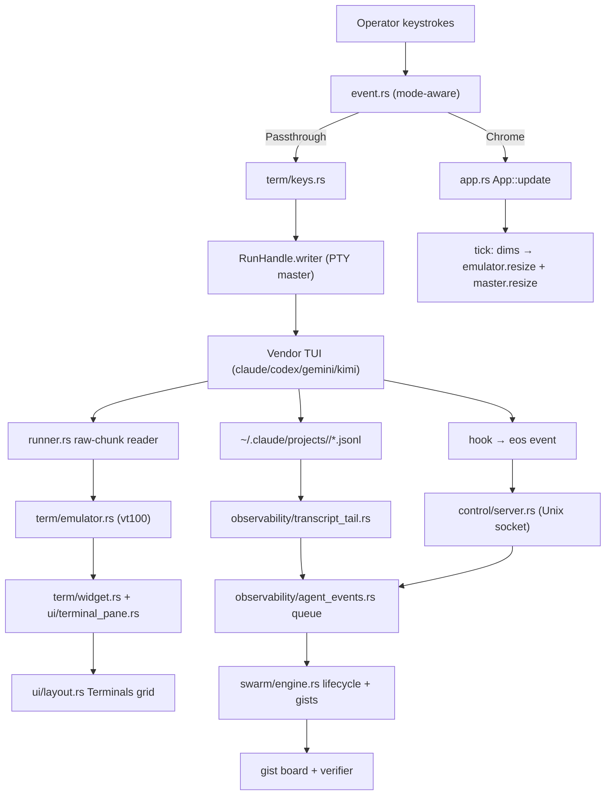
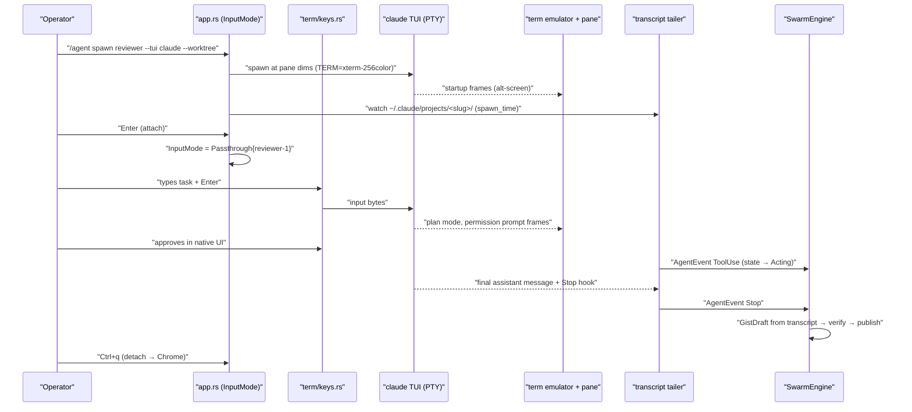

# Tech Plan: Embedded Vendor TUI

Parent plan: [plan.md](plan.md)
Every statement below is traceable to a specific file path via the `file:` prefix.

---

## Architectural Approach

Pattern name: **PTY Terminal Multiplexing + Passthrough Input Routing + Structured Event Sidecar**

Eocon Orchestrator Swarm (`eos` binary) embeds vendor CLI TUIs instead of piping them one-shot.

- The terminal substrate sources the existing PTY layer (`file:Dev/Tools/Eocon-Orchestrator-swarm/orchestrator/src/agents/runner.rs`, `portable-pty 0.9`) and replaces the hand-rolled `vte::Perform` grid (`file:Dev/Tools/Eocon-Orchestrator-swarm/orchestrator/src/pty_screen.rs`) with the `vt100` crate's full terminal state machine (alternate screen, scrollback, styled cells, cursor state), wrapped in a thin adapter that preserves the current `PtyScreen` method surface.
- Interactivity is a mode split, not a rewrite: the crossterm event loop (`file:Dev/Tools/Eocon-Orchestrator-swarm/orchestrator/src/event.rs`) gains a `Passthrough` branch that encodes `KeyEvent`s to terminal byte sequences and writes them to the focused agent's PTY master, with `Ctrl+q` as the reserved detach prefix — the tmux prefix-key model.
- Vendor CLIs are launched in their native interactive mode by a small adapter registry (`agents/vendor.rs`) that reuses the exe-discovery logic already proven in `file:Dev/Tools/Eocon-Orchestrator-swarm/orchestrator/src/chat.rs:415-505`. The one-shot headless path in `chat.rs` is untouched and remains the contract for unattended swarm agents.
- Orchestration signals never come from the rendered screen. Claude Code's session JSONL (`~/.claude/projects/<cwd-slug>/*.jsonl`) is tailed by a poll-based thread, and Claude Code hooks post `AgentEvent`s to the existing Unix control socket (`file:Dev/Tools/Eocon-Orchestrator-swarm/orchestrator/src/control/`). Both feed one bounded event queue drained on the 50 ms tick, matching the codebase's sync-thread architecture (no tokio).
- The embedded-TUI components do NOT: parse screen text for orchestration state, modify the headless chat path, hold provider credentials (vendor CLIs manage their own auth), or write outside the project's `.eocon/` and workspace `.claude/settings.json` (hooks install, merge-only). The event sidecar does NOT: inject input into agents, render UI, or gate the human's passthrough interaction.

## Key Architectural Decisions

| Decision | Choice | Rationale |
|---|---|---|
| Embed vendor TUIs vs re-implement harness features | Embed: run `claude`/`codex`/`gemini`/`kimi` interactive in PTY panes | Harness teams ship weekly; the one-shot pipe in `file:Dev/Tools/Eocon-Orchestrator-swarm/orchestrator/src/chat.rs` already lags them (no permission prompts, no plan mode). Embedding inherits every future vendor feature at zero marginal cost — the proven Claude-Squad/tmux-orchestrator pattern |
| Terminal emulation | `vt100` crate behind a thin adapter + own ~150-line ratatui widget | The hand-rolled grid lacks alt-screen (CSI ?1049), ignores OSC (`file:Dev/Tools/Eocon-Orchestrator-swarm/orchestrator/src/pty_screen.rs:355`), and misses DECSC/DECRC — a long tail of rendering bugs against real TUIs. `tui-term` would also work but pins to specific ratatui versions; this workspace is on ratatui 0.30, so owning the (small) widget decouples us. `wezterm-term` is heavier than needed |
| PTY read framing | Raw chunk reads (8 KB buffer), forward immediately | `read_until(b'\n')` (`file:Dev/Tools/Eocon-Orchestrator-swarm/orchestrator/src/agents/runner.rs:106`) stalls on TUI frames that never end in newline; raw reads are also strictly better for the existing build/test agents |
| Input routing model | Modal: `Chrome` vs `Passthrough`, prefix key `Ctrl+q` | tmux's prefix model is the only scheme that guarantees escape from a child that swallows all other keys. `Esc` cannot be the detach key — vendor TUIs consume Esc constantly; today `Esc` quits the whole app (`file:Dev/Tools/Eocon-Orchestrator-swarm/orchestrator/src/event.rs:48`), which must be Chrome-mode-only |
| Resize protocol | Render pass records pane dims; tick reconciles emulator grid + `master.resize()` | Children must get SIGWINCH to reflow; today no call site resizes the PTY master at all. Reconciling on tick (not in the render closure) keeps rendering pure |
| Multiplexer build vs tmux delegation | Build in-process (own panes) | Yokan is already a full-screen ratatui app with its own layout/focus system; shelling to tmux would fork the UI stack, break the Apple Container runner path, and forfeit the unified chat rail. tmux control-mode is noted as a future alternate runner for session persistence |
| Orchestration signal source | JSONL transcript tail + hooks → control socket; screen scraping banned | Screen text is the most fragile possible interface and changes with every vendor release; transcripts and hooks are semi-stable, structured, and already line-JSON like the control protocol |
| Hook transport | Hooks shell out to `eos event` (control-socket client) | Reuses the registered-instance socket (`file:Dev/Tools/Eocon-Orchestrator-swarm/orchestrator/src/control/registry.rs`) — no new listener, no HTTP server, works for headless instances too |
| Vendor scope for events (Phase C) | Claude Code first-class; others pane-only until stable surfaces exist | Claude Code has documented hooks + JSONL transcripts; Codex/Gemini equivalents are unstable. Panes work for all vendors regardless |
| Unattended agents | Keep `chat.rs` one-shot path unchanged | The swarm engine's autonomous dispatch needs no terminal; changing both paths at once doubles risk for zero demo value |
| Concurrency model | Threads + `std::sync::mpsc` + 500 ms tail poll, drained on 50 ms tick | Matches the entire codebase (`file:Dev/Tools/Eocon-Orchestrator-swarm/orchestrator/src/lib.rs:338`); introducing tokio for a file tail is unjustified |
| Worktree isolation | Opt-in `--worktree` per agent under `<project>/.eocon/worktrees/<name>` | Parallel coding agents on one tree corrupt each other; opt-in first because worktrees complicate non-git cwds and cleanup semantics |

## Architecture Validation Notes

| Finding | Resolution | Status |
|---|---|---|
| PTY reader is line-buffered (`read_until(b'\n')`, `file:Dev/Tools/Eocon-Orchestrator-swarm/orchestrator/src/agents/runner.rs:101-119`); TUI output would stall between newlines | Phase A step 4 replaces with raw chunk reads; same fix in `sandbox.rs` | ✅ Resolved (in plan) |
| No `master.resize()` call exists anywhere; `App::resize_screens` (`file:Dev/Tools/Eocon-Orchestrator-swarm/orchestrator/src/app.rs:514-527`) resizes only the local grid with a `rows-4, cols/2` heuristic | Phase A step 7: dims bookkeeping + trait-level `resize` | ✅ Resolved (in plan) |
| Hand-rolled emulator lacks alt-screen, OSC, DECSC/DECRC | Replaced by `vt100`; compatibility shims preserve `advance/resize/as_text/full_text` | ✅ Resolved (in plan) |
| `Esc` → `Action::Quit` globally (`file:Dev/Tools/Eocon-Orchestrator-swarm/orchestrator/src/event.rs:48`) would kill the app while using a vendor TUI | Passthrough branches before the Action map; Esc forwards; quit is Chrome-only | ✅ Resolved (in plan) |
| `ratatui 0.30` vs `tui-term` version coupling is unverified | Decision avoids the coupling: `vt100` has no ratatui dependency; the widget is ours. Implementer must still verify `vt100` builds in-workspace (step 1) | ⚠️ Verify at step 1 |
| Claude transcript path slug: cwd with `/`→`-` (verified `~/.claude/projects/-Users-emmanuel/` exists on this machine); JSONL schema is semi-stable, not a public contract | Tailer treats unknown/malformed lines as skippable; tests pin against a checked-in fixture, not the live schema; hook events are the redundancy | ✅ Accepted |
| Claude Code hooks receive JSON on stdin and are configured in `.claude/settings.json`; hook config merge must not clobber user settings | `eos hooks install` merges JSON keys, writes nothing outside the `hooks` object, and prints a diff before writing | ✅ Resolved (in plan) |
| Codex writes one-shot answers to a temp file (`file:Dev/Tools/Eocon-Orchestrator-swarm/orchestrator/src/chat.rs:461`) — its interactive TUI is fine in a PTY, but has no hook surface | Codex/Gemini/Kimi get panes (Phase B) without the event tap (Phase C) until surfaces stabilize | ✅ Accepted |
| Swift build/test gist parsing reads screen text (`file:Dev/Tools/Eocon-Orchestrator-swarm/orchestrator/src/app.rs:723-733`) | Left working via `full_text()` shim; not expanded to vendor TUI agents (banned) | ✅ Accepted |
| Kitty keyboard protocol: some vendor TUIs progressively enhance if the terminal advertises it; the outer terminal may, but our emulator does not forward the query response | Phase B encodes legacy sequences only; vt100 answers device-status queries conservatively so children fall back to legacy input — correct behavior, documented | ✅ Accepted |
| Mouse: vendor TUIs use mouse sparsely; crossterm mouse capture currently maps only scroll (`file:Dev/Tools/Eocon-Orchestrator-swarm/orchestrator/src/event.rs:78-84`) | Out of scope for B; scroll in passthrough forwards arrow-key fallback; SGR mouse passthrough is a recorded future extension | ✅ Accepted |
| Apple Container runner (`file:Dev/Tools/Eocon-Orchestrator-swarm/orchestrator/src/agents/sandbox.rs`) spawns via `container` CLI in a PTY — vendor TUIs inside machines work identically only if the CLI is installed in the image | Vendor-in-container is not gated for the demo; PtyRunner is the Phase B target, container images gain vendor CLIs later | ✅ Accepted |
| `AgentOutput` variants are matched exhaustively across `app.rs`, `workflow_panel.rs`, `agent_card.rs`, `dashboard.rs` | No new variant is added — TUI agents reuse `AgentOutput::Pty`; a `vendor: Option<VendorCli>` field on `AgentInstance` carries the distinction | ✅ Resolved (in plan) |

## Failure Modes

| Failure | Recovery |
|---|---|
| Vendor CLI not installed / not on PATH | `vendor.rs` discovery fails at spawn with the exact paths searched (same UX as `chat.rs` preflight); agent never enters the grid |
| Child TUI exits while attached | `drain_pty_outputs` sees `try_wait()`; force-detach to Chrome, status-bar announcement with exit code; pane retains final screen + scrollback |
| Child hangs (stops reading PTY); writes would block | Key-forward writes are error-surfaced, never retried in a loop; detach is processed in the outer loop before any write, so the operator always escapes |
| Emulator hits an unhandled escape sequence | `vt100` skips unknown sequences by design; `/agent redraw` sends Ctrl+l to force a child repaint |
| Pane resized below the child's minimum usable size | Emulator + PTY resize to the true dims regardless; vendor TUIs render their own "terminal too small" state — no orchestrator-side special case |
| Rapid layout cycling causes resize storms | Tick-level reconciliation naturally debounces to one resize per changed dims per tick (50 ms) |
| `git worktree add` fails (dirty tree, non-git cwd, name collision) | Spawn aborts with the git stderr verbatim; nothing is spawned; no partial state |
| Transcript file never appears (vendor version changed path/format) | Tailer times out adopting after 30 s and emits a `Voice::Warning`; pane interaction is unaffected (sidecar is advisory); hooks remain the second channel |
| Malformed JSONL lines / schema drift | Per-line skip with a counted debug stat; never fatal; fixture tests pin our parser, not the vendor schema |
| Hook fires but instance socket is gone (TUI quit) | `eos event` exits non-zero silently (hooks must never block the vendor CLI); Claude Code treats non-blocking hook failure as advisory |
| Two agents adopt the same transcript (same cwd, near-simultaneous spawn) | Adoption requires file creation time ≥ agent spawn time and takes the newest unclaimed file; a claimed-set in the tailer registry prevents double-adoption; collision logs a warning and leaves the second agent transcript-less (hooks still identify by `EOS_AGENT_ID`) |
| Passthrough target killed via control socket mid-typing | Kill path routes through the same lifecycle handler as natural exit → force-detach applies |
| `.claude/settings.json` has user content | Install merges only the `hooks` key, preserves everything else byte-for-byte, prints the diff, and refuses on parse failure |

## Data Model

### Existing Data Structures (Consumed)

**RunHandle** (produced by `file:Dev/Tools/Eocon-Orchestrator-swarm/orchestrator/src/agents/runner.rs:27-35`; consumed by pane drain, passthrough writer, resize reconciler):

```text
RunHandle { child: Box<dyn Child+Send>, master: Box<dyn MasterPty+Send>,
            writer: Box<dyn Write+Send>, rx: Receiver<RunnerMsg>,
            machine_name: Option<String>, dedicated: bool, container_pid: Option<u32> }
```

**Claude session transcript line** (produced by the `claude` CLI under `~/.claude/projects/<cwd-slug>/<session>.jsonl`; consumed by `transcript_tail.rs`; shape is semi-stable — parser is tolerant):

```json
{"type":"assistant","uuid":"...","sessionId":"9f2c...","message":{"role":"assistant","content":[{"type":"text","text":"Done — the fix is in place."},{"type":"tool_use","id":"toolu_01","name":"Edit","input":{"file_path":"src/lib.rs"}}]},"timestamp":"2026-07-14T18:22:04Z"}
```

**ControlRequest / ControlResponse** (single-line JSON over the instance Unix socket, `file:Dev/Tools/Eocon-Orchestrator-swarm/orchestrator/src/control/protocol.rs`) — extended, not replaced.

### New Data Structures (Produced)

**AgentEvent** (produced by `transcript_tail.rs` and `ControlRequest::AgentEvent`; consumed by `SwarmEngine` for lifecycle + gists):

```json
{
  "agent_id": "reviewer-1",
  "session_id": "9f2c41aa-...",
  "kind": "ToolUse",
  "payload": {"name": "Edit", "input": {"file_path": "src/lib.rs"}},
  "at": "2026-07-14T18:22:04Z"
}
```

**VendorCli spawn spec** (produced by `agents/vendor.rs`; consumed by `spawn_tui_agent` → `AgentRunner::spawn`):

```text
AgentCmd { program: "/opt/homebrew/bin/claude", args: [],
           env: [("TERM","xterm-256color"), ("COLORTERM","truecolor"), ("EOS_AGENT_ID","reviewer-1")],
           cwd: Some("<project>/.eocon/worktrees/reviewer-1"), risk_tier: Medium, agent_id: Some("reviewer-1") }
```

**Key encoding table** (produced by `term/keys.rs::encode_key`; consumed by the passthrough writer) — representative rows:

```text
Char('a')                → 0x61            Ctrl+Char('c')     → 0x03
Enter                    → 0x0D            Esc                → 0x1B
Backspace                → 0x7F            Tab / BackTab      → 0x09 / CSI Z
Up/Down/Right/Left       → CSI A/B/C/D     Ctrl+Right         → CSI 1;5C
Home/End                 → CSI H / CSI F   PgUp/PgDn          → CSI 5~ / CSI 6~
Delete/Insert            → CSI 3~ / CSI 2~ F1..F4 / F5..F12   → SS3 P..S / CSI 15~..24~
```

**Hooks install payload** (merged into workspace `.claude/settings.json` by `eos hooks install`):

```json
{
  "hooks": {
    "Stop": [{"matcher": "", "hooks": [{"type": "command",
      "command": "eos event --instance $EOS_INSTANCE --agent $EOS_AGENT_ID --kind stop"}]}],
    "PostToolUse": [{"matcher": "", "hooks": [{"type": "command",
      "command": "eos event --instance $EOS_INSTANCE --agent $EOS_AGENT_ID --kind tool"}]}]
  }
}
```

## Component Architecture



### Terminal emulator — `src/term/emulator.rs` + `src/term/widget.rs` (Phase A)

- **Responsibility:** Faithfully model each agent's terminal state and paint it as a ratatui widget.
- **Interface:**
  1. `TermEmulator::new(rows, cols, scrollback_lines)`
  2. `advance(&[u8])` / `resize(rows, cols)` / `dims()` / `scroll_offset(±n)`
  3. `title() -> Option<&str>`, `cursor() -> (row, col, visible)`, `is_alt_screen()`
  4. Compatibility: `as_text()` / `full_text()` → `ratatui::text::Text`
  5. `TerminalPaneWidget::new(&emulator).attached(bool)` implementing `Widget`
- **Internal flow:** bytes → `vt100::Parser::process` → on paint, iterate visible rows × cols, translate `vt100::Cell` color/attrs to `Style`, write into the ratatui `Buffer`; scrollback rows substitute when `scroll_offset > 0`; cursor cell inverts when attached.

### PTY runner — `src/agents/runner.rs` / `src/agents/sandbox.rs` (Phase A)

- **Responsibility:** Spawn, stream, resize, and kill agent processes in real PTYs (host or Apple Container Machine).
- **Interface:** `AgentRunner::{spawn(cmd, size), resize(handle, size), kill(handle)}`; `RunHandle.rx` yields `RunnerMsg::Bytes` raw chunks.
- **Internal flow:** openpty → CommandBuilder (env incl. TERM/COLORTERM) → spawn → reader thread `read()` 8 KB chunks → mpsc. Resize delegates to `master.resize` (delivers SIGWINCH).

### Passthrough router — `src/event.rs` + `src/app.rs` + `src/term/keys.rs` (Phase B)

- **Responsibility:** Route every keystroke to exactly one consumer: outer chrome or the attached child.
- **Interface:** `InputMode::{Chrome, Passthrough{agent_id, pending_prefix}}`; `Action::{Attach, Detach, ForwardKey(KeyEvent)}`; `encode_key(KeyEvent) -> Option<Vec<u8>>`.
- **Internal flow (passthrough):** KeyEvent → prefix check (Ctrl+q: first press arms detach, second press within the same arm forwards literal 0x11) → encode → `writer.write_all + flush` → error ⇒ `Voice::Warning`, mode preserved. Child-exit and kill paths force `Chrome`.

### Vendor adapter — `src/agents/vendor.rs` (Phase B)

- **Responsibility:** One place that knows how to launch each vendor CLI interactively.
- **Interface:** `VendorCli::from_str`, `agent_cmd(cwd, extra_args) -> Result<AgentCmd, String>`.
- **Internal flow:** resolve exe (PATH + known fallbacks per `file:Dev/Tools/Eocon-Orchestrator-swarm/orchestrator/src/chat.rs:415-505`), interactive argv (no `-p`/`exec`), inject `TERM`, `COLORTERM`, `EOS_AGENT_ID`, `EOS_INSTANCE`.

### Event sidecar — `src/observability/agent_events.rs` + `transcript_tail.rs` + control extension (Phase C)

- **Responsibility:** Convert vendor-native records into `AgentEvent`s on one queue; never touch the screen.
- **Interface:** `EventQueue::{sender(), drain()}` (bounded); `spawn_tailer(agent_id, cwd, spawn_time) -> TailerHandle`; `ControlRequest::AgentEvent{agent, kind, payload}`.
- **Internal flow (tailer):** slugify cwd → poll dir 500 ms → adopt newest unclaimed `*.jsonl` with ctime ≥ spawn → seek-tail → parse line → map to `AgentEvent` → send. Stop on agent kill or channel close.
- **Internal flow (engine drain):** per tick: `Message` → state `Thinking`; `ToolUse` → `Acting`; `Stop` → `Completed`, build `GistDraft` from last assistant text, verifier → publish.

## Component Boundaries

| Component | Owns | Does NOT own |
|---|---|---|
| Term emulator/widget | Grid state, styling translation, scrollback windowing, cursor | PTY I/O, focus, input encoding, layout |
| PTY runner | Process lifecycle, raw byte streaming, resize syscall, spawn env | Grid state, vendor knowledge, event semantics |
| Passthrough router | Mode state, prefix handling, key encoding, write-error surfacing | What the child does with bytes, pane rendering |
| Vendor adapter | Exe discovery, interactive argv, identifying env vars | Spawning, policy classification, panes |
| Layout/pane chrome | Rects, grid arrangement, badges, hints | Emulator internals, input routing |
| Event sidecar | Transcript adoption/parsing, hook ingestion, AgentEvent queue | UI, input, gist verification rules |
| Swarm engine | Lifecycle transitions from events, gist build/publish, worktree bookkeeping | Terminal rendering, key routing, vendor argv |
| Control plane | Socket transport, request routing | Event semantics beyond enqueue |
| Headless chat path (`chat.rs`) | One-shot unattended generation (unchanged) | Anything embedded-TUI related |

## Integration Sequence

The attach → interact → complete → gist cycle is the most complex multi-component interaction:


