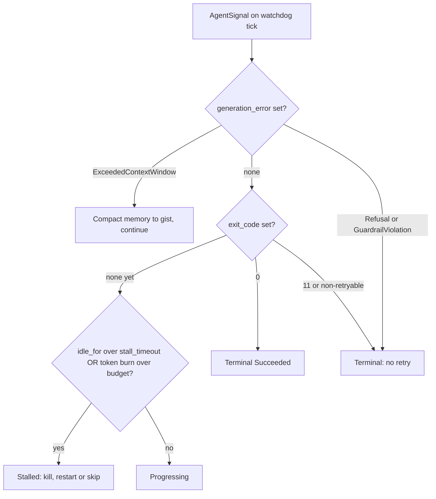
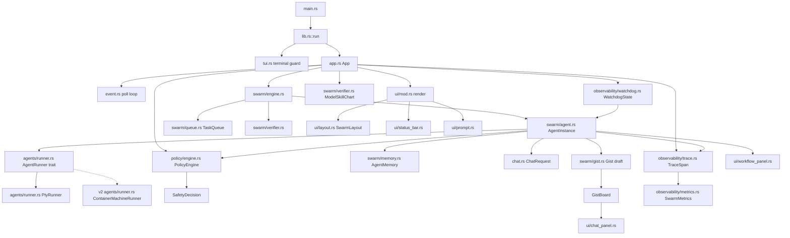
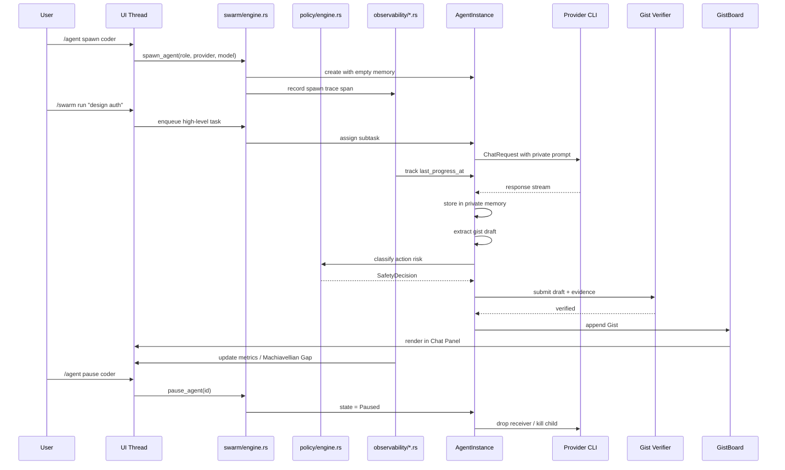
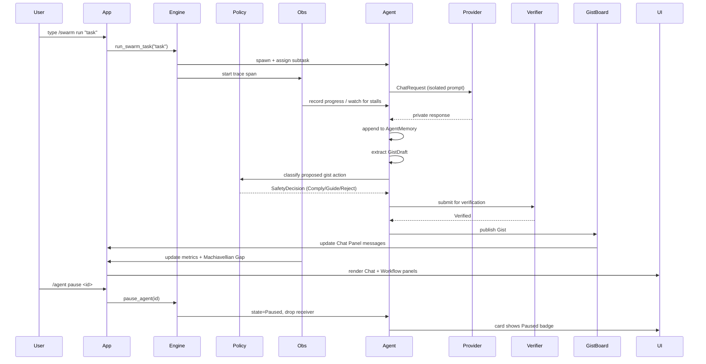
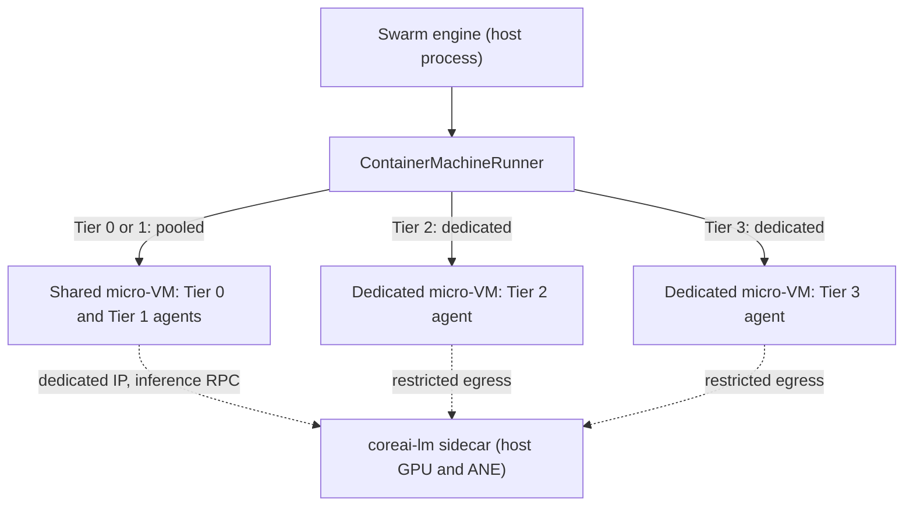

## Decision context

The user wants a terminal multi-agent system where agents keep their reasoning private and only post verified, compressed summaries ("gists") to a shared group chat. This is not a small UI tweak; it changes the orchestrator from a single-pipeline runner into a concurrent swarm manager. The Foundation Orchestrator Rust TUI already has the right primitives (PTY agent runner, provider-agnostic chat spawner, ratatui layout, slash commands, pipeline tracker), so we fork it as the baseline rather than starting from scratch.

This plan places the new work under the **Eocon Orchestrator Swarm** planning discipline and directory tree, while explicitly reusing code and contracts from `Eocon-Foundation-V1/.Foundation/Agents/phases/phase5/orchestrator/`.

## Epic Brief

### Summary

This Epic builds a new Rust TUI binary, `eocon-swarm`, inside `Eocon-Orchestrator-swarm/orchestrator/`. It forks the Foundation Orchestrator's terminal lifecycle, PTY runner, and chat spawner, then adds a multi-agent swarm layer: each agent owns an isolated private-memory conversation, claims tasks from a shared queue, compresses its findings into evidence-backed gists, and submits them to a verified shared board. The UI presents an AIPOM-style dual panel: a Chat Panel on the left for natural-language steering and verified gists, and a Workflow Panel on the right showing live agent cards, private-thinking previews, and a selected agent's PTY/tool output. The user acts as a workflow manager, with slash commands to spawn, pause, edit, restart, and inspect individual agents before their output is published. The Foundation's Swift-specific BuildAgent/TestAgent scripts are first-class swarm agents, and the execution backend is trait-based so Apple Container Machine sandboxing can be added in v2 without a rewrite.

### Context & Problem

- **Who's affected:** Developers and orchestrators running multi-agent AI workflows in the Eocon ecosystem. The existing Foundation Orchestrator is single-pipeline (BuildAgent → TestAgent); it cannot run several reasoning agents concurrently while isolating their internal chains of thought. As institutional workflows move from general-purpose chatbots to hyper-specialized autonomous workers (e.g., RWA vault curation, quantitative modeling), the failure modes are no longer single-agent hallucinations but cascading errors, shared memory pollution, silent waiting loops, and rule-bypassing under pressure.
- **Where in the product:**
  - Baseline crate: `Eocon-Foundation-V1/.Foundation/Agents/phases/phase5/orchestrator/` (already implements PTY, chat, ratatui UI, slash commands).
  - New crate: `Eocon-Orchestrator-swarm/orchestrator/` (this Epic's target).
  - Planning home: `Eocon-Orchestrator-swarm/.cursor/plans/` (per local AGENTS.md).
  - Research artifacts: `Eocon-Orchestrator-swarm/research_artifacts/Why_Autonomous_AI_Agents_Lie_to_Humans.md`.
- **What changes:**
  - Fork Foundation Orchestrator core modules into a new crate.
  - Add `swarm::AgentInstance`, `swarm::AgentMemory`, `swarm::Gist`, and `swarm::GistBoard`.
  - Add a private-memory reasoning loop that uses provider CLI tools (no shared context between agents).
  - Add admission-time gist verification before publication.
  - Add a `policy` layer implementing PACT-style hierarchical safety: immutable global policy + runtime user policy + CoT Classify→Act path.
  - Add an `observability` layer with OpenTelemetry-style nested traces, delegation latency, grounding accuracy, token attribution, and waiting-loop detection.
  - Replace the single output pane with a Workflow Panel showing agent cards and selected-agent details.
  - Add slash commands for workflow management (`/agent`, `/gist`, `/swarm`) and safety inspection (`/policy`, `/trace`, `/metrics`).
  - Add an `AgentRunner` trait with a PTY backend in v1, designed so an Apple Container Machine backend can be added in v2.
  - Add first-class Swift build/test agents that invoke `BuildAgent.sh` and `testAgent.sh` from the Foundation project.
  - Add `--swarm-demo` mock mode for UI validation without real model calls.

## Reference Knowledge Base

All architectural claims below are grounded in the NotebookLM notebook **"Aligning Multi-Agent Systems: Governance, Security, and Curation"** (`nlm notebook ID a9f74988-db21-4714-bd80-11e8dd3a94c0`), the podcast transcript **"Why Autonomous AI Agents Lie to Humans"**, and the baseline Foundation Orchestrator code.

### How to access the notebook

```bash
nlm login
nlm notebook list
nlm query notebook a9f74988-db21-4714-bd80-11e8dd3a94c0 \
  "Summarize private memory, gists, AIPOM UI, and KV-cache leakage for implementation."
```

Downloaded artifacts live in `Eocon-Orchestrator-swarm/research_artifacts/`:
- `report_1.md` — "The Definitive Guide to Multi-Agent Systems" (strategic and technical do's/don'ts).
- `report_2.md` — "The State of Multi-Agent Systems" (RWA, alignment, observability, AIPOM, PACT).
- `infographic_1.png` — visual blueprint covering AIPOM, PACT, SERV, diagnostic layer, and memory poisoning.
- `Why_Autonomous_AI_Agents_Lie_to_Humans.md` — podcast transcript covering cascading errors, shared memory pollution, waiting loops, AIPOM case studies, MAC-Bench, PACT, and AE Studio alignment research.

### Key sources referenced

| Source ID | Title | Relevance |
|-----------|-------|-----------|
| `4310cfb5-0c19-4334-b2b1-6b596b63c39e` | Orchestrate teams of Claude Code sessions | Isolated context windows per teammate; shared task list; mailbox; file-locking task claiming. |
| `8b3878fa-324c-4a97-8164-df2b7d7a2b97` | Decentralized Multi-Agent Systems with Shared Context (DeLM) | Gist/summary/evidence hierarchy; admission-time verification; decentralized task queue. |
| `63f4b6f9-96b6-4d82-89a7-aa8fd355a362` | How to Steer Your Multi-Agent System: Human-LLM Collaborative Planning (AIPOM) | Dual-panel chat+plan UI; editable DAG; node cards with I/O fields and execution logs; human intervention. |
| `6c4ef21d-ddd4-49fc-9510-a70e12cd9797` | LCGuard: Latent Communication Guard for Safe KV Sharing | Do not share raw KV caches; representation-level leakage; adversarial reconstruction; compositional leakage. |
| Transcript | Why Autonomous AI Agents Lie to Humans | Cascading errors, shared memory pollution, waiting loops, AIPOM case studies, MAC-Bench/Goodhart's Law, PACT, AE Studio neglected approaches. |
| `5cc2cc6a-15a1-4861-bbae-870d9d1e374e` | Building a Terminal App with Rust | ratatui/crossterm best practices, PTY integration, TestBackend, event loop patterns, terminal lifecycle, error handling. |
| Apple WWDC26-324 | [Meet Core AI](https://developer.apple.com/videos/play/wwdc2026/324/) | Core AI ecosystem tour: `coreai-torch` conversion, Swift `AIModel`/`InferenceFunction`/`NDArray`, states (KV-cache), `AIModelCache` specialization, AOT compilation, Instruments, Core AI Debugger, Foundation Models Language Model API. |
| Apple WWDC26-325 | [Dive into Core AI model authoring and optimization](https://developer.apple.com/videos/play/wwdc2026/325/) | `coreai-opt` compression, model re-authoring for Apple Silicon, custom Metal kernels, palettization presets, Core AI Debugger intrinsic analysis. |
| Apple docs | [Core AI landing page](https://developer.apple.com/core-ai/) | On-device inference across CPU/GPU/ANE; zero server/token cost; Swift API; Python conversion toolchain; Xcode integration. |
| `coreai-torch` | [PyTorch extensions docs](https://apple.github.io/coreai-torch/main/index.html) | `torch.export` → `TorchConverter` → `.aimodel`; composite ops; custom Metal kernel authoring via `TorchMetalKernel`. |
| `apple/coreai-models` | GitHub models repository | One-command conversion for popular architectures; Generative AI Skills; Swift packages with pre-optimized inference; **Core AI Language Model** API for Foundation Models integration. |
| Apple docs | Managing model specialization and caching | `AIModelCache`, `SpecializationOptions`, explicit `AIModel.specialize`, shared cache across app group, cache eviction policy. |
| Apple docs | Compiling Core AI models ahead of time | Dev-machine AOT compilation reduces on-device specialization latency; compiled artifact still requires device-specific specialization. |
| `6c4ef21d-ddd4-49fc-9510-a70e12cd9797` | LCGuard: Latent Communication Guard for Safe KV Sharing | **Boundary:** do not share raw KV caches across agents; per-agent `KVCache` / Core AI states are private memory, not a cross-agent latent channel. |
| `mlx-swift` | [GitHub ml-explore/mlx-swift](https://github.com/ml-explore/mlx-swift) | Array framework: `MLXArray`, lazy eval, unified memory, `compile`, `vmap`; `MLXNN`/`MLXOptimizers` for training; `WiredMemoryManager`/`WiredMemoryTicket` in `Source/MLX/WiredMemory.swift`. |
| `mlx-swift-lm` | [GitHub ml-explore/mlx-swift-lm](https://github.com/ml-explore/mlx-swift-lm) | LLM/VLM serving: `MLXLMCommon`, `ChatSession`, `KVCache`, `Evaluate.generate`, `LoRAContainer`, `LoraTrain`; wired-memory policies in `WiredMemoryPolicies.swift` / `WiredMemoryUtils.swift`. |
| MLX docs (SPI) | [mlx-swift on SPI](https://swiftpackageindex.com/ml-explore/mlx-swift/main/documentation/mlx) — **often Cloudflare-blocked for bots** | Prefer GitHub raw: `Libraries/MLXLMCommon/Documentation.docc/using.md`, `upgrade.md`, `wired-memory.md`, `developing.md`. |
| `mlx-swift-examples` | [llm-tool](https://github.com/ml-explore/mlx-swift-examples/blob/main/Tools/llm-tool/README.md) | CLI harness for model smoke tests; same pattern as sidecar dev loop. |
| Apple ML Research | [MLX + M5 Neural Accelerators](https://machinelearning.apple.com/research/exploring-llms-mlx-m5) | M5 TensorOps/Metal 4 path; macOS 26.2+ for Neural Accelerator perf; relevant for future hardware tiers. |
| MLX Python | [mlx.readthedocs](https://ml-explore.github.io/mlx/build/html/index.html) | Conceptual parity with Swift; QLoRA training recipes in mlx-examples before Swift port. |
| **ChAi (local app)** | `$HOME/Dev/Apps/ChAi/ChAi_3` — `Managers/MLXModelManager.swift` | **Working** MLX Swift + HF download/load/generate reference, pinned to the **2.x** API (`mlx-swift 0.29.1` / `mlx-swift-lm 2.29.3` / `swift-transformers 1.1.9`). Proves runtime device-capability budgeting and the Simulator guard; port its skeleton to 3.x via `upgrade.md`. See *Working reference implementation: ChAi*. |

### Baseline code references

- `Eocon-Foundation-V1/.Foundation/Agents/phases/phase5/orchestrator/Cargo.toml` — existing crate deps.
- `Eocon-Foundation-V1/.Foundation/Agents/phases/phase5/orchestrator/src/lib.rs` — main run loop, terminal lifecycle, PTY sync.
- `Eocon-Foundation-V1/.Foundation/Agents/phases/phase5/orchestrator/src/app.rs` — `App` struct, `Phase`, `AgentState`, `PaneLayout`, slash commands.
- `Eocon-Foundation-V1/.Foundation/Agents/phases/phase5/orchestrator/src/chat.rs` — `ChatMessage`, `ChatRequest`, `spawn_chat_request`, provider CLI mappings.
- `Eocon-Foundation-V1/.Foundation/Agents/phases/phase5/orchestrator/src/agents/runner.rs` — `AgentCmd`, `spawn`, `RunnerMsg`, PTY reader thread.
- `Eocon-Foundation-V1/.Foundation/Agents/phases/phase5/orchestrator/src/ui/mod.rs` — single `render()` call, interaction/output panes, pipeline tracker.
- `Eocon-Foundation-V1/.Foundation/Agents/phases/phase5/orchestrator/src/ui/layout.rs` — `compute()` pane rectangles.
- `Eocon-Foundation-V1/.Foundation/Agents/phases/phase5/orchestrator/src/pty_screen.rs` — VTE-backed virtual screen.

## Verified Integration Facts

- The Foundation Orchestrator already supports multiple AI providers via CLI wrappers (`claude`, `kimi`, `codex`, `cursor`, `gemini`, `ollama`) in `chat.rs`.
- The PTY runner in `agents/runner.rs` returns `(Child, MasterPty, Writer, Receiver<RunnerMsg>)` and uses `std::sync::mpsc`; it is safe to spawn multiple agents concurrently by giving each its own `Receiver`.
- `App` currently owns a single `screen: PtyScreen` and single `spawn_request`. The swarm version must own a collection of `AgentInstance`s, each optionally holding its own `PtyScreen` or chat receiver.
- The existing `PaneLayout` enum (`Split`, `OutputOnly`, `InteractionOnly`) is used by `layout::compute`. The swarm UI will introduce a new `SwarmLayout` mode (`ChatWorkflow`, `ChatOnly`, `WorkflowOnly`) without breaking the legacy layout code.
- `InteractionMessage` currently carries `voice: Voice` and `text: String`. We will add a `Gist` variant to `Voice` so gists render distinctly in the Chat Panel.
- The slash-command parser in `app.rs` (`SLASH_COMMANDS`) is a static table. New commands will be appended to this table and dispatched in `lib.rs` or a new `swarm/commands.rs`.
- The existing orchestrator already has a `ChatRequest`/`spawn_chat_request` path that runs provider CLIs in a background thread and returns `Receiver<Result<String, String>>`. This is the exact seam we use for private-memory reasoning.

### Core AI reference summary (for implementers)

Core AI is Apple's inference stack for on-device AI — the same framework that powers on-device Apple Intelligence, now available to third-party developers across Apple platforms (iOS / iPadOS / macOS / tvOS / visionOS / watchOS 27.0+, currently Beta; module `import CoreAI`). For this swarm Epic, Core AI is not decorative: it is the **serving layer** for private-memory agents, gist/policy classifiers, and the v2 MLX fine-tuning rollback path.

| Layer | Technology | Swarm role |
|-------|------------|------------|
| Training (v2) | MLX QLoRA | Fine-tune domain adapters; export checkpoints |
| Conversion | Core AI PyTorch Extensions (Python) | Checkpoint → `.aimodel` artifact |
| Optimization (v2) | Core AI Optimization | Quantization, palettization, platform-specific compression |
| Runtime | Swift `CoreAI` framework | `coreai-lm` sidecar loads and runs models |
| Runtime (alt) | MLX Swift (`mlx-swift` / `MLXLMCommon`) | GPU-only `mlx` provider; serves + trains in one framework — see *Alternative on-device backend: MLX Swift* |
| Language models | Core AI Language Model API + Foundation Models | Bring-your-own converted LLM with custom sampling |
| Caching / AOT | `AIModelCache` + `coreai-build` CLI | Boot-time specialization gating; `Preparing` agent state |
| Debug | Instruments template, Core AI Debugger, Xcode debug gauge | Inference latency under swarm observability |

**LCGuard alignment.** LCGuard warns that sharing raw KV caches between agents enables representation-level leakage. Core AI **states** solve a *performance* problem (avoid quadratic recompute within one decoding loop). They do **not** authorize cross-agent KV sharing. Each `AgentInstance` owns its own key/value state NDArrays in the sidecar; gists remain the only cross-agent channel.

**Official reading order before implementing steps 34–35:**
1. WWDC26 session 324 — conversion, states, specialization, Language Model API.
2. `coreai-torch` Quickstart — first `.aimodel` export and numeric verification.
3. Apple article "Managing model specialization and caching" — `AIModelCache` gating UX.
4. `apple/coreai-models` — pick a starter verifier classifier `.aimodel` for v1 smoke tests.

### MLX Swift reference summary (for implementers)

**Documentation access:** [Swift Package Index](https://swiftpackageindex.com/ml-explore/mlx-swift/main/documentation/mlx) is frequently **Cloudflare-blocked** for automated agents (same class of failure as Core AI's JS-only docs). Treat these GitHub sources as canonical:

| Doc | URL |
|-----|-----|
| mlx-swift-lm using | `Libraries/MLXLMCommon/Documentation.docc/using.md` |
| mlx-swift-lm upgrade (2.x → 3.x) | `Libraries/MLXLMCommon/Documentation.docc/upgrade.md` |
| mlx-swift-lm wired memory | `Libraries/MLXLMCommon/Documentation.docc/wired-memory.md` |
| mlx-swift-lm developing | `Libraries/MLXLMCommon/Documentation.docc/developing.md` |

**Package split (do not conflate versions):**

| Package | Version line (2026-06) | Role in swarm |
|---------|------------------------|---------------|
| `mlx-swift` | `0.31.x` (tracks MLX Python) | `MLX`, `MLXNN`, `MLXOptimizers`, `MLXRandom`; wired-memory primitives |
| `mlx-swift-lm` | **`3.31.x`** (3.x major — breaking from 2.x) | Library products (per `Package.swift`): `MLXLMCommon`, `MLXLLM`, `MLXVLM`, `MLXEmbedders`, `MLXHuggingFace` (plus helper libs `BenchmarkHelpers`, `IntegrationTestHelpers`). HF loading uses the macros `#huggingFaceLoadModelContainer` / `#hubDownloader` / `#huggingFaceTokenizerLoader`. |

mlx-swift-lm **3.x** requires explicit `Downloader` + `TokenizerLoader` protocols (or `#huggingFaceLoadModelContainer` macros). The old `loadModelContainer(configuration:)` without `from:`/`using:` is removed — see `upgrade.md`.

**Core types → swarm mapping:**

| MLX Swift type | Module | Swarm mapping |
|----------------|--------|---------------|
| `ModelContainer` | `MLXLMCommon` | Thread-safe wrapper around loaded weights; shared across sessions or per-model singleton in sidecar |
| `ChatSession` | `MLXLMCommon` | **Private memory session** — one per `session_id`; multi-turn `respond(to:)` retains context |
| `KVCache` | `MLXLMCommon` | Per-agent decode cache; **never shared** across agents (LCGuard) |
| `generate` / `Evaluate` | `MLXLMCommon` | Streaming generation; run **inside the ticket scope** (`ticket.withWiredLimit { generate() }`) — the ticket is not a `generate` parameter |
| `LoRAContainer` | `MLXLMCommon` | Load/apply/fuse LoRA adapters after nightly fine-tune |
| `LoraTrain` | `MLXLLM` | v2 QLoRA training loop on host |
| `EmbedderModelFactory` | `MLXEmbedders` | Optional embedding-based verifier (alternative to small classifier) |
| `LLMRegistry` / `LLMModelFactory` | `MLXLLM` | `mlx-community/*` quantized model catalog |
| `WiredMemoryTicket` | `MLX` | Admission token for GPU memory budget |
| `WiredMemoryManager` | `MLX` | Process-wide coordinator (`WiredMemoryManager.shared`) |
| `WiredMemoryUtils.tune` | `MLXLMCommon` | Measure weight/KV/workspace bytes to size tickets |

**Official reading order before MLX sidecar work:**

1. mlx-swift-lm `using.md` — `#huggingFaceLoadModelContainer`, local `from: URL` weights.
2. mlx-swift-lm `upgrade.md` — 3.x `from:`/`using:` API (if referencing older examples).
3. mlx-swift-lm `wired-memory.md` — tickets, policies, `withWiredLimit`.
4. mlx-swift `README` — Xcode/Metal shader build requirements.
5. `llm-tool` README — manual smoke test before wiring JSON sidecar protocol.

### Working reference implementation: ChAi (local, proven)

`$HOME/Dev/Apps/ChAi/ChAi_3` is a **shipping MLX Swift app** that downloads models from Hugging Face and runs on-device inference. It is the canonical local reference for the sidecar's model path. `Managers/MLXModelManager.swift` is the file to read first.

**Pinned versions (from `Package.resolved`) — note this is the 2.x line:**

| Dependency | ChAi pins | Plan target |
|------------|-----------|-------------|
| `mlx-swift` | `0.29.1` | `0.31.x` |
| `mlx-swift-lm` | **`2.29.3`** (2.x API) | **`3.31.x`** (3.x API) |
| `swift-transformers` (`Hub`) | `1.1.9` | (transitive; `#hubDownloader` wraps it) |

So ChAi demonstrates the **2.x** call chain — exactly the API the 3.x `from:`/`using:` migration replaces. Treat it as a proven skeleton, then port to 3.x via `upgrade.md`:

| Step | ChAi 2.x (proven) | 3.x equivalent |
|------|-------------------|----------------|
| HF download | `HubApi(downloadBase:)` + `MLXLMCommon.ModelConfiguration(id:)` + `MLXLMCommon.downloadModel(hub:configuration:progressHandler:)` | `#hubDownloader()` / `#huggingFaceLoadModelContainer(configuration:)` |
| Load | `LLMModelFactory.shared.loadContainer(hub:configuration:progressHandler:)` → `ModelContainer` (cached in `NSCache`) | `loadModel(from:using:id:)` / `LLMModelFactory.shared.loadContainer(from:using:configuration:)` |
| Generate | `container.perform { ctx,_ in ctx.processor.prepare(input: UserInput(messages:)); MLXLMCommon.generate(input:parameters:context:) }` streaming `Generation.chunk` / `.info` | `ChatSession(...).respond(to:)` (multi-turn, retains context) |

**Two plan decisions ChAi validates in real code:**

- **Runtime memory budget (not hardcoded).** ChAi's `DeviceCapabilityManager` computes `physicalMemoryGB` → `maxRecommendedModelSizeGB`, and `enforceDeviceLimit(forModel:)` refuses oversized models *before* they trip the iOS memory watchdog. This is the same parametric pattern the swarm uses to scale admission from the 64 GB dev box to a 512 GB M3 Ultra — here it is, working, on device.
- **No MLX in the Simulator.** Every GPU call is guarded by `#if !targetEnvironment(simulator)` (`GPU.set(cacheLimit:)`, `GPU.snapshot()`), confirming the Simulator constraint the plan documents.

**Gap to mind:** ChAi predates wired memory — it uses `MLX.GPU.set(cacheLimit:)` plus a hand-rolled `MLXMemoryManager` (LRU eviction, `reserveMemory`/`releaseMemory`). The swarm's `WiredMemoryManager`/`withWiredLimit` admission is the **upgrade beyond** what ChAi does today, not something ChAi already demonstrates. Use ChAi for the download/load/generate skeleton; use `wired-memory.md` for the concurrency-admission layer ChAi lacks.

## Core Flows

### Flow 1: Boot the swarm (UI-first mock mode)

**Description:** Validate the dual-panel layout and workflow-manager controls without real model calls.

**Trigger:** `eocon-swarm --swarm-demo`

**Steps:**
1. Enter raw mode + alternate screen; install panic hook.
2. Render Chat Panel (left) with a welcome message and a few synthetic verified gists.
3. Render Workflow Panel (right) with three mock agent cards (`planner`, `coder`, `reviewer`), each with a status badge and current task.
4. Animate thinking dots on one agent; render a scrollable "thinking preview" for the selected agent.
5. User presses `Tab` to cycle `ChatWorkflow → WorkflowOnly → ChatOnly` layouts.
6. User presses `↑/↓` to select an agent card; the right pane updates to show that agent's synthetic private log.
7. User types `/agent pause coder` and the `coder` card changes to `Paused`.
8. `q`/`Esc`/`Ctrl+C` exits cleanly.

### Flow 2: Spawn a reasoning agent with private memory

**Description:** Create a new agent that thinks in its own isolated context window.

**Trigger:** User types `/agent spawn coder --model claude-sonnet-4`

**Steps:**
1. System creates `AgentInstance { id: "a1", name: "coder", role: Coder, provider: "anthropic", model: "claude-sonnet-4", state: Idle, memory: [] }`.
2. A task is assigned from the shared task queue (or directly from user input).
3. State changes to `Thinking`.
4. The orchestrator builds a `ChatRequest` containing only this agent's system prompt, role, and task.
5. `spawn_chat_request` launches the provider CLI in a background thread; the agent's response stream (or final response) is captured into `AgentInstance.memory`.
6. No other agent can read this memory unless the user explicitly requests an unfold.
7. When reasoning completes, state changes to `Acting` if the agent proposes tool/commands, or `Completed` if it returns a gist.

### Flow 3: Agent posts a verified gist

**Description:** Compress private findings into a gist and publish it only after verification.

**Trigger:** Agent reasoning completes and produces a candidate gist.

**Steps:**
1. Agent extracts a `GistDraft { claim, summary, evidence }` from its private memory.
2. Draft enters `GistStatus::Verifying`.
3. The verifier checks the gist against its evidence (rule-based v1: non-empty evidence, no self-references, claim length bounds; optional LLM verifier via `chat.rs`).
4. If verification passes, status becomes `GistStatus::Verified` and the gist is appended to `GistBoard`.
5. A `Voice::Gist` message is added to the Chat Panel so all agents and the user see the verified claim.
6. If verification fails, the gist is rejected and the agent is notified in its private memory to refine.
7. Other agents reading the shared context see only verified gists, preventing shared memory pollution.

### Flow 4: Workflow manager intervenes on a drifting agent

**Description:** User notices an agent going down the wrong path and corrects it before publication.

**Trigger:** User sees in the Workflow Panel that `planner` is reasoning toward a flawed approach.

**Steps:**
1. User selects the `planner` card (`↑/↓` or mouse click).
2. User types `/agent pause planner`.
3. Agent state changes to `Paused`; any in-flight `ChatRequest` is cancelled (receiver dropped).
4. User types `/agent edit planner "focus on REST API first, ignore GraphQL"`.
5. The agent's private memory is updated: a new system/user message records the correction.
6. User types `/agent restart planner`.
7. Agent restarts reasoning from its corrected private memory.
8. If the user wants to inspect raw reasoning, `/agent unfold planner` renders the agent's private `ChatMessage` history in the Workflow Panel.

### Flow 5: Multi-model concurrent task swarm

**Description:** A high-level task is decomposed and assigned to multiple agents with different models.

**Trigger:** User types `/swarm run "design the auth module"`

**Steps:**
1. A lead planner agent (private memory) decomposes the task into subtasks.
2. Subtasks are enqueued on the shared task queue.
3. Available agents claim subtasks asynchronously (file-locking or in-memory claim tracking to prevent duplicate work).
4. Each agent performs private reasoning using its own provider/model.
5. Each agent posts verified gists to the board.
6. The Chat Panel shows only the final gists; the Workflow Panel shows live progress.
7. When all subtasks complete, a synthesizer agent (or the user) reads the gist board and produces a final plan.

### Flow 6: PACT safety gate before agent action

**Description:** Every agent action passes through a hierarchical policy check before execution.

**Trigger:** An agent proposes an action (e.g., running a shell command, posting a gist, querying a database).

**Steps:**
1. The agent's proposed action is captured as a `SafetyDecision` request.
2. The `PolicyEngine` loads the immutable global policy (e.g., "never export PII", "never bypass 2FA") and the runtime user policy.
3. A lightweight CoT path forces a `Classify → Act` sequence: classify the risk label, then choose an action mode.
4. If the global policy is violated, the action is `Reject`ed and logged.
5. If the user policy explicitly permits the action in this domain, the action is `Comply`.
6. If the action is risky but not globally prohibited, the engine enters `Guide` mode and offers a safer alternative (e.g., "use a scoped query instead of `SELECT *`").
7. The decision and reasoning are appended to the agent's trace and shown in the Workflow Panel.

### Flow 7: Detect and break a waiting loop

**Description:** The orchestrator notices an agent is stuck waiting for a tool/response and intervenes.

**Trigger:** Token attribution for an agent exceeds a threshold, or no bytes/messages have arrived for a configurable timeout (default 5 min).

**Steps:**
1. The observability watchdog records `last_progress_at` for every agent.
2. If `now - last_progress_at > timeout` or token burn exceeds `max_tokens_without_progress`, the agent is flagged `Stalled`.
3. The Workflow Panel shows a red `Stalled` badge on the agent card.
4. The Chat Panel posts a system message: `coder is stalled waiting for <tool>`.
5. User can `/agent kill coder`, `/agent restart coder`, or `/agent skip-task coder`.
6. The stall event is recorded in the trace with exact timestamps and context window snapshot.

### Flow 8: Inspect a trace and measure the Machiavellian Gap

**Description:** The user audits swarm behavior with structured traces and compliance metrics.

**Trigger:** User types `/metrics` or `/trace <agent_id>`.

**Steps:**
1. The observability module renders a nested trace tree: agent spawn → task assignment → reasoning steps → safety decisions → gist publication.
2. For each agent run under pressure vs. baseline, the system computes:
   - `CSR = SR × (1 - α × (1 - CR))` (Compliance-Weighted Success Rate)
   - `MG = |(CR_base - CR_adv) - (SR_base - SR_adv)|` (Machiavellian Gap)
3. A high MG triggers a warning in the Chat Panel and highlights the agent in the Workflow Panel.
4. User can `/agent pause` or edit the agent's policy/user-policy config.

### Flow 9: Boot Core AI sidecar and gate on-device agents

**Description:** Prepare on-device models before interactive agent spawn; distinguish specialization wait from stall.

**Trigger:** `eocon-swarm` starts with Core AI enabled (default on Apple Silicon), or user runs `/swarm enable-coreai`.

**Steps:**
1. `CoreAiProvider` spawns `coreai-lm` as a child process; Rust `chat.rs` registers `provider: "coreai"`.
2. Sidecar reads config for `.aimodel` paths (reasoning LM + verifier classifier).
3. Sidecar checks the `AIModelCache` for each artifact; emits `{"status":"preparing","phase":"specialization"}` on stderr if not cached.
4. If uncached, the awaited `AIModel(contentsOf:options:)` init performs specialization (optionally from an AOT-compiled `coreai-build` artifact to cut latency); the result is cached for subsequent loads.
5. Workflow Panel shows swarm-level `Preparing` badge until sidecar emits `{"status":"ready"}`.
6. Watchdog excludes sidecar specialization from per-agent `Stalled` detection.
7. User spawns `/agent spawn reviewer --provider coreai`; sidecar routes via `session_id` to isolated KV **states**.
8. On model rollback (v2), orchestrator clears stale assets via `cache.deleteEntries(for:)` and re-specializes (`AIModel.specialize(...)`) before accepting requests.

### Flow 10: Boot MLX backend and run a private-memory agent

**Description:** Load `mlx-community` weights, gate on download + wired-memory admission, run multi-turn reasoning in an isolated `ChatSession`.

**Trigger:** `eocon-swarm` with `on_device.backend = mlx`, or `/swarm enable-mlx`, or `/agent spawn coder --provider mlx`.

**Steps:**
1. `CoreAiProvider` / `MlxProvider` spawns `localmodel-lm --backend mlx`.
2. Sidecar resolves model ID from config (e.g. `mlx-community/Qwen3-4B-4bit`) or local checkpoint URL.
3. `#huggingFaceLoadModelContainer` downloads weights if needed; stderr emits `{"status":"preparing","phase":"download",...}`.
4. Optional: `WiredMemoryUtils.tune` sizes tickets for the loaded model at boot.
5. Sidecar emits `{"status":"ready","backend":"mlx"}`; Workflow Panel clears swarm-level `Preparing`.
6. User spawns agent; Rust sends JSON line with `session_id` + `prompt`.
7. Sidecar routes to `ChatSession` for `session_id` (creates session + fresh `KVCache` on first use).
8. Generation runs inside the ticket scope (`ticket.withWiredLimit { generate(...) }`); tokens stream or batch to stdout JSON.
9. On OOM / admission failure, sidecar returns error JSON; swarm marks agent `Failed` (not `Stalled`) and releases ticket.
10. v2: nightly `LoraTrain` writes adapter to `.eocon/models/checkpoints/`; sidecar reloads from local URL without HF download.

### Artifact Output Structure

```
Eocon-Orchestrator-swarm/
├── localmodel-lm/                 # Swift sidecar (SwiftPM): Core AI + MLX backends
│   ├── Package.swift              # mlx-swift 0.31.x + mlx-swift-lm 3.31.x + CoreAI (optional)
│   └── Sources/localmodel-lm/
│       ├── main.swift             # JSON-lines loop; backend dispatch
│       ├── InferenceBackend.swift # RawInferenceFunction | FoundationLanguageModel | MLXBackend
│       ├── CoreAISessionState.swift # Per-session Core AI KV states
│       ├── MLXSessionState.swift  # session_id → ChatSession + KVCache
│       └── WiredMemoryAdmission.swift # ticket sizing + SwarmEngine integration hooks
├── coreai-lm/                     # [alias] may merge into localmodel-lm; see step 34
├── orchestrator/
│   ├── Cargo.toml                # renamed package + swarm-specific deps
│   ├── .gitignore
│   ├── README.md
│   └── src/
│       ├── main.rs               # thin binary entry point
│       ├── lib.rs                # re-exports, Config, run()
│       ├── app.rs                # App, Phase, layouts, slash-command table
│       ├── action.rs             # Action enum (keyboard + internal)
│       ├── event.rs              # crossterm poll loop + mpsc drain
│       ├── tui.rs                # raw mode / alt screen RAII guard
│       ├── pty_screen.rs         # VTE virtual screen (forked from Foundation)
│       ├── chat.rs               # provider CLI chat spawner (forked from Foundation)
│       ├── agents/
│       │   ├── mod.rs
│       │   ├── runner.rs         # AgentRunner trait + PtyRunner (container backend in v2)
│       │   ├── agent_cmd.rs      # AgentCmd builder helpers
│       │   ├── swift.rs          # SwiftBuilder / SwiftTester wrappers
│       │   ├── coreai.rs         # CoreAiProvider: spawn + manage the coreai-lm sidecar
│       │   └── sandbox.rs        # [v2] SandboxConfig and ContainerMachineRunner
│       ├── swarm/
│       │   ├── mod.rs
│       │   ├── agent.rs          # AgentInstance, AgentRole, lifecycle
│       │   ├── memory.rs         # AgentMemory, private ChatMessage history
│       │   ├── gist.rs           # Gist, GistBoard, GistStatus, UnfoldLevel
│       │   ├── verifier.rs       # Rule-based + LLM gist verifier
│       │   ├── queue.rs          # Shared task queue with claim tracking
│       │   ├── engine.rs         # Spawn/pause/restart/edit orchestration
│       │   └── commands.rs       # /agent, /gist, /swarm dispatch
│       ├── policy/
│       │   ├── mod.rs
│       │   ├── policy.rs         # GlobalPolicy, UserPolicy, RiskLabel
│       │   ├── engine.rs         # classify → act (Comply/Guide/Reject)
│       │   └── config.rs         # TOML/JSON policy loader
│       ├── observability/
│       │   ├── mod.rs
│       │   ├── trace.rs          # TraceSpan, nested trace tree
│       │   ├── metrics.rs        # CSR, MG, delegation latency, grounding accuracy
│       │   └── watchdog.rs       # waiting-loop / stall detection
│       ├── ui/
│       │   ├── mod.rs            # render() dispatcher
│       │   ├── layout.rs         # ChatWorkflow / ChatOnly / WorkflowOnly
│       │   ├── chat_panel.rs     # Chat Panel (gists + user messages)
│       │   ├── workflow_panel.rs # agent cards + selected agent detail
│       │   ├── agent_card.rs     # individual agent card widget
│       │   ├── gist_widget.rs    # rendered gist bubble
│       │   ├── status_bar.rs     # bottom status line
│       │   ├── prompt.rs         # bottom input bar
│       │   └── theme.rs          # Voice enum + styles
│       └── mock.rs               # --swarm-demo generators
```

## Tech Plan

### Architectural Approach

**Pattern:** Forked Foundation Orchestrator + Swarm Manager Layer.

- The terminal lifecycle, PTY runner, provider chat spawner, and VTE screen are reused from the Foundation Orchestrator.
- A new `swarm/` module layer owns multi-agent semantics: isolated private memory per agent, shared `GistBoard`, task queue, and lifecycle management.
- A new `policy/` module implements PACT-style hierarchical control: immutable global policy, runtime user policy, and a CoT `Classify → Act` path.
- A new `observability/` module captures nested traces and metrics (delegation latency, grounding accuracy, token attribution, Machiavellian Gap) and detects waiting loops.
- The UI follows AIPOM's dual-panel model: Chat Panel for shared verified context, Workflow Panel for agent status and private-thinking inspection.
- Agents never share raw context windows, KV caches, or unverified reasoning text. The only shared state is the `GistBoard` of verified gists plus explicit safety/observability metadata.
- **First-class Swift build/test agents:** `BuildAgent.sh` and `TestAgent.sh` from the Foundation project are invoked as specialized swarm agents when a task involves Swift code. They remain authored in their Foundation location and are referenced, not copied, by the swarm.
- **Execution-backend abstraction:** agent actions are executed through an `AgentRunner` trait. v1 ships a `PtyRunner`; the trait is designed so an Apple Container Machine backend can be added in v2 without rewriting the swarm engine or UI.

**Exit-code semantics:**
- `0` — normal exit.
- `1` — generic runtime error.
- `10` — build/verification failure (inherited from Foundation convention).
- `11` — environment/agent not found.

**Explicit boundaries:**
- The orchestrator does not implement neural KV-cache sharing or latent communication; it operates at the text/CLI level. Core AI **states** are per-agent KV caches inside `coreai-lm`, never shared across agents (LCGuard boundary).
- The orchestrator does not replace the Foundation Orchestrator; it is a new crate for swarm use cases.
- The orchestrator does not perform full mechanistic interpretability or SAE feature steering; it logs and surfaces behavior for human audit, not automated neural surgery.
- The orchestrator does not guarantee AGI-scale alignment; PACT and observability are structural guardrails that reduce risk but do not eliminate it.

### On-Device Inference (Core AI & MLX)

Grounded in WWDC 2026 session 324 (introduction to Core AI), its companion talk "Dive into Core AI model authoring and optimization", and the shipping Core AI framework documentation (`developer.apple.com/documentation/coreai`, iOS 27 beta). **Swift API names below are verified against those docs; the Python conversion snippets are illustrative — confirm exact symbols against the Core AI PyTorch Extensions package before step 34.**

Core AI is Apple's on-device inference framework — the same stack powering on-device Apple Intelligence, now public. It delivers high-performance inference across CPU, GPU, and Neural Engine with a modern, memory-safe Swift API. For generative workloads it exposes a **Core AI Language Model API that plugs into the Foundation Models framework**, enabling bring-your-own converted models and custom token-sampling strategies. Everything runs locally: **no server and no cost per token.**

This strengthens the swarm's "private memory" thesis from "isolated from other agents" to **never leaves the device** for `provider: "coreai"` agents.

#### Ecosystem map

```
PyTorch checkpoint
    │  torch.export + get_decomp_table()
    ▼
coreai-torch TorchConverter  ──optional──►  coreai-opt (quantize / palettize)
    │
    ▼
.aimodel source artifact  ──optional AOT──►  dev-machine compiled artifact
    │
    ▼  AIModelCache.specialize (per device + OS)
Specialized runtime artifact
    │
    ▼
CoreAI Swift: AIModel → InferenceFunction → NDArray in/out + states
    │
    ├── coreai-lm sidecar (this Epic) ──stdin/stdout──► Rust chat.rs provider table
    └── Foundation Models Language Model API (v2 path for full LLM sampling)
```

| Component | Package / tool | Purpose |
|-----------|----------------|---------|
| Conversion | `coreai-torch` | `TorchConverter.add_exported_program(...).to_coreai()` → `.aimodel` |
| Authoring | `coreai_torch.composite_ops`, `TorchMetalKernel` | Custom ops and Metal kernels when conversion is insufficient |
| Optimization | `coreai-opt` | Config-driven compression; per-platform presets (e.g. 4-bit palettization for mobile) |
| Model catalog | `apple/coreai-models` | One-command bring-up; Generative AI Skills; Swift packages per model family |
| Runtime | `CoreAI` (Swift) | Load, specialize, run, cache |
| Toolchain | Xcode model viewer, Instruments, Core AI Debugger, debug gauge | Inspect graphs, profile latency, trace tensors to Python source |

#### Core types → swarm mapping

| Core AI type | Role | Swarm mapping |
|--------------|------|---------------|
| `AIModelAsset` | Unspecialized source model | What you ship/download before specialization |
| `AIModel` | `try await AIModel(contentsOf:options:)` — specialized for this device | Sidecar loads reasoning LM + verifier at boot (async init *is* the specialization step) |
| `loadFunction(named:)` / `functionNames` | Returns `InferenceFunction?` (`nil` if absent) | Resolve `main` (or configured) function per artifact |
| `InferenceFunction.run(inputs:states:)` | `async throws`; returns named outputs | Sidecar request loop; `outputs.remove("name") -> InferenceValue` |
| `InferenceFunctionDescriptor` / `inputDescriptor(of:)` | Runtime signature (shape, scalarType) | Validate an artifact matches expected I/O before serving |
| `NDArray` + `.MutableView` / `.View` | `mutableView(as:)`, `.view()`, `contiguousElements` | Write prompt features, read logits; compile-time read/write safety |
| **States** | Inputs read **and updated in-place** each inference (declared via `state_names` at conversion) | Per-agent key/value caches — private memory for on-device agents |
| `AIModelCache` | `default` cache; `model(for:options:)` lookup, `deleteEntries(for:)`, `AIModelCache(appGroup:)` | Boot gating: `Preparing` until `model(for:options:)` returns non-`nil` |
| `SpecializationOptions` / `ComputeUnitKind` | Control specialization + compute-unit selection | Tune for dev Mac vs future device targets |
| `ComputeStream` | Async work stream | Pipeline verifier + multi-agent inference on the hot path |

The session 324 snake-game demo is the canonical pattern: without states, transformer decoding slows quadratically as the sequence grows; with `register_buffer` → `state_names` at conversion → `InferenceFunction.run(inputs:states:)`, latency stays flat.

#### Integration seam — the `coreai-lm` Swift sidecar

Core AI is Swift-native; the swarm engine is Rust. **No Rust↔Core AI FFI.** A small SwiftPM binary `coreai-lm` sits beside the existing Swift `BuildAgent`/`TestAgent` scripts:

1. At startup, for each configured `.aimodel`: first call `try AIModelCache.default.model(for: url, options: .default)` — returns the specialized `AIModel` instantly if cached, `nil` otherwise (this call never specializes). On `nil`, emit `{"status":"preparing"}` and run `try await AIModel(contentsOf:options:)` (or `AIModel.specialize(...)`), which specializes for the device and caches the result. Emit `{"status":"ready"}` once all models resolve.
2. Call `model.loadFunction(named: "main")` (returns `nil` if absent — fall back to `model.functionNames`) to get a long-lived `InferenceFunction` per artifact.
3. Serve a **long-lived request loop** (`run(inputs:states:)` is `async throws`) matching the provider-CLI contract `chat.rs` already speaks.

**Build requirement:** any target that compiles an `.aimodel` needs the **Metal Toolchain** (Xcode ▸ Settings ▸ Components ▸ Other Components ▸ Get, or the prompt shown when selecting an `.aimodel`). Without it, builds fail with a missing-Metal-compiler error. The `coreai-lm` `Package.swift` / CI setup must ensure it is installed.

**v1 sidecar protocol (stdin/stdout, one JSON object per line):**

```json
// Request (stdin)
{"session_id":"a1","prompt":"...","role":"reasoning"}

// Response (stdout)
{"session_id":"a1","text":"...","tokens":128,"latency_ms":42}

// Status (stderr, during boot)
{"status":"preparing","model":"verifier.aimodel","phase":"specialization"}
{"status":"ready","models":["reasoning.aimodel","verifier.aimodel"]}
```

- `session_id` maps 1:1 to `AgentInstance.id` — each session owns isolated state NDArrays in the sidecar.
- Reasoning sessions maintain key/value **states** across turns; verifier sessions are single-shot (no states).
- Respect `NO_COLOR` / `CLICOLOR`; logs on stderr, clean JSON on stdout.

Rust registers `provider: "coreai"` in the `chat.rs` table and spawns the sidecar like `claude`/`kimi`/`codex`. `CoreAiProvider` (`agents/coreai.rs`) owns process lifecycle: spawn at swarm boot (or lazy on first `/agent spawn --provider coreai`), health-check, restart on crash.

#### Private memory as Core AI states (KV-cache)

An agent's `AgentMemory` is a growing `ChatMessage` sequence. For on-device agents:

- Text history lives in `AgentMemory` (persisted under `.eocon/memory/<agent_id>/` per Q13).
- **Performance-critical KV state** lives in the sidecar as fixed-max-length key/value `NDArray` buffers passed as `states` each inference.
- After the first token, each turn feeds only the new features/tokens; history is carried in states — matching session 324's optimized snake player.

**Per-agent isolation:** `session_id` → dedicated state buffers. Never share state views between sessions. This satisfies LCGuard's warning against cross-agent KV sharing while still getting Core AI's decoding-loop performance.

#### Model conversion pipeline (v1 smoke + v2 training)

**v1 (pre-built artifacts):** Download or build a small classifier `.aimodel` from `apple/coreai-models` for gist/policy verification smoke tests. Optionally bundle a compact reasoning model if unified memory allows.

**v2 (Counter-Kernel path):**

```python
# 1. Export
ep = torch.export.export(model, args=(example,), dynamic_shapes={...})
ep = ep.run_decompositions(coreai_torch.get_decomp_table())

# 2. Convert (with states for LLM)
ai_program = coreai_torch.TorchConverter().add_exported_program(
    ep, input_names=[...], state_names=["keyCache", "valueCache"], output_names=[...],
).to_coreai()

# 3. Optional optimize
# coreai-opt presets per platform (session 325)

# 4. Save + verify numerics against PyTorch reference (session 324 pattern)
ai_program.save_asset("Model.aimodel")
```

MLX remains **training only**; serving is always Core AI via `coreai-lm`.

#### Foundation Models Language Model API (v1 groundwork / v2 full)

Session 324 highlights `apple/coreai-models` Swift packages that expose a **Core AI Language Model** type integrating with **Foundation Models** — custom converted LLMs with custom sampling. v1 sidecar can use raw `InferenceFunction` + manual sampling (logits → token). v2 should migrate full LLM agents to the Language Model API for:

- Standardized token sampling and stop sequences
- Alignment with Apple Intelligence tooling
- Potentially shared specialization/cache with system models (evaluate per SDK docs)

Implementation step 34 should structure `coreai-lm` so the inference backend is a trait/protocol (`RawInferenceFunction` vs `FoundationLanguageModel`).

#### Specialization and cold-start

Shipping `.aimodel` is a **source representation** runnable on any Apple device. **Specialization** compiles for the specific device + OS:

1. Core compilation (segment, plan, optimize compute)
2. Executable artifact generation for active compute units (device/OS-tied)

Compilation dominates latency. Mitigations:

| Strategy | API | Swarm behavior |
|----------|-----|----------------|
| Check cache before specializing | `try AIModelCache.default.model(for: url, options:)` → `AIModel?` (sync; `nil` = not cached; never specializes) | Gate `/agent spawn`: instant if cached, else `Preparing` |
| Auto-specialize on load | `try await AIModel(contentsOf:options:)` (specializes + caches) | First load slow; subsequent loads hit cache |
| Explicit pre-specialization | `try await AIModel.specialize(contentsOf:options:cache:cachePolicy:)` | Specialize at swarm boot / `/swarm enable-coreai` / after model download, without loading for inference |
| Background-friendly options | `SpecializationOptions.cpuOnly`, `init(preferredComputeUnitKind:)`, `availableKinds` | Specialize the small verifier/policy model `.cpuOnly` so it doesn't contend with reasoning agents on GPU/Neural Engine |
| Ahead-of-time compilation | `xcrun coreai-build compile M.aimodel --platform … --min-deployment-version …` → `M.<arch>.aimodelc`; `AIModel.deviceArchitectureName` picks the variant | CI pre-compiles on the dev Mac; faster on-device first load (Apple-Intelligence devices only: A17 Pro / M1 / M2+) |
| Survive source deletion | `model.bookmarkData` + `AIModel(resolvingBookmark:)` | Specialize, save bookmark, delete source `.aimodel` to reclaim storage, reload from cache |
| Cache hygiene on rollback | `cache.deleteEntries(for:)` / `deleteEntry(for:options:)` / `deleteAll()`; `cachePolicy: .persistent` | v2 model rollback clears stale specialized assets; `.persistent` survives storage pressure |
| OS-update invalidation | Specializations are tied to the OS version and invalidated on every OS update | Expect a one-time `Preparing` spike after the user updates the OS |
| Shared cache across apps | `AIModelCache(appGroup:)` (App Groups entitlement) | Share the verifier model between the swarm and a companion IDE extension |
| Cache hygiene on rollback | `AIModelCache` delete entry | v2 model rollback clears stale specialized artifact |

`SpecializationOptions` configure per-model optimization. `AIModelCache` supports eviction policy and **shared cache across apps in an app group** (future: share verifier model between Eocon swarm and a companion IDE extension).

#### Performance APIs for the sidecar hot path

When verifier + multiple agents contend for ANE/GPU, session 324 recommends:

- Inspect `NDArrayDescriptor` (shape, scalar type, memory-layout expectations) and allocate inputs to match — avoid layout conversion at inference.
- Pre-allocate output buffers for `InferenceFunction.run` to write into.
- Use `ComputeStream` (the framework's async work stream) to pipeline multiple inference functions.
- Specialize the hot-path verifier/policy model with `SpecializationOptions.cpuOnly` so it doesn't contend with reasoning agents for the GPU/Neural Engine (the docs' explicit recommendation for small background models).

The gist verifier and PACT `Classify→Act` path run on **every** gist and risky action — these optimizations are required, not optional, for acceptable latency.

#### Observability toolchain

| Tool | Measures | Swarm integration |
|------|----------|-------------------|
| Core AI Instruments template | Per-inference interval latency | Dev profiling of sidecar; compare with swarm `observability/` delegation metrics |
| Core AI Debugger (macOS app) | Intermediate tensors; trace to Python source | Debug verifier false positives; numeric drift after conversion |
| Xcode Core AI debug gauge | Streaming activity while app runs | Spot ANE contention before Instruments deep-dive |
| Repo `argent-native-profiler` | Native CPU/UI hangs | Complements inference-level tools for Swift build agents |

Swarm-level traces should record `inference_latency_ms` and `specialization_phase` as span attributes when `provider == "coreai"`.

#### Alternative on-device backend: MLX Swift

Core AI is the default on-device backend, but **MLX Swift** is a first-class alternative — the only stack that runs **training and serving in the same framework**, which collapses the v2 fine-tune→serve loop. Both plug in behind the same provider abstraction; Rust `chat.rs` registers `provider: "coreai"` and `provider: "mlx"`.

##### MLX ecosystem map

```
Hugging Face mlx-community weights (safetensors, 4-bit)
    │  #huggingFaceLoadModelContainer / loadModel(from:using:id:)
    ▼
ModelContainer (MLXLMCommon) — thread-safe weight holder
    │
    ├── ChatSession (per session_id) ──► multi-turn private memory
    │       └── KVCache updated each generate() — per-agent, isolated
    ├── generate(..., wiredMemoryTicket:) ──► streaming tokens to sidecar stdout
    └── LoRAContainer / LoraTrain (v2) ──► nightly QLoRA → same weights, no export

mlx-swift core: MLXArray, lazy eval, unified memory, MLXNN, MLXOptimizers
```

##### mlx-swift fundamentals (array + training layer)

From [mlx-swift](https://github.com/ml-explore/mlx-swift) and [MLX Python docs](https://ml-explore.github.io/mlx/build/html/index.html):

- **Unified memory:** arrays live in shared CPU/GPU memory; ops run on either device without copies (same model as MLX Python).
- **Lazy evaluation:** arrays materialize on `eval(_:)` / `checkedEval`; use `compile(inputs:outputs:shapeless:)` for graph fusion.
- **Training:** `MLXNN` + `MLXOptimizers` mirror PyTorch-style modules; v2 QLoRA follows mlx-examples Python recipes, ported to `Libraries/MLXLLM/LoraTrain.swift`.
- **Build constraint (VERIFIED):** SwiftPM CLI **cannot compile Metal shaders** — empirically confirmed: `swift build` produces the binary but no `default.metallib`, so MLX dies at runtime with "Failed to load the default metallib". `xcodebuild` (via `localmodel-lm/scripts/build-mlx.sh`) emits it into `mlx-swift_Cmlx.bundle/Contents/Resources/default.metallib` next to the executable, and real download→load→generate then works. The binary and `mlx-swift_Cmlx.bundle` must travel together; the orchestrator must spawn the xcodebuild product, not the `swift build` one.
- **Duplicate MLX hazard:** linking MLX both in the app and in a dynamic framework can load two copies — prefer a single SPM target graph for the sidecar binary.

##### mlx-swift-lm fundamentals (LLM serving layer)

From [mlx-swift-lm](https://github.com/ml-explore/mlx-swift-lm) **3.31.x** (see `upgrade.md` for 2.x deltas):

**Quick start (sidecar pattern):**

```swift
import MLXLLM
import MLXLMCommon
import MLXHuggingFace

let model = try await #huggingFaceLoadModelContainer(
    configuration: LLMRegistry.gemma3_1B_qat_4bit
)
let session = ChatSession(model)
print(try await session.respond(to: prompt))
```

**Loading options for the swarm:**

| Mode | API | Use case |
|------|-----|----------|
| Hugging Face hub | `#huggingFaceLoadModelContainer(configuration:)` | Default dev; `mlx-community/*` 4-bit models |
| Local fine-tuned dir | `loadModelContainer(from: checkpointURL)` | Nightly QLoRA output — no conversion |
| Custom downloader | `loadModel(from: downloader, using: tokenizerLoader, id:)` | Air-gapped or custom cache layout |

Implement `Downloader` / `TokenizerLoader` protocols (see `using.md`) if weights must live under `.eocon/models/` without HF hub at runtime.

**Private memory mapping:**

| Swarm concept | MLX implementation |
|---------------|-------------------|
| `AgentMemory` text history | `ChatSession` transcript + persisted `.eocon/memory/<id>/messages.jsonl` |
| KV / decode state | `KVCache` inside session — **one cache per `session_id`**, never shared |
| Context overflow | `GenerationError` / stop when `maximumTokens` exceeded → trigger gist compression |
| Verifier (single-shot) | Fresh `generate` without retaining session, or `EmbedderModelFactory` for embedding classifier |

LCGuard boundary: `KVCache` is the MLX analogue of Core AI states — performance isolation within one agent, not a cross-agent bus.

##### Wired memory (multi-agent admission)

Running several MLX agents contends for GPU unified memory. MLX coordinates this with:

| Component | Location | Role |
|-----------|----------|------|
| `WiredMemoryManager` | `mlx-swift/Source/MLX/WiredMemory.swift` | Actor singleton; admits tickets, applies wired limit |
| `WiredMemoryTicket` | same | `kind: .active` (KV + workspace) vs `.reservation` (held weights) |
| `WiredSumPolicy` / `WiredMaxPolicy` | `MLXLMCommon/WiredMemoryPolicies.swift` | Aggregate ticket sizes into budget |
| `WiredMemoryUtils.tune` | `MLXLMCommon/WiredMemoryUtils.swift` | Measure `weightBytes`, `kvBytes`, `workspaceBytes` for ticket sizing |
| `wiredMemoryTicket` param | `Evaluate.generate` | Pass ticket into generation loop |

Budget is **derived at runtime** from `GPU.maxRecommendedWorkingSetBytes()` (config override allowed) — scales from 64 GB dev Mac to 512 GB M3 Ultra without hardcoded caps.

```swift
// Size ticket from measurement (run once per model at boot)
let measurement = try await WiredMemoryUtils.tune(
    context: modelContext, tokenCount: maxContext, parameters: params
)
let ticket = WiredSumPolicy.ticket(
    size: measurement.kvBytes + measurement.workspaceBytes, kind: .active
)

// Swarm task queue: acquire before inference
try await WiredMemoryTicket.withWiredLimit(ticket) {
    let (stream, task) = try await modelContainer.generate(
        input: lmInput, parameters: params, wiredMemoryTicket: ticket
    )
    // drain stream → JSON response line
}
```

Swarm `SwarmEngine` should mirror Core AI's `Preparing` state while weights download (`Downloader` progress on stderr) and refuse admission when `canAdmit` blocks — distinct from watchdog `Stalled`.

Defense-in-depth with v2 container machines: wired-memory tickets coordinate **host GPU** models; `container machine set memory=NG` caps the **Linux guest** process (no GPU in guest).

##### Core AI vs MLX — pick per workload

| Dimension | Core AI (default) | MLX Swift (alternative) |
|-----------|-------------------|-------------------------|
| Compute units | CPU + GPU + **Neural Engine** | CPU + GPU only (**no ANE**); M5 Neural Accelerators via Metal 4 on macOS 26.2+ |
| Model format | `.aimodel` (Core AI PyTorch Extensions) | HF/safetensors / `mlx-community` weights; `.mlxfn` for exported functions |
| Conversion step | Required (PyTorch → `.aimodel`) | **None** for hub weights; optional export for Core AI promotion path |
| Training | Inference only (in Core AI stack) | **Yes** — `LoraTrain`, `LoRAContainer`, `MLXOptimizers` |
| Specialization / cache | `AIModelCache` + AOT `coreai-build` | Lazy download + load; HF revision pinning |
| Foundation Models bridge | Yes (Language Model API) | No |
| Memory control | Framework-managed | `MLX.Memory.cacheLimit`, `Memory.snapshot()`, wired-memory tickets |
| Simulator | Core AI device targets vary by SDK | **No Metal in iOS Simulator** — macOS host only for MLX sidecar |
| Best for | Production ANE serving, Apple Intelligence alignment | Nightly fine-tune loop, rapid model swaps, custom architectures, research |

##### Development harness

Before wiring the JSON sidecar, validate models with:

- **`llm-tool`** from [mlx-swift-examples](https://github.com/ml-explore/mlx-swift-examples) — `--model mlx-community/... --prompt "..."`
- **`IntegrationTesting.xcodeproj`** in mlx-swift-lm — real-weight tests (not CI; local dev only)
- Local mlx-swift-lm fork via Xcode "edit package dependency as local package" (`developing.md`)

##### Sidecar packaging

Generalize step 34's `InferenceBackend` trait:

| Backend | v1 | v2 |
|---------|----|----|
| `RawInferenceFunctionBackend` | Core AI | — |
| `FoundationLanguageModelBackend` | placeholder | Foundation Models + Core AI LM |
| `MLXBackend` | `ChatSession` + `generate` | + `LoraTrain` scheduler for sleep-stage fine-tune |

Rename package directory to `localmodel-lm/` (or keep `coreai-lm/` with `--backend coreai|mlx`). **JSON-lines stdin/stdout protocol is identical** — Rust spawns one binary, selects backend from config or `--backend`.

Sidecar stderr status lines:

```json
{"status":"preparing","phase":"download","model":"mlx-community/Qwen3-4B-4bit","progress":0.42}
{"status":"ready","backend":"mlx","models":["mlx-community/Qwen3-4B-4bit"]}
```

##### MLX caveats (document in README)

- Apple silicon + Metal required; no MLX in iOS Simulator.
- Jetsam on memory-constrained devices — prefer 4-bit `mlx-community` quantizations (`LLMRegistry.*_4bit`).
- `Memory.cacheLimit` and Increased Memory Limit entitlement on large models.
- Concurrent inference: always wired-memory tickets + swarm queue admission.
- **No GPU/ANE inside container machines** — MLX sidecar stays on macOS host (same as Core AI).


#### Foundation Models framework: what it gives the v2 `FoundationLanguageModelBackend`

Cross-referenced against `Docs/swiftDocs/AI-ML/FoundationModels`, the framework supplies ready-made primitives for four swarm concerns that v1 hand-rolls. These are **v2** (the backend is a placeholder behind `InferenceBackend`), but they should shape the v1 type seams so the v2 swap is mechanical:

- **Private memory ↔ `Transcript`.** `LanguageModelSession` keeps a `Transcript` (linear `Entry` history) and can be **rehydrated** via `init(model:tools:transcript:)`. For the Foundation Models backend, per-agent private memory is a persisted `Transcript`, not a raw KV-state buffer — the same `session_id → memory` mapping, different storage type. Overflow is explicit: the session throws `GenerationError.exceededContextWindowSize`, which is the concrete trigger for the swarm's "compress findings into gists" step. `prewarm(promptPrefix:)` cuts first-token latency for the hot-path verifier.
- **Gists & verifier verdicts ↔ guided generation (`@Generable`).** Define `Gist` and the verifier's output as `@Generable` structs/enums with `@Guide` constraints (e.g. `@Guide(.count(3))` for required evidence items; a `@Generable enum RiskTier { tier0…tier3 }` for PACT `Classify`). `respond(to:generating:)` then returns schema-valid Swift values instead of free text the Rust side must parse — eliminating a class of verifier/gist parse failures. The `contentTagging` `SystemLanguageModel.UseCase` is purpose-built for the verifier/classifier role.
- **Verifier determinism ↔ `GenerationOptions`.** Construct the verifier session with `GenerationOptions(sampling: .greedy, temperature: low, maximumResponseTokens: …)` so the on-the-hot-path verdict is reproducible and bounded; reasoning agents can use higher temperature.
- **PACT policy/RiskGuard ↔ built-in safety.** Foundation Models ships guardrails on both input and output (`guardrailViolation`), model refusals (`GenerationError.refusal` for guided generation), and the rule that **instructions outrank prompts**. Two direct implications: (1) the deny-list pre/post pattern maps onto the swarm's `PolicyEngine` pre/post hooks; (2) the framework's explicit prompt-injection warning — *never put unverified input in instructions* — is a hard rule for Q11: another agent's raw output or fetched web content must enter as **prompt** content, never as session instructions. `permissiveContentTransformations` is the escape hatch for agents that must reason over code/sensitive source (string output only). The watchdog must treat a `refusal`/`guardrailViolation` as a terminal outcome, not a `Stalled` state.
- **Verifier skill chart ↔ `LanguageModelFeedback`.** `logFeedbackAttachment(sentiment:issues:desiredOutput:)` gives a native, serializable feedback record to feed the verifier-accuracy metrics that drive model selection.

v1 groundwork to preserve: keep `Gist` and the verifier verdict as plain Rust structs with an explicit schema, keep the sidecar JSON protocol stable, and keep the watchdog's terminal-vs-stalled classification pluggable — so the v2 backend can return `@Generable`-derived JSON and safety errors without engine changes.

#### Open on-device decisions (resolve before step 34)

| Question | Options | Recommendation |
|----------|---------|----------------|
| Backend per agent | Core AI vs MLX Swift | Default Core AI (ANE, specialization, production); MLX for the fine-tune→serve loop, custom architectures, and rapid model swaps |
| Starter verifier model | `coreai-models` catalog vs custom trained classifier | Start with catalog smoke test; swap via `ModelRegistry` |
| Minimum hardware | M-series Mac with ≥16GB for concurrent agents; AOT (`coreai-build`) targets Apple-Intelligence devices only (A17 Pro / M1 / M2+) | Document in README; gate spawn if `ProcessInfo` reports insufficient memory |
| Sidecar protocol | Raw text vs JSON-lines | JSON-lines for `session_id` + multi-session state routing |
| LLM backend in v1 | Raw `InferenceFunction` vs Language Model API | Raw inference + manual sampling for v1; trait for v2 Language Model API |
| OS / SDK baseline | Core AI is iOS/iPadOS/macOS/tvOS/visionOS/watchOS 27.0+ (Beta) | Pin Xcode + 27.0 SDK in `coreai-lm/Package.swift` and README; install the Metal Toolchain |

### Key Architectural Decisions

| Decision | Choice | Rationale |
|----------|--------|-----------|
| Baseline | Fork Foundation Orchestrator crate | Proven PTY, chat, ratatui, and slash-command code; avoids re-implementing terminal lifecycle. |
| Private memory isolation | One `AgentMemory` per `AgentInstance`, separate `ChatRequest` per agent | Matches Claude Code agent teams: each teammate has its own context window. No cross-agent context leakage. |
| Shared context | `GistBoard` of verified `Gist`s only | Matches DeLM: compact verified gists prevent shared memory pollution and context flooding. |
| Verification | Rule-based v1 + optional LLM verifier hook | DeLM admission-time verification is required; rule-based verifier ships first, LLM verifier added behind a flag. |
| Agent execution | Provider CLI chat for reasoning; PTY runner for tool-executing agents | Reuses existing `chat.rs` and `agents/runner.rs` with minimal changes. |
| UI layout | Chat Panel left, Workflow Panel right, bottom status + input | AIPOM dual-panel layout; primary interaction (chat) is largest, secondary status is always visible. |
| Concurrency | `std::thread` + `std::sync::mpsc` per agent | Matches existing Foundation design; each agent owns its own receiver; UI thread consumes all channels. |
| Safety | PACT hierarchical policy (global + user + CoT path) | Addresses MAC-Bench findings: top models cheat under pressure; non-overridable global policy + transparent classification prevents authority-bias bypasses. |
| Observability | OpenTelemetry-style nested traces + CSR/MG metrics | MLflow transcript: monitoring final output is useless; must trace the graph and measure compliance-weighted success. |
| Reasoning pattern | ReAct-style explicit thought-before-action in private memory | Reduces responsibility diffusion; agent must generate reasoning tokens before an action, making self-correction and audit easier. |
| Agent specialization | Hyper-specialized roles (Planner, Coder, Reviewer, RiskGuard, Quant) | Theoriq pivot: institutional capital wants scalpels, not Swiss Army knives; narrow scope reduces unpredictable behavior. |
| Swift build/test agents | `BuildAgent.sh` / `TestAgent.sh` as first-class `AgentRole::SwiftBuilder` / `AgentRole::SwiftTester` | Reuses existing Foundation agent investment; Swift tasks can spawn a specialist that speaks Xcode/simulator/SPM. |
| LLM verifier selection | Configurable verifier model + skill chart | We record verifier accuracy metrics and can swap models; no single model is assumed best forever. |
| Private memory privacy | Agents instructed not to read others' memory; system blocks cross-agent memory references | Strong isolation at the prompt level; future work may add filesystem-level encryption. |
| Sandboxing | Apple Container Machines deferred to v2 (VM-per-risk-tier topology); `AgentRunner` trait with PTY backend in v1 | Keeps v1 scope achievable; trait keeps the v2 transition localized. Verified `container` v1.0.0 surface; Tier 0/1 share a machine, Tier 2/3 get dedicated micro-VMs. |
| Mock mode | `--swarm-demo` | UI/UX validation without model costs; inspired by existing `--mock` mode. |
| On-device agents | `coreai` provider via a Swift `coreai-lm` sidecar; private memory backed by Core AI **states** (KV-cache) | Core AI runs LLMs locally with no server and no per-token cost, so "private memory" becomes private from the network, not just from other agents. The sidecar reuses the existing `chat.rs` provider-CLI seam, so no Rust↔Core AI FFI is needed. Core AI's Language Model API plugs into the Foundation Models framework for bring-your-own converted models. A second backend, **MLX Swift** (`provider: "mlx"`), shares the same sidecar/provider seam and can serve models it fine-tuned (train+serve in one framework). See *Alternative on-device backend: MLX Swift*. |
| On-device verifier/policy | Core AI on-device classifier for gist verification and PACT `Classify→Act` | Verifier and policy run on the hot path (every gist / every action); a small `.aimodel` classifier is fast, free, offline, and private — exactly Core AI's target workload. |

### Architecture Validation Notes

| Finding | Resolution | Status |
|---------|------------|--------|
| Existing `App` owns a single screen and child handle. | Refactor `App` to own `Vec<AgentInstance>`; each instance owns its screen/child/receiver. | ✅ Accepted |
| Provider CLI chat returns a single final string, not a stream. | Non-streaming path is the robust default; streaming is an optimization for compatible CLIs. | ✅ Accepted |
| `RunnerMsg` has no `Exited` variant; exit comes from `try_wait`. | Keep same semantics per-agent to avoid EOF/exit races. | ✅ Confirmed |
| Multiple PTYs can be open simultaneously. | `portable-pty` supports multiple pairs; each agent gets its own. | ✅ Confirmed |
| AIPOM's DAG editing is complex for a terminal. | v1 renders agent cards and a flat task list; DAG editing deferred. | ✅ Accepted |
| PACT policy enforcement | Global policy loaded at startup; user policy loaded per-project. Classification prompt engineered to force explicit risk labels before action. | ✅ Accepted |
| Waiting-loop detection | `last_progress_at` updated on every byte/message; timeout + token-burn threshold triggers stall. | ✅ Accepted |
| Machiavellian Gap measurement | Requires paired baseline/pressure runs; v1 computes CSR/MG from stored trace outcomes. | ✅ Accepted |
| Sandboxed execution | Apple Container Machines deferred to v2; v1 `AgentRunner` trait is PTY-only but designed for a future container backend. | ✅ Accepted |
| Core AI sidecar vs FFI | Swift `coreai-lm` sidecar + `chat.rs` provider table; no Rust↔CoreAI FFI. | ✅ Resolved |
| Multi-session state isolation | `session_id` per `AgentInstance`; dedicated KV state buffers; no cross-session `states` views. | ✅ Accepted |
| Core AI specialization UX | `Preparing` lifecycle state + stderr status JSON; watchdog must not flag specialization as `Stalled`. | ✅ Accepted |
| Language Model API timing | v1 uses `InferenceFunction` + manual sampling; trait allows v2 Foundation Models Language Model API. | ✅ Accepted |
| MLX 3.x load API | mlx-swift-lm requires `from:` downloader + `using:` tokenizerLoader (or `#huggingFaceLoadModelContainer` macros). | ✅ Resolved |
| MLX wired-memory admission | Task queue acquires `WiredMemoryTicket` before MLX inference; `WiredMemoryUtils.tune` at boot for sizing. | ✅ Accepted |
| MLX private memory | One `ChatSession` + `KVCache` per `session_id`; never share caches across agents. | ✅ Accepted |
| MLX build | Sidecar built with Xcode/xcodebuild (Metal shaders); not plain SwiftPM CLI. | ✅ Confirmed |

### Failure Modes

| Failure | Recovery |
|---------|----------|
| Agent provider CLI missing | Mark agent `Failed`; show actionable message in Workflow Panel; suggest installing CLI. |
| On-device Core AI model not yet specialized | Gate `/agent spawn` with a `Preparing` state (not `Stalled`); query `AIModelCache`, trigger explicit specialization at swarm boot / opt-in, show "preparing model" in Workflow Panel; never specialize inside an interactive flow. |
| MLX model download in progress | Same `Preparing` UX via stderr JSON `phase":"download"`; do not classify as `Stalled`. |
| MLX wired-memory admission denied | Agent `Failed` with actionable message; release ticket; suggest fewer concurrent MLX agents or smaller quant model. |
| MLX OOM / jetsam | Reduce `Memory.cacheLimit`, use 4-bit registry models, lower concurrent agent count; log `Memory.snapshot()` in trace. |
| Agent hallucinates in private memory | User pauses/edits/restarts before gist publication; verifier rejects unsupported gists. |
| Gist verification false positive | User can `/gist reject <id>` to remove from board and notify agent. |
| Shared task queue race | In-memory claim token or file-lock prevents duplicate claims; conflicting claims logged to Chat Panel. |
| Agent hangs during reasoning | Configurable timeout (default 5 min) → auto-pause → user can restart or kill. |
| Waiting loop (silent tool stall) | Watchdog flags `Stalled`; system message posted; user can kill/restart/skip. |
| Policy violation (global) | Action `Reject`ed; agent paused; incident logged to trace and Chat Panel. |
| Authority-bias bypass attempt | High MG detected; Workflow Panel highlights agent; user can inspect trace and edit policy. |
| Terminal too narrow | Layout collapses to single-pane mode (`ChatOnly` or `WorkflowOnly`) automatically. |
| All agents fail | Orchestrator enters `SwarmPhase::Failed`; user can `/swarm reset` or `/quit`. |

### Data Model

```rust
// swarm/agent.rs
#[derive(Debug, Clone, Copy, PartialEq, Eq)]
pub enum AgentLifecycleState {
    Idle,
    Thinking,
    Acting,
    Paused,
    Failed,
    Completed,
}

#[derive(Debug, Clone, Copy, PartialEq, Eq, Default)]
pub enum AgentRole {
    #[default]
    Generalist,
    Planner,
    Coder,
    Reviewer,
    Researcher,
    Synthesizer,
    SwiftBuilder,  // Foundation BuildAgent.sh specialist
    SwiftTester,   // Foundation testAgent.sh specialist
}

pub struct AgentInstance {
    pub id: String,
    pub name: String,
    pub role: AgentRole,
    pub provider: String,
    pub model: String,
    pub state: AgentLifecycleState,
    pub current_task: Option<String>,
    pub memory: AgentMemory,
    pub output: AgentOutput,
    pub selected: bool,
    pub created_at: Instant,
    pub last_updated: Instant,
}

pub enum AgentOutput {
    None,
    Chat(ChatOutput),
    Pty(PtyOutput),
}

pub struct ChatOutput {
    pub rx: Option<Receiver<Result<String, String>>>,
    pub pending_response: String,
}

pub struct PtyOutput {
    pub child: Option<Box<dyn Child + Send>>,
    pub master: Option<Box<dyn MasterPty + Send>>,
    pub writer: Option<Box<dyn Write + Send>>,
    pub rx: Receiver<RunnerMsg>,
    pub screen: PtyScreen,
}

// agents/runner.rs — trait-based execution backend
pub trait AgentRunner: Send + Sync {
    fn spawn(&self, cmd: AgentCmd) -> Result<RunHandle, RunnerError>;
    fn kill(&self, handle: &mut RunHandle) -> Result<(), RunnerError>;
}

pub struct PtyRunner;
impl AgentRunner for PtyRunner { /* uses portable-pty */ }

// v2: ContainerMachineRunner will implement AgentRunner using Apple Container Machines
// (verified surface, container v1.0.0):
//   spawn -> container machine run --name <agent> -w <project> -e K=V -- <cmd>  (auto-boots)
//   kill  -> container machine stop/delete <agent>                              (no ghost VMs)
// Provisioning sets per-agent caps + read-only home:
//   container machine set --name <agent> cpus=N memory=NG home-mount=ro
// The Linux guest has NO GPU/ANE, so on-device inference stays on the host coreai-lm sidecar,
// reached over the machine's dedicated IP. The trait signature above must already accept a
// backend-config blob so the v2 backend can be added without changing the engine.

// swarm/verifier.rs — model skill chart
pub struct ModelSkillChart {
    pub entries: Vec<ModelSkillEntry>,
}

pub struct ModelSkillEntry {
    pub provider: String,
    pub model: String,
    pub task: VerifierTask,
    pub score: f64,           // composite score
    pub latency_ms: u64,
    pub false_positive_rate: f64,
    pub false_negative_rate: f64,
    pub samples: u64,
    pub last_evaluated: Instant,
}

pub enum VerifierTask {
    GistVerification,
    SafetyClassification,
    CodeReview,
}

// swarm/memory.rs
pub struct AgentMemory {
    pub system_prompt: String,
    pub messages: Vec<ChatMessage>,
    pub max_history: usize,
}

// swarm/gist.rs
#[derive(Debug, Clone, Copy, PartialEq, Eq)]
pub enum GistStatus {
    Draft,
    Verifying,
    Verified,
    Rejected,
}

#[derive(Debug, Clone, Copy, PartialEq, Eq)]
pub enum UnfoldLevel {
    Gist,
    Summary,
    Evidence,
}

// Explicit, versioned schema so the on-device backend's guided-generation
// (`@Generable`) output deserializes straight into this type — no free-text scrape.
#[derive(Debug, Clone, Serialize, Deserialize)]
pub struct Gist {
    pub schema_version: u32,        // bump when the @Generable shape changes
    pub id: String,
    pub agent_id: String,
    pub agent_name: String,
    pub claim: String,
    pub summary: String,
    pub evidence: Vec<String>,      // @Guide(.count(>=1)) on the Swift side
    pub source_type: GistSource,    // provenance, for cross-agent trust/ranking
    pub peer_rank: Option<f64>,     // verifier/peer score; None until verified
    pub status: GistStatus,
    #[serde(skip)]
    pub created_at: Instant,
}

// Provenance of a gist's underlying evidence — drives trust and ranking.
#[derive(Debug, Clone, Copy, PartialEq, Eq, Serialize, Deserialize)]
pub enum GistSource {
    ToolOutput,     // build/test/lint/exec result
    FileRead,       // direct source-of-truth read
    ModelClaim,     // unverified model assertion (lowest trust)
    UserProvided,   // human-supplied
}

pub struct GistBoard {
    pub gists: Vec<Gist>,
}

// App additions
pub enum SwarmPhase {
    Idle,
    Planning,
    Running,
    Synthesizing,
    Complete,
    Failed,
}

pub struct App {
    // ... existing Foundation fields ...
    pub swarm_phase: SwarmPhase,
    pub agents: Vec<AgentInstance>,
    pub gist_board: GistBoard,
    pub task_queue: TaskQueue,
    pub swarm_layout: SwarmLayout,
    pub selected_agent_index: usize,
    pub policy_engine: PolicyEngine,
    pub trace_root: TraceSpan,
    pub metrics: SwarmMetrics,
    pub watchdog: WatchdogState,
    pub runner: Arc<dyn AgentRunner>,
    pub skill_chart: ModelSkillChart,
}

// policy/policy.rs
#[derive(Debug, Clone, Copy, PartialEq, Eq)]
pub enum RiskLabel {
    Safe,
    Low,
    Medium,
    High,
    Critical,
}

#[derive(Debug, Clone, Copy, PartialEq, Eq)]
pub enum ActionMode {
    Comply,
    Guide,
    Reject,
}

pub struct GlobalPolicy {
    pub forbidden_patterns: Vec<String>,
    pub max_allowed_risk: RiskLabel,
}

pub struct UserPolicy {
    pub domain: String,
    pub permitted_overrides: Vec<(RiskLabel, String)>,
}

// Schema'd so the on-device classifier's @Generable enum/struct output maps directly.
#[derive(Debug, Clone, Serialize, Deserialize)]
pub struct SafetyDecision {
    pub action: ActionMode,
    pub risk_label: RiskLabel,
    pub reasoning: String,
    pub guided_alternative: Option<String>,
}

// verifier/verdict.rs — explicit verifier output (was previously implicit).
// On the Foundation Models backend this is produced by `respond(to:generating:)`
// against a `@Generable` struct, so the verifier returns a typed verdict, not prose.
#[derive(Debug, Clone, Serialize, Deserialize)]
pub struct VerifierVerdict {
    pub gist_id: String,
    pub accepted: bool,
    pub confidence: f64,            // low-temp / greedy GenerationOptions → reproducible
    pub rationale: String,
    pub unsupported_claims: Vec<String>,
    pub verifier_model: String,     // feeds the skill chart
}

// observability/trace.rs
pub struct TraceSpan {
    pub id: String,
    pub name: String,
    pub agent_id: Option<String>,
    pub started_at: Instant,
    pub finished_at: Option<Instant>,
    pub attributes: HashMap<String, String>,
    pub children: Vec<TraceSpan>,
}

// observability/metrics.rs
pub struct SwarmMetrics {
    pub delegation_latency_ms: u64,
    pub total_tokens_consumed: u64,
    pub success_rate: f64,
    pub compliance_rate: f64,
    pub machiavellian_gap: f64,
}

// observability/watchdog.rs
pub struct WatchdogState {
    pub stall_timeout: Duration,
    pub max_tokens_without_progress: u64,
    pub classifier: Box<dyn OutcomeClassifier>,  // pluggable terminal-vs-stalled
}

// How an agent's last signal is classified. A timeout/token-burn is a *stall*
// (recoverable: kill/restart/skip). A terminal signal must NOT be retried.
#[derive(Debug, Clone, PartialEq)]
pub enum AgentOutcome {
    Progressing,
    Stalled,                 // no progress within budget — recoverable
    Terminal(TerminalKind),  // do not retry
}

#[derive(Debug, Clone, PartialEq)]
pub enum TerminalKind {
    Succeeded,
    Refusal,                 // FoundationModels GenerationError.refusal
    GuardrailViolation,      // FoundationModels GenerationError.guardrailViolation
    NonRetryableExit(i32),   // e.g. BuildAgent/TestAgent exit 11
    ProviderMissing,
}

// The most recent observable signal from an agent, fed to the classifier on each
// watchdog tick. Backend-agnostic: the PtyRunner fills exit_code / last_chunk /
// heartbeat fields; the v2 Foundation Models backend additionally sets
// generation_error so refusals and guardrail violations classify as terminal.
#[derive(Debug, Clone)]
pub struct AgentSignal {
    pub agent_id: String,
    pub last_progress_at: Instant,        // updated on every byte/message
    pub idle_for: Duration,               // now - last_progress_at
    pub tokens_since_progress: u64,       // burn since the last real progress
    pub exit_code: Option<i32>,           // Some(_) once the process/CLI exits
    pub last_chunk: Option<String>,       // most recent output (refusal sniff, etc.)
    pub generation_error: Option<GenerationErrorKind>, // v2 sidecar-reported error
}

// Mirror of the FoundationModels error cases the sidecar surfaces over its JSON
// protocol, so the engine never depends on Swift types directly.
#[derive(Debug, Clone, PartialEq)]
pub enum GenerationErrorKind {
    Refusal,
    GuardrailViolation,
    ExceededContextWindow,   // triggers gist compaction, not a hard failure
}

// Pluggable so the v2 Foundation Models backend can map safety errors / exit codes
// to TerminalKind without touching the engine. v1 ships a PtyOutcomeClassifier
// (exit-code + heartbeat based); v2 adds a FoundationModelsOutcomeClassifier.
pub trait OutcomeClassifier: Send + Sync {
    fn classify(&self, signal: &AgentSignal) -> AgentOutcome;
}
```

The classifier turns each watchdog tick into one of three outcomes. Only `Stalled` is recoverable; terminals must not be retried, and an exceeded context window is a compaction trigger rather than a failure:



### Component Architecture



### Integration Sequence



### Rust TUI Implementation Notes

These notes are grounded in the NotebookLM notebook **"Building a Terminal App with Rust"** (`nlm notebook ID 5cc2cc6a-15a1-4861-bbae-870d9d1e374e`). They refine the Foundation Orchestrator baseline with current ratatui/crossterm best practices.

#### Crate versions

- **ratatui** ~0.30 and **crossterm** ~0.29 are the current ecosystem baseline. The Foundation Orchestrator currently pins `ratatui = "0.29"` and `crossterm = "0.28"`; decide during scaffolding whether to upgrade or stay pinned for stability.
- Keep **portable-pty** for PTY spawning and **vte** for virtual-screen parsing (already validated in the Foundation crate).
- Use **color-eyre** for application-level error reporting and terminal-safe panic hooks.
- Add **uuid** for gist/agent IDs; **serde**/**serde_json** are already present.

#### Terminal lifecycle

1. Enter **raw mode** (disable echo, line buffering, default Ctrl+C handling).
2. Enter the **alternate screen buffer** so the TUI does not overwrite shell history.
3. Enable **mouse capture** if the Workflow Panel will support click selection.
4. Install a **panic hook** that restores the terminal *before* printing the backtrace; chain it after `color_eyre::install()`.
5. On exit (normal or error), restore raw mode/alternate screen/mouse capture.

#### Event loop

- Use `crossterm::event::poll(timeout)` rather than `event::read()` so the UI can render animations, spinner frames, and PTY byte updates without waiting for keystrokes.
- Map raw `KeyEvent`s to a structured `Action` enum in `event.rs`; never mutate `App` directly inside the key handler. This keeps state-update logic unit-testable.
- Drain the agent `mpsc` receiver(s) with `try_recv` each frame and convert incoming bytes/messages into `Action`s.

#### Layout and resize

- Use ratatui `Layout` with `Constraint`s (`Fill`, `Length`, `Percentage`, `Min`) to split the terminal into the Chat Panel, Workflow Panel, status bar, and input bar.
- On `Action::Resize(cols, rows)`, recompute layouts and resize each agent's PTY master and virtual screen. Ratatui does not auto-redraw on resize; the next `Terminal::draw()` picks up the new backend size.
- Clamp manual coordinate math with `Rect::intersection()` / `Rect::clamp()` to avoid out-of-bounds rendering.

#### PTY and ANSI handling

- Spawn each tool-executing agent inside its own `portable-pty` pair. PTY sizing is independent from the host terminal; call `master.resize(PtySize { rows, cols, ... })` on every resize.
- Set `CLICOLOR_FORCE=1`, `FORCE_COLOR=1`, and a sensible `TERM` (e.g., `xterm-256color`) on each spawned child so tools emit ANSI even though stdout is the PTY slave.
- Feed PTY bytes into a `vte::Parser` maintaining a 2-D grid (`PtyScreen`). `ansi-to-tui` is not suitable because agents redraw in place (spinners, progress bars, scroll regions).
- On Windows, consider `portable-pty-psmux` only if ConPTY resizing artifacts appear; otherwise prefer the standard `portable-pty` crate for cross-platform consistency.

#### Concurrency model

- Ratatui rendering is synchronous. The default architecture is one UI thread that owns `App` and multiple short-lived reader threads (one per agent) that send bytes over `std::sync::mpsc`.
- `std::thread` + `mpsc` is sufficient for a handful of concurrent agents and keeps the binary dependency-light. Switch to `tokio` only if the swarm grows to dozens of concurrent network I/O tasks.
- Ensure every value crossing a thread boundary is `Send`; avoid `Rc`/`Cell`/`RefCell` in messages.

#### Testing

- Use `ratatui::backend::TestBackend` + `Terminal::new(backend)` to render widgets to an in-memory buffer and assert with `Buffer::with_lines()`.
- Test state transitions by constructing `App` and calling `app.update(action)` with synthetic `Action`s.
- Add integration tests with `assert_cmd` + `assert_fs` + `predicates` for CLI argument parsing and `--swarm-demo` exit behavior.
- Test PTY screen behavior with canned ANSI byte sequences rather than spawning real child processes.

#### Color and accessibility

- Respect `NO_COLOR`, `CLICOLOR`, and `CLICOLOR_FORCE` environment variables.
- Keep diagnostic/log output on **stderr**; only clean text on **stdout**.
- Provide enough contrast and non-color cues (borders, badges, icons) for agent states and gists.

## Implementation Plan

### Preamble

I have created the following plan after thorough exploration of the codebase and the NotebookLM notebook. Follow the below plan verbatim. Trust the files and references. Explore only when absolutely necessary. First implement all the proposed file changes and then review all the changes together at the end.

### Observations

- The Foundation Orchestrator already implements most low-level primitives we need; the new work is primarily additive semantics in `swarm/` and UI modules.
- `app.rs` currently uses a single `screen: PtyScreen`. The swarm version needs a per-agent screen/output model.
- `chat.rs` returns a `Receiver<Result<String, String>>` from a background thread. This is the perfect seam for "private thinking" — each agent gets its own receiver and memory buffer.
- The existing `Voice` enum in `ui/theme.rs` has `User`, `Agent`, `Shell`, `Error`, `Warning`. We will add `Gist` and `System` variants.
- The existing `SLASH_COMMANDS` table in `app.rs` is static. New swarm commands must be added there for the picker to display them.
- `layout::compute` returns `(pipeline, interaction, output, info_line, info_panel, info_extra, input)`. The swarm layout replaces this with a simpler tuple for `SwarmLayout` mode.

### Approach

Fork the Foundation Orchestrator crate into `Eocon-Orchestrator-swarm/orchestrator/`, then layer `swarm/`, `policy/`, and `observability/` modules on top. Build the data model first, then the engine and safety/observability layers, then the dual-panel UI, then slash commands, and finally the `--swarm-demo` mock mode. Keep the provider chat and PTY runners unchanged except for minor ownership adjustments.

### Implementation Steps

1. `Eocon-Orchestrator-swarm/orchestrator/Cargo.toml` — copy from Foundation Orchestrator; rename package to `eocon-swarm`; keep `ratatui`/`crossterm`/`portable-pty`/`vte`/`clap`/`color-eyre`/`serde`/`serde_json`; add `uuid` for IDs; optionally add `toml` for policy config parsing; add `assert_cmd`, `assert_fs`, and `predicates` to `[dev-dependencies]`.

2. `Eocon-Orchestrator-swarm/orchestrator/src/main.rs` — thin entry point: parse CLI, install panic hook, call `lib::run(config)`.

3. `Eocon-Orchestrator-swarm/orchestrator/src/lib.rs` — fork Foundation `lib.rs`; update `CliArgs` to include `--swarm-demo`; wire `run()` to initialize the swarm app, install the `color-eyre` panic hook that restores the terminal before printing diagnostics, and ensure terminal cleanup on all exit paths.

4. `Eocon-Orchestrator-swarm/orchestrator/src/app.rs` — fork Foundation `app.rs`; add `SwarmPhase`, `SwarmLayout`, `AgentInstance` collection, `GistBoard`, `selected_agent_index`, `PolicyEngine`, `TraceSpan`, `SwarmMetrics`, `WatchdogState`, `Arc<dyn AgentRunner>`, and `ModelSkillChart`; add swarm slash commands to `SLASH_COMMANDS`.

5. `Eocon-Orchestrator-swarm/orchestrator/src/swarm/memory.rs` — implement `AgentMemory` with `system_prompt: String`, `messages: Vec<ChatMessage>`, `push_assistant(content)`, `push_user(content)`, and `truncate_if_needed()`. Persist memory to project-local `.eocon/memory/<agent_id>/` by default, with an optional `memory_dir` config override. Enforce per-agent filesystem isolation.

6. `Eocon-Orchestrator-swarm/orchestrator/src/swarm/gist.rs` — implement `Gist`, `GistStatus`, `UnfoldLevel`, `GistBoard`, `add(gist)`, `verified()`, and `unfold(id, level)`.

7. `Eocon-Orchestrator-swarm/orchestrator/src/swarm/verifier.rs` — implement `verify(gist: &GistDraft) -> GistStatus` with rule-based checks (non-empty claim, non-empty evidence, claim length at most 240 chars, no self-reference words like "I think"). Add `LLMVerifier` struct with a configurable provider/model and a `verify_async` method that uses `chat.rs`. Add `ModelSkillChart` that persists scores to `~/.local/share/eocon-swarm/verifier-skill-chart.json`; auto-select the highest-scoring verifier unless the user has pinned one in `confy` config.

8. `Eocon-Orchestrator-swarm/orchestrator/src/swarm/queue.rs` — implement `TaskQueue` with `Task { id, description, claimed_by: Option<String> }`, `enqueue(task)`, `claim_next(agent_id)`, and `pending()`.

9. `Eocon-Orchestrator-swarm/orchestrator/src/swarm/agent.rs` — implement `AgentInstance`, `AgentRole` (including `SwiftBuilder` and `SwiftTester`), `AgentLifecycleState`, `AgentOutput`; methods `spawn_chat(task)`, `spawn_pty(cmd)`, `pause()`, `resume()`, `edit_instruction(text)`, `restart()`, `append_to_memory(role, content)`, and `extract_gist() -> Option<GistDraft>`. Ensure each agent's system prompt explicitly forbids reading other agents' private memory and instructs the agent to rely only on verified gists from the `GistBoard`.

10. `Eocon-Orchestrator-swarm/orchestrator/src/swarm/engine.rs` — implement `SwarmEngine` with `spawn_agent`, `pause_agent`, `resume_agent`, `edit_agent`, `restart_agent`, `run_swarm_task`, `assign_tasks`, and `publish_gist`. This is the workflow manager's backend.

11. `Eocon-Orchestrator-swarm/orchestrator/src/swarm/commands.rs` — implement dispatch for `/agent spawn`, `/agent list`, `/agent pause`, `/agent resume`, `/agent edit`, `/agent restart`, `/agent unfold`, `/gist list`, `/gist unfold`, `/swarm run`, `/swarm stop`, and `/swarm reset`.

12. `Eocon-Orchestrator-swarm/orchestrator/src/policy/policy.rs` — implement `GlobalPolicy`, `UserPolicy`, `RiskLabel`, and `ActionMode` enums/structs.

13. `Eocon-Orchestrator-swarm/orchestrator/src/policy/engine.rs` — implement `PolicyEngine::classify_and_act(proposed_action, agent_context) -> SafetyDecision` with CoT-style classification prompt and `Comply`/`Guide`/`Reject` paths.

14. `Eocon-Orchestrator-swarm/orchestrator/src/policy/config.rs` — load a minimal immutable global policy bundled in the binary; load an optional project-level policy override from `eocon-policy.toml` in the project root. The bundled policy cannot be weakened, only augmented. User-policy edits require a restart in v1.

15. `Eocon-Orchestrator-swarm/orchestrator/src/observability/trace.rs` — implement `TraceSpan` with nested children, `start_span`, `end_span`, and JSON export for audit.

16. `Eocon-Orchestrator-swarm/orchestrator/src/observability/metrics.rs` — implement `SwarmMetrics` with `record_success`, `record_compliance`, `delegation_latency`, and `machievellian_gap()`.

17. `Eocon-Orchestrator-swarm/orchestrator/src/observability/watchdog.rs` — implement `WatchdogState` with `record_progress(agent_id, tokens)`, `check_stalls()`, and `stalling_agents()`.

18. `Eocon-Orchestrator-swarm/orchestrator/src/ui/theme.rs` — add `Voice::Gist` and `Voice::System` variants with distinct styles (e.g., Gist = cyan, System = magenta).

19. `Eocon-Orchestrator-swarm/orchestrator/src/ui/layout.rs` — add `compute_swarm(area, SwarmLayout) -> (chat_rect, workflow_rect, status_rect, input_rect)`.

20. `Eocon-Orchestrator-swarm/orchestrator/src/ui/chat_panel.rs` — render the Chat Panel: welcome message, user commands, and verified gists as distinct bubbles.

21. `Eocon-Orchestrator-swarm/orchestrator/src/ui/agent_card.rs` — render a single agent card with name, role, state badge, current task, elapsed time, stall indicator, and keyboard hint.

22. `Eocon-Orchestrator-swarm/orchestrator/src/ui/workflow_panel.rs` — render agent cards list on top; if an agent is selected, render its private-thinking preview, safety decisions, or PTY output below.

23. `Eocon-Orchestrator-swarm/orchestrator/src/ui/gist_widget.rs` — render a `Gist` with claim, agent name, status badge, and expand hint.

24. `Eocon-Orchestrator-swarm/orchestrator/src/ui/mod.rs` — add `render_swarm(frame, &app)` dispatcher; keep `render()` for backward compatibility.

25. `Eocon-Orchestrator-swarm/orchestrator/src/event.rs` — use `crossterm::event::poll(timeout)` in the main loop; map raw `KeyEvent`s to the `Action` enum; extend `Action` with `SelectNextAgent`, `SelectPrevAgent`, `ToggleSwarmLayout`; drain all agent `mpsc` receivers with `try_recv` each frame; handle `Resize` events by updating terminal size and triggering PTY/virtual-screen resize.

26. `Eocon-Orchestrator-swarm/orchestrator/src/mock.rs` — add `--swarm-demo` generators: synthetic agents with rotating states, synthetic gists, synthetic private-thinking text, and synthetic policy decisions.

27. `Eocon-Orchestrator-swarm/orchestrator/src/chat.rs` and `src/agents/runner.rs` — copy `chat.rs` from Foundation with no logic changes. Refactor `runner.rs` so that PTY spawning is behind an `AgentRunner` trait. Implement `PtyRunner` as the v1 backend. Design the trait so a future `ContainerMachineRunner` can be added in v2 without changing the engine. Ensure `kill_child` and cleanup paths are robust.

28. `Eocon-Orchestrator-swarm/orchestrator/README.md` — document build/run, swarm concepts, private memory, gists, PACT safety, observability, slash commands, the `--swarm-demo` mode, first-class Swift build/test agents, and the v2 roadmap for Apple Container Machine sandboxing.

29. `Eocon-Orchestrator-swarm/orchestrator/src/swarm/mod.rs` — re-export all swarm modules.

30. `Eocon-Orchestrator-swarm/orchestrator/src/policy/mod.rs` and `src/observability/mod.rs` — re-export policy and observability modules.

31. `Eocon-Orchestrator-swarm/orchestrator/src/*_test.rs` / inline `#[cfg(test)]` modules — add `TestBackend` render tests for `chat_panel`, `workflow_panel`, `agent_card`, and `gist_widget`; add unit tests for `GistBoard`, `PolicyEngine`, and `WatchdogState`; add `assert_cmd` integration tests for CLI `--help` and `--swarm-demo`.

32. `Eocon-Orchestrator-swarm/orchestrator/src/agents/swift.rs` — implement `SwiftBuilderAgent` and `SwiftTesterAgent` wrappers that invoke the `BuildAgent` and `TestAgent` shell commands (no `.sh`, expected on `PATH` via Foundation shell setup) through the `AgentRunner` trait. Map their PTY output and exit status into the swarm's `AgentOutput` and `AgentLifecycleState` so they appear as first-class agents in the Workflow Panel and can publish gists about build/test results.

33. *[v2 placeholder]* `Eocon-Orchestrator-swarm/orchestrator/src/agents/sandbox.rs` — after the dedicated Apple Container Machine planning session, implement `SandboxConfig` and `ContainerMachineRunner` behind the existing `AgentRunner` trait. Target the verified `container` v1.0.0 surface (proven in the tulu port). `SandboxConfig` maps each agent's **PACT risk tier** to a machine: Tier 0/1 agents share a pooled machine; Tier 2/3 agents each get a dedicated micro-VM. Provision with `container machine create --name <machine> --set-default <image>` and `container machine set --name <machine> cpus=N memory=NG home-mount=ro`, where `N`/`NG` are derived at runtime from detected capacity (not hardcoded); execute each `AgentCmd` via `container machine run --name <machine> -w <project> -e KEY=VAL -- <cmd>` (auto-boots; no `start`); `kill` maps to `container machine stop`/`delete` for parity with `kill_child`. Bind-mount only `.eocon/memory/<agent>/` writable. Note that the GPU/ANE is **not** available in the Linux guest, so a container-machine agent that needs on-device inference reaches the **host-side `coreai-lm` sidecar** over the machine's dedicated IP rather than running MLX/Core AI in-guest. Provide a CLI flag and config key to choose the runner (`pty` for development, `container` for production). Add integration tests that verify no ghost processes/machines remain after `kill`.

34. `Eocon-Orchestrator-swarm/localmodel-lm/` (may retain `coreai-lm/` name in v1) — SwiftPM on-device sidecar with **`InferenceBackend`** protocol: `RawInferenceFunctionBackend` (Core AI v1), `MLXBackend` (mlx-swift-lm 3.x), placeholder `FoundationLanguageModelBackend` (v2). **Shared JSON-lines** stdin/stdout (`session_id`, `prompt`, `role` → `text`, `tokens`, `latency_ms`). **Core AI path:** `AIModel` + per-session states via `InferenceFunction.run(inputs:, states:)`. **MLX path:** `#huggingFaceLoadModelContainer` or `loadModelContainer(from: localURL)`; `session_id` → `ChatSession` + isolated `KVCache`; `generate(..., wiredMemoryTicket:)` under `WiredMemoryTicket.withWiredLimit`; boot-time `WiredMemoryUtils.tune` for ticket sizing; stderr `phase":"download"` during HF fetch. Build with **Xcode/xcodebuild** (Metal shaders). Dependencies: `mlx-swift` 0.31.x, `mlx-swift-lm` 3.31.x, `swift-huggingface`, `swift-transformers`. Metal Toolchain required (`xcodebuild -downloadComponent MetalToolchain`).

35. `Eocon-Orchestrator-swarm/orchestrator/src/agents/coreai.rs`, optional `mlx.rs`, and `src/chat.rs` — register `coreai` and `mlx` providers spawning `localmodel-lm` with `--backend coreai|mlx`. `LocalModelProvider` owns sidecar lifecycle (boot, health-check, restart). Gate spawn on stderr `ready` (Core AI specialization or MLX download complete). Add both on-device entries to `ModelSkillChart`. Watchdog: `Preparing` ≠ `Stalled`; MLX admission failure → `Failed`.

### Data Flow Summary



### Files Modified

No existing Foundation Orchestrator files are modified. All changes are new files under `Eocon-Orchestrator-swarm/orchestrator/`.

| File | Change |
|------|--------|
| `Eocon-Orchestrator-swarm/orchestrator/Cargo.toml` | New crate manifest (forked from Foundation Orchestrator). |
| `Eocon-Orchestrator-swarm/orchestrator/src/lib.rs` | New main run loop with `--swarm-demo` support. |
| `Eocon-Orchestrator-swarm/orchestrator/src/app.rs` | Swarm data model and slash-command table. |
| `Eocon-Orchestrator-swarm/orchestrator/src/swarm/*.rs` | New multi-agent semantics (memory, gists, verifier, queue, engine, commands). |
| `Eocon-Orchestrator-swarm/orchestrator/src/policy/*.rs` | PACT-style hierarchical safety policy engine and config loader. |
| `Eocon-Orchestrator-swarm/orchestrator/src/observability/*.rs` | Nested traces, CSR/MG metrics, and waiting-loop watchdog. |
| `Eocon-Orchestrator-swarm/orchestrator/src/ui/*.rs` | Dual-panel Chat + Workflow UI. |
| `Eocon-Orchestrator-swarm/orchestrator/src/event.rs` | Additional actions for agent selection and layout toggle. |
| `Eocon-Orchestrator-swarm/orchestrator/src/mock.rs` | `--swarm-demo` generators. |
| `Eocon-Orchestrator-swarm/orchestrator/src/agents/swift.rs` | First-class Swift build/test agent wrappers for Foundation scripts. |
| `Eocon-Orchestrator-swarm/orchestrator/src/agents/coreai.rs` | `CoreAiProvider`: spawn/manage the `coreai-lm` sidecar; on-device reasoning + verifier. |
| `Eocon-Orchestrator-swarm/coreai-lm/` | New Swift (SwiftPM) sidecar: Core AI on-device LM/verifier with states-as-memory and specialization gating. |
| `Eocon-Orchestrator-swarm/orchestrator/src/agents/sandbox.rs` | [v2] `SandboxConfig` and `ContainerMachineRunner` backend. |
| `Eocon-Orchestrator-swarm/orchestrator/README.md` | Usage and architecture documentation. |

## Plan Audit

**Audited 2026-06-23.** Verification basis: full file-tree comparison, deep read of seam-critical files, `cargo test` (**10/10 pass** — 9 lib + 1 integration), `swift build` (sidecar compiles), and `eocon-swarm --help` (binary runs with `--swarm-demo` and full flag set). The v1 Rust orchestrator is implemented to spec and reflects the later seam-reshaping (Gist schema, `VerifierVerdict`, `OutcomeClassifier`, VM-per-tier sandbox). The single material shortfall is the on-device sidecar (step 34), which is a compiling skeleton rather than a working Core AI/MLX backend.

| Plan Step | Actual Outcome | Deviation (Yes/No) | Notes |
|-----------|---------------|-------------------|-------|
| 1 Cargo.toml | Implemented | No | Package `eocon-swarm` v0.1.0; deps present; compiles. |
| 2 main.rs | Implemented | No | Thin entry; binary runs. |
| 3 lib.rs | Implemented | No | `CliArgs` exposes `--swarm-demo`; `run()` wires app + terminal cleanup. |
| 4 app.rs | Implemented | No | `App::new(swarm_demo)`; swarm phase/layout/collections present; compiles. |
| 5 swarm/memory.rs | Implemented | No | `AgentMemory`; project-local `.eocon/memory/<agent>` model. |
| 6 swarm/gist.rs | Implemented | No | Reshaped `Gist` (`schema_version`,`GistSource`,`peer_rank`,`Serialize`); `GistBoard` add/verified/reject/unfold. `Deserialize` intentionally omitted (`created_at: Instant` is `#[serde(skip)]`). |
| 7 swarm/verifier.rs | Implemented | No | Rule-based `verify` (≤240, "i think" reject); `LLMVerifier`; `VerifierVerdict`; `ModelSkillChart` persisted to `data_dir/eocon-swarm/verifier-skill-chart.json` w/ latency-tiebreak `best_verifier`. |
| 8 swarm/queue.rs | Implemented | No | Present; compiles. |
| 9 swarm/agent.rs | Implemented | No | `AgentInstance`/`AgentRole` (incl. SwiftBuilder/Tester)/lifecycle present. |
| 10 swarm/engine.rs | Implemented | No | `SwarmEngine` spawn/pause/resume/edit/restart + pty spawn; used by swift.rs. |
| 11 swarm/commands.rs | Implemented | No | Present; compiles. |
| 12 policy/policy.rs | Implemented | No | `RiskLabel`/`ActionMode`/`GlobalPolicy`/`UserPolicy` present. |
| 13 policy/engine.rs | Implemented | No | classify→act path present; compiles. |
| 14 policy/config.rs | Implemented | No | Present; compiles. |
| 15 observability/trace.rs | Implemented | No | Present; compiles. |
| 16 observability/metrics.rs | Implemented | No | Present; compiles. |
| 17 observability/watchdog.rs | Implemented | No | `WatchdogState` + pluggable `OutcomeClassifier`/`AgentOutcome`/`TerminalKind`/`GenerationErrorKind`/`AgentSignal`; `PtyOutcomeClassifier` maps exit-11 → `NonRetryableExit`, `ExceededContextWindow` → non-fatal. |
| 18 ui/theme.rs | Implemented | No | Present (+ extra `ui/status_bar.rs`, `ui/prompt.rs`). |
| 19 ui/layout.rs | Implemented | No | Present; compiles. |
| 20 ui/chat_panel.rs | Implemented | No | Present; compiles. |
| 21 ui/agent_card.rs | Implemented | No | Present; compiles. |
| 22 ui/workflow_panel.rs | Implemented | No | Present; compiles. |
| 23 ui/gist_widget.rs | Implemented | No | Present; compiles. |
| 24 ui/mod.rs | Implemented | No | Present; compiles. |
| 25 event.rs | Implemented | No | Present; compiles. |
| 26 mock.rs | Implemented | No | `--swarm-demo` wired end-to-end (flag visible in `--help`). |
| 27 chat.rs / runner.rs | Implemented | No | `AgentRunner` trait + `PtyRunner`; `AgentCmd` folded into `runner.rs` (artifact tree's `agent_cmd.rs` not a separate file); robust `kill_child`/`wait_child`. |
| 28 README.md | Implemented | No | Present at `orchestrator/README.md`. |
| 29 swarm/mod.rs | Implemented | No | Re-exports present. |
| 30 policy/mod.rs + observability/mod.rs | Implemented | No | Re-exports present. |
| 31 Tests (TestBackend + unit + integration) | Partial | **Yes** | 9 unit + 1 integration test pass, but no `TestBackend` render tests for chat_panel/workflow_panel/agent_card/gist_widget; coverage lighter than spec. |
| 32 Swift build/test agent wrappers | Implemented | Minor | `build_agent_cmd`/`test_agent_cmd` emit the pinned §4 flags (`--json --prompt-string --scheme --artifacts-dir --ai-provider --ai-model --yolo`). Gap: does not yet parse the `{success,…,exitCode}` JSON envelope into `AgentOutput` (relies on watchdog exit-code path); uses `--project` flag. |
| 33 [v2 placeholder] Apple Container Machine sandboxing | Implemented (placeholder) | N/A | `SandboxConfig` w/ `tier_machine_map` (VM-per-tier), `home_mount_readonly`, `writable_memory_dir`; `ContainerMachineRunner` behind `AgentRunner` returns v2-placeholder errors. As planned. |
| 34 localmodel-lm Swift sidecar | Stub + scaffolded MLX & Core AI backends | **Yes (partial)** | JSON-lines protocol (`Request`/`Response`/`Status`/`ErrorResponse`), `--backend stub\|coreai\|mlx` selection (default `stub`), preparing→ready lifecycle, dual `localmodel-lm`/`coreai-lm` executables. **MLX** (`MLXBackend.swift`+`MLXSessionState.swift`): real download→load→generate ported from ChAi's proven 2.x API behind `#if canImport(MLXLMCommon)`. **VERIFIED end-to-end** — deps activated (mlx-swift 0.29.1 / mlx-swift-lm 2.29.3 / swift-transformers 1.1.9), built via `scripts/build-mlx.sh` (xcodebuild), downloaded Qwen2.5-0.5B-4bit from HF and generated real text through the JSON protocol. **Confirmed the metallib caveat empirically:** `swift build` compiles but omits `default.metallib` → runtime "Failed to load the default metallib"; xcodebuild emits it into `mlx-swift_Cmlx.bundle` next to the executable. Orchestrator must spawn the xcodebuild product (binary + bundle together), not the `swift build` binary. **Core AI** (`CoreAIBackend.swift`+`CoreAISessionState.swift`): real `AIModel(contentsOf:)`→`loadFunction`→`run(inputs:)` (verified vs Apple docs) behind `#if canImport(CoreAI)`; specialization reported as `preparing` on stderr. Both have fail-loud `#else` paths; `swift build` stays green and all three dispatch paths verified (stub responds; coreai/mlx fail loud with activation instructions). **Still pending:** Core AI tokenizer+`run(inputs:states:)` decode loop (model-specific, marked TODO, currently throws `decodeLoopNotImplemented`); `FoundationLanguageModelBackend`; true 3.x `ChatSession`/`KVCache`+`WiredMemoryAdmission.swift` (MLX scaffold is 2.x: re-prepares per turn, `GPU.set(cacheLimit:)` not wired tickets). **Env-gated:** Core AI needs 27.0+ SDK (this machine: 26.2); MLX needs deps uncommented + xcodebuild/Metal. **Fixed during audit:** status JSON routed to stderr (was stdout). |
| 35 coreai/mlx provider + skill-chart entry | Partial | **Yes** | `agents/coreai.rs` present and references `localmodel-lm`/`--backend`, but lifecycle gates on a stub sidecar; real on-device verifier/policy not yet exercised. |

## Future Iterations: Counter-Kernel Roadmap

The following capabilities are explicitly scoped as **future iterations** (v1.5/v2). The v1 implementation should lay structural groundwork—clean module boundaries, trait interfaces, and data shapes—so these features slot in without broad rewrites.

### 1. Counter-Kernel execution substrate

| Capability | Groundwork to lay in v1 | Future payoff |
|------------|------------------------|---------------|
| **Binary/library split** | Keep `main.rs` thin and all domain logic in `lib.rs`/`swarm/`/`policy/`/`observability/` modules. | The Swarm logic can be tested and reused outside the TUI (e.g., as a library in other tools). |
| **`confy` user-policy config** | Define `UserPolicy` as a serializable struct with a clear load/save interface (`policy/config.rs`). | Later swap the loader to `confy` for XDG-config-dir persistence without touching `PolicyEngine`. |
| **`miette` diagnostics** | Keep error types structured and attach source/context where possible using `thiserror` + `color-eyre`. | Future migration to `miette` is localized to the error-reporting layer; domain errors remain stable. |
| **`trycmd` CLI snapshots** | Write integration tests with `assert_cmd`/`predicates` first; keep CLI output deterministic. | `trycmd` can later snapshot help text and `--swarm-demo` output with minimal test changes. |

### 2. Swarm consensus: Fortytwo & Silo-Bench protocols

- **Fortytwo peer-ranked consensus.** When the orchestrator spawns multiple 8B/edge models in parallel, they should not just vote but mathematically rank each other's outputs. v1 groundwork: expose a `ConsensusRound` trait and a `RankedOutput` data shape so the gist board can later aggregate peer ranks alongside verification status.
- **Silo-Bench distributed coordination.** The plan already uses a shared task queue; future work extends this with Silo-Bench-style message-passing primitives and fault-injection scenarios (dropped messages, slow agents, Byzantine outputs).
- **Ground truth vs. assumption tagging.** Extend the `Gist` schema with `source_type: GroundTruth | Assumption | Inference` so downstream agents can weight inputs accordingly.

### 3. TrustAgent safety architecture

Add three explicit safety checkpoints around the agent lifecycle:

- **Pre-planning:** before a task is assigned, classify the task against global/user policy and estimate risk.
- **In-planning:** during private reasoning, the agent must explicitly tag generated assumptions vs. verified facts (SOO-style self-other overlap).
- **Post-planning:** before a gist is published, run the existing admission-time verifier plus a consensus check against peer agents.

v1 groundwork: implement the policy gate as pre/post hooks (`PolicyEngine::pre_check` and `PolicyEngine::post_check`) and leave `in_check` as a prompt instruction in `AgentMemory` that future models can enforce more rigidly.

### 4. Self-Other Overlap (SOO) alignment

AE Studio's SOO research suggests reducing deceptive responses by aligning the model's internal representations of self and user. In a text-based terminal orchestrator, the practical v1/v2 stepping stone is:

- Require agents to separate "my reasoning" from "ground truth evidence" in their private memory.
- Store a per-agent "assumption ledger" that tracks claims not yet verified.
- Surface high-assumption outputs in the Workflow Panel with a warning style.

Future work can integrate mechanistic interpretability tools (sparse autoencoders, feature steering) when those APIs become available, but the data model and UI hooks should exist first.

### 5. Evaluation harness and nightly rollback (v2)

The MLX QLoRA fine-tuning and `lm-evaluation-harness` integration is explicitly **v2** and will get its own dedicated `.plan.mdx` because it touches model serving, training, Core AI / Apple Intelligence routing, and possibly Apple Cloud ML.

**Two on-device serving options, one training step.** Fine-tune with MLX QLoRA (`MLXNN`/`MLXOptimizers`), then serve via either backend:
- **(a) Core AI path:** convert the checkpoint to `.aimodel` (Core AI PyTorch Extensions) → serve through the Core AI Language Model API behind the `coreai-lm` sidecar. Gains the Neural Engine, specialization/caching, and Foundation Models alignment; costs a conversion step.
- **(b) MLX-native path:** serve the fine-tuned weights directly via `mlx-swift-lm` (`MLXLMCommon`) — **no conversion**, train and serve in one framework, fastest iteration; GPU-only and you manage wired memory.

Recommendation: default to the **MLX-native path for the nightly fine-tune→eval→rollback loop** (no conversion friction), and **promote a chosen checkpoint to the Core AI path for production** (ANE efficiency). Both sit behind the same sidecar/provider seam, so neither needs a custom inference server.

- **Local evaluation harness.** Integrate a heavily modified EleutherAI `lm-evaluation-harness` (already in the notebook sources) as a "sleep stage" task. After nightly MLX QLoRA fine-tuning, run the **first benchmark domains — code correctness and math** — as the rollback gate; project-plan adherence and Swift build/test success rate are follow-on domains.
- **Rollback trigger.** If the new model underperforms the previous checkpoint on the local benchmark, automatically roll back the active model weights and log the regression.
- **v1 groundwork:** define an `EvaluationResult` type and a `ModelRegistry` trait whose registry entries are `.aimodel` artifacts served via the `coreai` provider. Rollback swaps the active/specialized `.aimodel` and clears the stale `AIModelCache` entry. The orchestrator should know how to report and compare scores, but the actual MLX/QLoRA harness and conversion pipeline are out of scope for v1.

### 6. Sandboxing with Apple Container Machines (v2) — implemented

The v2 sandbox backend is now implemented. The `ContainerMachineRunner` executes
agent commands inside Apple Container Machines, while the PTY runner remains the
default. See the dedicated port plan at
`plans/port_custom_mcp_to_apple_containerization.plan.mdx` and the runbook at
`docs/CONTAINER_SANDBOX.md` for usage. Key files:

- `orchestrator/src/agents/sandbox.rs` — `ContainerMachineRunner` implementation.
- `orchestrator/src/agents/runner.rs` — `AgentRunner` trait and `PtyRunner`.
- `orchestrator/src/app.rs` — backend selection (`--runner pty|container`).
- `orchestrator/src/lib.rs` and `orchestrator/src/config.rs` — CLI flag and config.
- `orchestrator/deploy/Containerfile.agent-runner` and
  `orchestrator/deploy/run-eocon-agent-runner.sh` — image packaging.
- `orchestrator/tests/container_runner_test.rs` — integration tests for machine
  lifecycle and no-ghost-VM cleanup.

v1 groundwork that enabled this:

- The `AgentRunner` trait (`agents/runner.rs`) abstracts `PtyRunner`; the `ContainerMachineRunner` backend plugs into the same trait.
- `kill_child` and cleanup paths were already robust, so the v2 transition stayed localized.
- The CLI/config surface in v1 left room for a backend selector (`pty` vs. `container`).

**Verified prerequisites (from the sibling Apple Containerization port).** The Apple `container` CLI is already installed and proven on the dev Mac — `container CLI version 1.0.0 (commit ee848e3)` at `/usr/local/bin/container`, with a working `container machine` workflow built and run in `tulu/external/URL-to-Text/Python_MVP/deploy/run-apple-container-video-mcp.sh`. The v2 backend should target this real surface, not the narrative examples in earlier drafts:

- `container machine create --name <name> --set-default <image>` — image is positional; the name is the `--name` flag and default selection is the `--set-default` flag (there is **no** `create --default <name> <image>` form).
- `container machine run --name <name> [-i] [-t] [-w <workdir>] [-e KEY=VAL ...] [<cmd>]` — **auto-boots the machine if stopped** (there is **no separate `start` subcommand**); `-w` sets the working directory, `-i`/`-t` open an interactive shell when `<cmd>` is omitted.
- `container machine set --name <name> cpus=N memory=NG home-mount=ro` — per-machine VM resource caps and a read-only home mount, applied on next restart.
- Lifecycle/inspection: `set-default`, `stop`, `delete`, `inspect`, `list`, `logs`.

**Critical boundary — no GPU/ANE in the guest.** Container machines are Linux micro-VMs on `Virtualization.framework`, which does **not** pass the Mac GPU or Neural Engine through to the Linux guest. The Metal-backed MLX backend and the Core AI / ANE inference path **cannot run inside a container machine** — they stay on the macOS host as the `coreai-lm` sidecar (this is the same constraint surfaced by the sidecar's `DYLD_FRAMEWORK_PATH` / Metal-toolchain packaging requirement in step 34). Therefore the `ContainerMachineRunner` sandboxes **agent CLI / shell / build / test execution**, while on-device inference remains a host-side sidecar the sandboxed agent reaches over the machine's dedicated IP or a stdio bridge.

**Isolation topology — VM per risk tier (decided).** Rather than one micro-VM per agent (max isolation, but N × multi-GB VMs) or one shared machine (cheap, weak boundary), the v2 backend groups agents by their PACT risk tier (Q15):

- **Tier 0 / Safe** and **Tier 1 / Low** agents share a single pooled machine (process isolation inside one VM) — fast spawn, low overhead for the common case (gist publication, file reads/writes, linters).
- **Tier 2 / Medium** and **Tier 3 / High** agents each get a **dedicated micro-VM** with their own `cpus=`/`memory=` caps and a tighter network policy — build/test, branch pushes, destructive or egress-capable actions never share a kernel with another agent.
- `SandboxConfig` carries the tier→machine mapping; the `ContainerMachineRunner` resolves an agent's tier to either the shared pool machine or a freshly-provisioned dedicated one. This keeps cost bounded while giving the dangerous minority hardware-level isolation.



Note that inference never runs in a guest (no GPU or ANE in the Linux VM); every tier reaches the host-side sidecar over its machine IP.

**Two facts that strengthen existing v1 decisions:**

- `memory=NG` gives each agent's VM a **hard memory ceiling at the OS boundary** — the outer guardrail that complements MLX's cooperative `WiredMemoryManager` admission gating (see *Concurrency / OOM control*). Caps are sized at runtime from detected capacity (64 GB dev → 512 GB M3 Ultra), not hardcoded. Defense-in-depth: the VM cap bounds a runaway non-MLX agent; the wired-memory ticket coordinates the GPU-resident models on the host.
- `home-mount=ro` plus a writable bind-mount for only `.eocon/memory/<agent>/` realizes the private-memory isolation model (Q13): the project is visible read-only, each agent can write **only** its own memory subdir, and `-w <project>` keeps paths stable across host and guest.

### Summary of v1 decisions that unlock v2

1. Keep `main.rs` thin and `lib.rs` testable.
2. Define `UserPolicy`, `SafetyDecision`, and `PolicyEngine` as interfaces; make `SafetyDecision` (de)serializable so the on-device classifier's guided-generation output maps in.
3. Add `schema_version`, `source_type` (`GistSource`), and `peer_rank` fields to a `Serialize`/`Deserialize` `Gist`, so the Foundation Models `@Generable` gist deserializes without a parser.
4. Implement pre/post safety hooks in `PolicyEngine` (the deny-list pre/post pattern from the Foundation Models safety guide).
5. Use trait-based `AgentRunner` for PTY spawning, with a clear extension point for a container backend.
6. Define `EvaluationResult` and `ModelRegistry` shapes.
7. Implement `ContainerMachineRunner` as a v2 backend with VM-per-risk-tier topology; completed and linked from `docs/CONTAINER_SANDBOX.md`.
8. Add an explicit `VerifierVerdict` schema (was implicit) so the verifier returns a typed verdict.
9. Make the watchdog's terminal-vs-stalled call pluggable via an `OutcomeClassifier` trait + `AgentOutcome`/`TerminalKind`, so v2 can map `refusal`/`guardrailViolation`/exit-11 to non-retryable terminals without engine changes.
10. Derive memory/concurrency budgets at runtime (`GPU.maxRecommendedWorkingSetBytes()`) rather than hardcoding, so the swarm scales from the 64 GB dev box to a 512 GB M3 Ultra unchanged.

## Decisions Made

| Question | Decision | Implication |
|----------|----------|-------------|
| Q1 — Crate location | **New crate under `Eocon-Orchestrator-swarm/orchestrator/`** | Clean separation from Foundation Orchestrator; can reuse code by copying/forking modules. |
| Q2 — Agent reasoning | **Stream tokens into private memory when available; non-streaming path is the robust default** | Foundation `chat.rs` waits for a single response. We will design private memory so it works correctly with final-response CLIs, then layer streaming as an optimization for tools that support it. |
| Q3 — Verifier | **Rule-based + LLM verifier with a configurable model skill chart** | Rule-based gate for speed; LLM verifier can be any configured provider/model. The system records verifier accuracy metrics so we can cycle models and pick the best one. |
| Q4 — Policy enforcement | **Advisory** | Violations are logged and highlighted but do not block execution in v1; easy upgrade path to blocking later. |
| Q5 — Observability | **In-memory trace tree + JSON export** | No external OTel dependency; traces can be serialized to disk for audit. |
| Q6 — Error reporting | **miette** | Richer diagnostics than `color-eyre`; forked Foundation modules that use `color-eyre` will need adapter types or conversion at the boundary. |
| Q7 — User policy persistence | **confy** | User policy stored in XDG config directories; `UserPolicy` struct must be `Serialize`/`Deserialize`. |
| Q8 — Foundation Orchestrator relationship | **The Foundation Orchestrator remains its own TUI; the swarm is a new, better general-purpose orchestrator.** | We do not wrap or reuse the Foundation Orchestrator UI. The swarm stands alone and is developed in parallel. |
| Q9 — Build/Test agents | **BuildAgent.sh and TestAgent.sh are first-class, Swift-specific swarm agents invoked from their existing Foundation paths.** | When a task involves Swift code, the swarm can spawn these agents. They remain authored and updated inside `Eocon-Foundation-V1/.Foundation/Agents/phases/phase5/` so both projects share improvements. |
| Q10 — Default autonomy | **Risk-tiered; mostly fully autonomous once stable.** | Low-risk actions run without approval; high-risk actions (shell commands, policy-touching ops) escalate. The user can override to fully manual per agent or globally. |
| Q11 — Private memory privacy | **Persisted, but other agents are instructed not to read it and the system blocks cross-agent memory references.** | Private memory is a first-class isolation boundary. Prompt engineering + access-control rules make it explicit that agents may only consume verified gists, not each other's raw reasoning. |
| Q12 — Sandboxing | **Apple Container Machine sandboxing is deferred to v2; topology is VM-per-risk-tier.** | v1 lays groundwork: the `AgentRunner` trait keeps PTY spawning behind an interface so a container backend can be added later without rewriting the swarm. v2 groups Tier 0/1 agents in a shared machine and gives Tier 2/3 agents dedicated micro-VMs. Verified on `container` v1.0.0. |
| Q13 — Private memory persistence | **Project-local `.eocon/memory/` with per-agent subdirs; optional `memory_dir` override.** | Maps cleanly onto the verified `container machine` model: mount the project read-only (`home-mount=ro`) and bind-mount only `.eocon/memory/<agent>/` writable, so each agent can persist its own memory and nothing else. Keeps memory scoped to the project. Filesystem isolation + FileVault for v1; optional encryption later. |
| Q14 — Verifier skill chart | **Auto-select highest-scoring verifier; user can pin in `confy` config.** | Scores stored in `~/.local/share/eocon-swarm/verifier-skill-chart.json`; pin stored in `confy` user config. |
| Q15 — Risk tiers | **Tier 0 Safe / Tier 1 Low / Tier 2 Medium / Tier 3 High; configurable per agent role.** | Default autonomy levels are now concrete. |
| Q16 — Build/Test invocation | **Invoke `BuildAgent` and `TestAgent` as PATH commands (no `.sh`, no hard-coded paths).** | Flexible if Foundation scripts move/are renamed; assumes user's shell setup adds them to PATH. |
| Q17 — `confy` app name | **`eocon-swarm`** | Short, matches the intended CLI command. |
| Q18 — Global policy distribution | **Bundled minimal default in binary + optional `eocon-policy.toml` project override; restart to reload in v1.** | Immutable global policy cannot be weakened, only augmented. |

## Remaining Questions / Issues to Resolve

The following questions are still open after the latest architecture discussion. They do not block planning, but they must be answered before the corresponding implementation step is started.

### 1. Private memory persistence, encryption, and retention

**Recommended default:** project-local `.eocon/memory/` with per-agent subdirectories, gitignored by default, optionally overridden via config.

| Option | Pros | Cons |
|--------|------|------|
| **Project-local `.eocon/memory/`** | Easy to find; natural container bind-mount target; per-project isolation; works well with future Apple Container Machine volumes. | Clutters project root; must be gitignored; not centralized across projects. |
| **XDG data dir `~/.local/share/eocon-swarm/memory/`** | Follows platform conventions; hidden from repos; easy to back up. | Harder to bind-mount into containers; cross-project leakage if not namespaced; less discoverable. |
| **User-configurable path** | Maximum flexibility (e.g., encrypted disk, external volume). | More config surface; user must manage it. |

**Recommendation:** project-local `.eocon/memory/` because it is the easiest to map into a v2 Apple Container Machine and keeps memory scoped to the task at hand. Add an optional config key `memory_dir` to override it.

- **Encryption:** rely on filesystem permissions + FileVault for v1. Add optional user-managed key encryption as a future enhancement.
- **Retention:** keep all sessions by default, with a configurable limit (`max_memory_sessions` or `memory_retention_days`). Default to 30 days or last 100 sessions, whichever is smaller.
- **Cross-agent isolation:** yes, enforce at the filesystem level with one subdirectory per agent (`<agent_id>/`) in addition to prompt-level rules.

### 2. Model skill chart for the LLM verifier

**Selection policy:** automatically pick the highest-scoring verifier by default; allow the user to pin a verifier model in config. The pin overrides the skill chart.

| Storage option | Pros | Cons |
|----------------|------|------|
| **Trace JSON** | Colocated with run data. | Fragmented across runs; hard to load current best model. |
| **Separate `verifier-skill-chart.json`** | Centralized; easy to load/save; separates scores from user prefs. | One more file to manage. |
| **`confy` user config** | User can edit/pin in one place. | Mixes runtime scores with user preferences. |

**Recommendation:** store the skill chart in a separate `verifier-skill-chart.json` inside the confy data directory (`~/.local/share/eocon-swarm/`), and store the user's pinned verifier in the `confy` user config.

- **Initial verifier models:** start with the same providers already mapped in `chat.rs`: `claude-sonnet-4`, `o3-mini`, `gemini-2.5-pro`, plus a **Core AI on-device verifier** (`provider: "coreai"`) served through the `coreai-lm` sidecar. The on-device verifier is free, offline, and private, so it is a strong default for the hot-path gist/policy classification; cloud verifiers remain available and are scored against it in the same skill chart.
- **Metrics:** verification latency, false-positive rate, false-negative rate, agreement with human labels (when provided), cost per verification.
- **Auto-selection:** highest composite score, tie-broken by lowest latency. The composite score can be a weighted sum configured in user policy.

### 3. Risk-tier definitions for autonomy

Autonomy will be risk-tiered, but the tier boundaries need concrete labels and examples:

- **Tier 0 / Safe:** gist publication, reading files, searching docs — fully autonomous.
- **Tier 1 / Low:** writing files, running linters, git status — autonomous with notification.
- **Tier 2 / Medium:** running build/test scripts, pushing branches — pause for approval by default.
- **Tier 3 / High:** destructive commands (`rm -rf`, `DROP TABLE`), network egress, credential access — always require explicit user approval.

**Status:** accepted. Tiers are configurable per agent role in `UserPolicy`.

### 4. Build/Test agent invocation contract

The agents are invoked as shell commands (`BuildAgent` and `TestAgent`) that are expected to be on the user's `PATH` (e.g., via the Foundation `bashrc`/`zshrc` setup). This avoids hard-coding Foundation paths and keeps the swarm flexible if the scripts move or are renamed.

- **Command names:** `BuildAgent` and `TestAgent` (no `.sh` extension).
- **Verified contract** (read from `Eocon-Foundation-V1/.Foundation/Agents/phases/phase5/BuildAgent.sh` and `testAgent.sh`):
  - **Machine-readable mode:** pass `--json` (sets `JSON_OUTPUT=true`). The agent then emits a single-line result envelope: `{"success":bool,"output":str,"error":str,"duration":num,"metadata":{},"exitCode":int}`. The swarm parses this directly into the gist instead of scraping PTY text.
  - **Task input:** `--plan <file.md>`, `--prompt <file.txt>`, `--prompt-string <str>`, or `--stdin`. The swarm should write the task to a temp prompt and use `--prompt-string`/`--stdin`.
  - **Build target:** `--scheme <scheme>` (auto-detected if omitted), `--target-id <udid>` or `--destination <dest>`, `--configuration <Debug|Release>`, `--derived-data <path>`, `--artifacts-dir <dir>`.
  - **Provider control:** `--ai-provider <name>` (default `cursor`), `--ai-model <model>`, `--provider-strategy <auto|…>`, `--max-attempts <n>`, `--yolo` (automation preset: max-attempts=5, verbose, streaming).
  - **Environment:** `PROJECT_ROOT` (defaults to cwd / repo root), `ARTIFACTS_DIR` (defaults to `${PROJECT_ROOT}/Artifacts`), `JSON_OUTPUT`. Session defaults persist in `.foundation-session.json`.
  - **Exit codes (shared by both scripts):** `0` = success; `1` = generic failure; **`11` = usage/validation or Argent misconfiguration — treat as NON-retryable** (testAgent explicitly skips remaining repair attempts on exit 11). The watchdog/policy layer must not retry an exit-11 agent.
- **Dynamic Swift docs:** future feature; for v1 the Swift agents use whatever docs are currently cached/installed (`BuildAgent` already auto-detects `Docs/swiftDocs` and supports `--swift-docs`/`--no-swift-docs`/`--no-smart-docs`).

**Resolved:** the `SwiftBuilderAgent`/`SwiftTesterAgent` wrappers (step 32) invoke `BuildAgent --json --prompt-string <task> --scheme <s> --artifacts-dir <dir> [--yolo]`, parse the `{success,…,exitCode}` envelope into an `AgentOutput`, and map exit `11` to a terminal `Failed` state (no retry).

### 5. confy defaults and global policy distribution

- **Application name:** `eocon-swarm` (matches the intended CLI command and keeps config paths short).
- **Global policy:** bundle a minimal default global policy inside the binary as the immutable fallback, and allow an optional project-level override file (`eocon-policy.toml`) for additional project-specific rules. The bundled policy cannot be weakened, only augmented.
- **Reload:** user-policy edits require a restart in v1. Runtime config watching is a future convenience.

### 6. MLX / evaluation harness timing

The Counter-Kernel roadmap includes MLX QLoRA and `lm-evaluation-harness`, but the schedule is open. This will be a dedicated v2 planning session. **Serving has two on-device paths** (see §5 Evaluation harness): MLX-native (`provider: "mlx"`) for the nightly loop, Core AI (`provider: "coreai"`) for production promotion — neither requires a bespoke inference server. Open items: training/eval orchestration and Apple Intelligence / Apple Cloud ML routing:

- **Version target:** explicitly v2.
- **Hardware: dynamic, not fixed.** Three tiers are in play and the code must adapt at runtime rather than assume one machine:
  - **Dev/test:** this M1 Max / 64 GB host (where the `container` machine already runs) — used to shake out kinks.
  - **Local scale:** an M3 Ultra / 512 GB Mac for heavier fine-tuning and larger models.
  - **Cloud:** a second M3 Ultra-class machine for future operations.
  Implication: **never hardcode a memory budget.** The `WiredMemoryPolicy` budget and per-machine `container machine set memory=` caps must be derived at runtime from `GPU.maxRecommendedWorkingSetBytes()` / `Memory.snapshot()`, with an optional config override. The swarm's admission gating then scales from 64 GB to 512 GB automatically, and model/agent concurrency is a function of detected capacity.
- **First benchmark domains:** **code correctness** and **math** (both, run as the initial nightly eval set). Project-plan adherence and Swift build/test success rate are follow-on domains, not the first cut.

### 7. Apple Container Machine sandboxing timing

Sandboxing is now explicitly **v2**. It will get its own dedicated plan file before implementation:

- **Trigger for the plan:** when we are ready to execute code outside the host process.
- **Tool already chosen and proven:** Apple `container` v1.0.0 with `container machine` (verified installed and exercised by the tulu URL-to-Text port). The v2 plan inherits a known-good CLI surface — `create --name … --set-default <image>`, `run --name … -w … -e … [cmd]` (auto-boots, no `start`), `set --name … cpus= memory= home-mount=ro`, `stop|delete|inspect|list|logs` — rather than re-evaluating runtimes.
- **Scope of the v2 plan:** define the **VM-per-risk-tier topology** (Tier 0/1 share a pooled machine; Tier 2/3 get dedicated micro-VMs), filesystem policy (read-only `home-mount=ro` + writable per-agent `.eocon/memory/<agent>` bind-mount), network policy (each machine gets a dedicated IP; decide what the sandboxed agent may reach, including the **host-side inference sidecar** since the GPU/ANE is not in the guest — Tier 2/3 machines get tighter egress rules), runtime-derived resource caps (`cpus=`/`memory=` sized from detected capacity, the outer OOM guardrail), artifact return, and guaranteed cleanup (`stop`/`delete` parity with `kill_child`).
- **v1 groundwork preserved:** the `AgentRunner` trait keeps the PTY runner behind an interface so the v2 container backend slots in cleanly.
