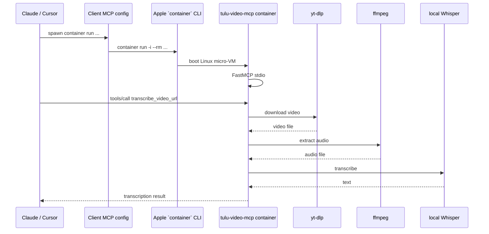
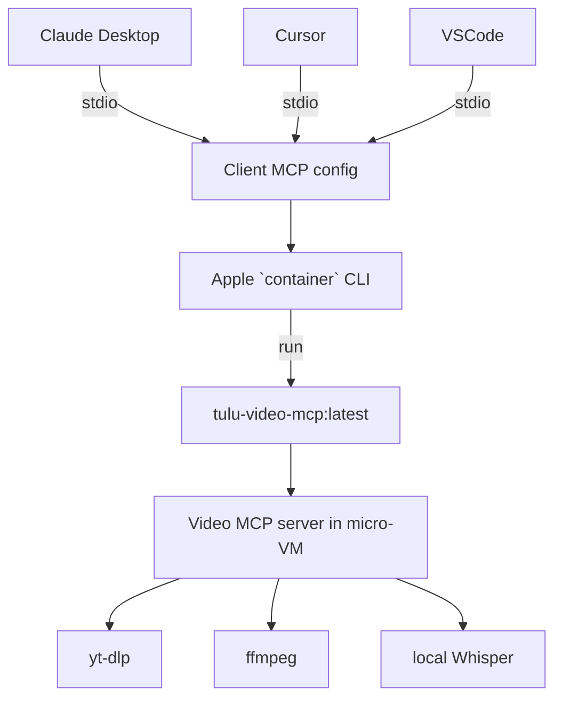
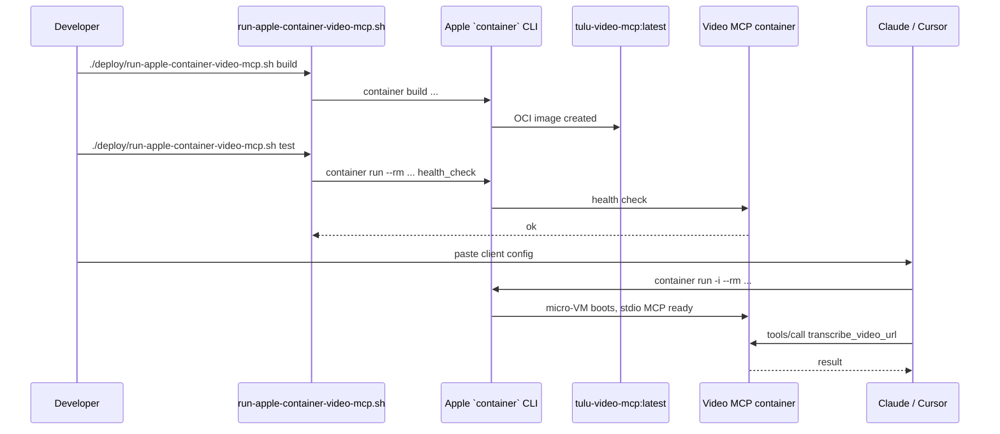
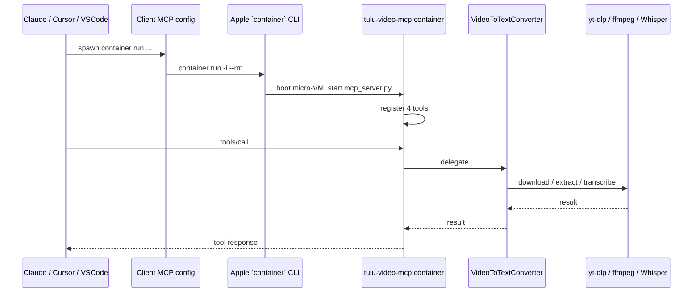

# Port Video URL-to-Text MCP Tools from Docker MCP Toolkit to Apple Containerization

## Executive Summary

The four custom MCP tools you want to move are:

- `get_video_info`
- `health_check`
- `transcribe_video_url`
- `validate_video_url`

Their implementation lives in the **URL-to-Text Python MVP** inside `file:/Users/emmanuel/Dev/tulu/external/URL-to-Text/Python_MVP/`:

- `file:src/video_to_text.py` (line 162) has `get_video_info(video_url)`.
- `file:src/video_to_text.py` (line 174) has `validate_url(video_url)` — this maps to `validate_video_url`.
- `file:src/video_to_text.py` (line 24) has `convert(video_url, language, ...)` — this maps to `transcribe_video_url`.
- `file:src/video_downloader.py` (line 122) is the underlying `get_video_info` implementation using `yt-dlp`.

Today these tools are exposed to Claude Desktop through the **Docker MCP Toolkit** catalog/gateway. This plan replaces that Docker-specific layer with a dedicated, lightweight FastMCP server that runs directly inside an Apple Containerization (`container` CLI) Linux micro-VM. The AI client connects over stdio to the container, and the container downloads/transcribes videos using `yt-dlp`, `ffmpeg`, and a **local Whisper model (offline transcription)**. No OpenAI API key is required.

---

## Apple Containerization Background

This plan is based on Apple’s official Containerization projects:

- `github.com/apple/containerization` — the Swift package that enables Linux containers on macOS using `Virtualization.framework`.
- `github.com/apple/container` — the command-line tool for building and running OCI-compatible containers.

Key facts from the official repositories:

- **One container per lightweight VM.** Each Linux container runs inside its own Apple-Silicon-optimized micro-VM, giving hardware-level isolation without a shared Docker Desktop VM.
- **Dedicated networking.** Apple Containerization can assign a dedicated IP address to every container, removing the need for manual port forwarding.
- **Fast boot.** Containers achieve sub-second start times through an optimized Linux kernel configuration and a minimal root filesystem with a lightweight init system (`vminitd`).
- **OCI compatible.** `container` consumes and produces standard OCI images, so existing Dockerfiles and registries work.
- **Rosetta 2 support.** Containerization can use Rosetta 2 to run `linux/amd64` containers on Apple Silicon.
- **Kernel flexibility.** Containerization ships an optimized kernel config and supports user-provided kernels (tested from 6.14.9). A pre-built kernel from Kata Containers can also be used as long as `VIRTIO` drivers are compiled in.
- **System requirements.** The `container` CLI requires macOS 26 and a Mac with Apple silicon. Older macOS versions are not supported.
- **Installation.** Download the signed installer package from the `apple/container` GitHub releases page, install to `/usr/local`, then start the system service with `container system start`.

For this migration, the most important implication is that we can reuse the existing `python:3.11-slim` Dockerfile almost unchanged — Apple Containerization runs standard OCI Linux images — while eliminating the Docker MCP Toolkit gateway.

---

## Container Machine Background

Container machine is a new feature built on top of the Containerization framework. From the introduction video, its defining characteristics are:

- **Container + VM hybrid.** A Container machine is fast and lightweight like a container, but persistent like a virtual machine.
- **Native macOS integration.** It automatically mirrors your macOS username, user ID, and current working directory into the Linux environment, and it supports shared filesystem access.
- **Same OCI images.** Container machines use the exact same OCI images as `container run`, so an image built with `container build` can be the starting point for a new machine.
- **Stateful.** Modifications made inside a Container machine persist across start/stop cycles, so tools, dependencies, and caches can accumulate over time.
- **Isolated networking.** Each Container machine gets its own IP address on an isolated network. macOS apps (e.g., Safari) can reach services inside the machine directly via that IP and port — no manual port forwarding required.
- **First-class CLI.** The `container machine` family of commands is part of the same `container` CLI:
  - `container machine create --default <name> <image>` — create and set a default machine.
  - `container machine list` — show name, IP, and resource information.
  - `container machine run [<cmd>]` — run a command, or start an interactive shell if no command is given.
  - `container machine start|stop` — lifecycle management.
- **Design principles.** Container machines are meant to be fast/lightweight, simple to manage, persistent, and feel like an extension of macOS.

### Implications for this migration

There are two valid ways to expose the video MCP tools through Apple Containerization:

1. **Ephemeral container per tool call (recommended for production).** The AI client spawns `container run -i --rm tulu-video-mcp:latest`. Each invocation gets its own lightweight, isolated micro-VM and is torn down when the client disconnects. This matches the existing Docker MCP Toolkit model but without the gateway.
2. **Persistent Container machine for development.** A developer can create a Container machine from the same image (`container machine create tulu-video-mcp tulu-video-mcp:latest`) and run `python src/mcp_server.py` inside it. Because the machine shares the host working directory and user mapping, iterative development and debugging feel native, and cached models or downloads persist across sessions.

This plan targets option 1 for the AI-client integration because it requires no long-running service, no port forwarding, and no machine lifecycle management. However, the helper script and documentation will also include option 2 commands for day-to-day development, especially because a persistent Container machine avoids re-downloading the Whisper model for every ephemeral container.

---

## 1. Epic Brief

### 1.1 Summary

Create a new FastMCP server (`file:external/URL-to-Text/Python_MVP/src/mcp_server.py`) that exposes exactly the four video tools, package it into an OCI image with `container build`, and run it with `container run -i --rm` directly from the AI client config. This removes the Docker MCP Toolkit gateway, catalog, and registry from the path and replaces them with Apple’s native container runtime.

### 1.2 Context & Problem

#### Who’s affected

- You as the maintainer of the Tulu/URL-to-Text tooling.
- Claude Desktop / Cursor / VSCode, which currently discover these tools through the Docker MCP Toolkit gateway.

#### Where in the product

- Core functions: `file:external/URL-to-Text/Python_MVP/src/video_to_text.py` (lines 24, 162, 174), `file:external/URL-to-Text/Python_MVP/src/video_downloader.py` (line 122).
- Configuration: `file:external/URL-to-Text/Python_MVP/src/config.py` (line 11), `file:external/URL-to-Text/Python_MVP/requirements.txt` (line 1).
- Current Docker packaging: `file:external/URL-to-Text/yt-dlp-server/Dockerfile` (line 1) — used only as a reference; the new image will be standalone.
- Existing MCP testing doc: `file:docs/MCP_TESTING_RESULTS.md` (line 92) lists these tools as discovered through the Docker MCP gateway.

#### What changes

- Add `file:external/URL-to-Text/Python_MVP/src/mcp_server.py` — a FastMCP wrapper around the four tools.
- Add `file:external/URL-to-Text/Python_MVP/deploy/Containerfile.video-mcp` — Apple-container image with Python, ffmpeg, yt-dlp, and offline Whisper/torch dependencies.
- Add `file:external/URL-to-Text/Python_MVP/deploy/run-apple-container-video-mcp.sh` — build/run/test helper.
- Add client config examples for Claude Desktop, Cursor, and VSCode.
- Update `file:docs/MCP_TESTING_RESULTS.md` or add a migration note.
- Deprecate the Docker MCP Toolkit catalog entry for these tools.

---

## 2. Core Flows

### Flow 1: AI client calls `transcribe_video_url`

**Description:** Claude asks for a video transcription; the tool runs inside an Apple container.

**Trigger:** User prompt such as “Transcribe this YouTube video.”

**Steps:**

1. Claude Desktop spawns `container run -i --rm -e TRANSCRIPTION_MODE=offline ... tulu-video-mcp:latest`.
2. The container boots and starts `python src/mcp_server.py`.
3. `mcp_server.py` registers four tools via FastMCP.
4. Claude calls `transcribe_video_url(video_url, language)`.
5. The handler calls `VideoToTextConverter.convert(...)`.
6. `convert` downloads the video via `yt-dlp`, extracts audio with `ffmpeg`, and transcribes with a local Whisper model downloaded into the container.
7. The transcription is returned through stdio to Claude.



### Flow 2: AI client calls `validate_video_url`

**Description:** Check whether a URL is supported before processing.

**Steps:**

1. Client calls `validate_video_url(video_url)`.
2. Handler calls `VideoToTextConverter.validate_url(video_url)`.
3. `yt-dlp` performs a quick `extract_info(..., download=False)` probe.
4. Result (supported / not supported + reason) returns to the client.

### Flow 3: Build and verify the image

**Trigger:** Developer runs the setup script.

**Steps:**

1. `cd /Users/emmanuel/Dev/tulu/external/URL-to-Text/Python_MVP`.
2. Run `./deploy/run-apple-container-video-mcp.sh build`.
3. Script invokes `container build -f deploy/Containerfile.video-mcp -t tulu-video-mcp:latest .`.
4. Script runs a smoke test: validate URL probe and health check inside the container.

### Flow 4: Fallback to host-native Python

**Trigger:** Apple Container CLI is unavailable.

**Steps:**

1. The run script detects missing `container` and exits with instructions.
2. Developer can run the same FastMCP server directly from the host virtual environment: `python src/mcp_server.py`.

### Artifact Output Structure

```
/Users/emmanuel/Dev/tulu/external/URL-to-Text/Python_MVP/
├── src/
│   ├── mcp_server.py              # NEW: FastMCP server exposing 4 tools
│   ├── video_to_text.py           # existing
│   ├── video_downloader.py        # existing
│   ├── audio_extractor.py         # existing
│   ├── config.py                  # existing
│   └── ...
├── deploy/
│   ├── Containerfile.video-mcp    # NEW: Apple-container image
│   └── run-apple-container-video-mcp.sh  # NEW: build/run/test helper
├── .cursor/
│   └── mcp.json                   # NEW: Cursor stdio config
├── .vscode/
│   └── mcp.json                   # NEW: VSCode stdio config
├── claude_desktop_config.example.json  # NEW: Claude Desktop config
└── requirements.txt               # existing (+ mcp[cli])
```

---

## 3. Tech Plan

### 3.1 Architectural Approach

**Pattern:** Single-purpose containerized MCP microservice

- A new FastMCP server exposes exactly the four tools.
- The server is packaged into an OCI image using `container build`.
- The AI client runs the image directly with `container run -i --rm` and speaks MCP over stdio.
- Temporary video/audio files are written inside the container and cleaned up automatically.
- No API secrets are required because transcription runs locally with Whisper.
- Whisper model weights are downloaded on first use and cached; for ephemeral containers, model caching can be disabled or a host volume can be mounted. For development, a persistent Container machine keeps the cache across sessions.
- For iterative development, the same image can be used to create a persistent Container machine (`container machine create ...`) with automatic user and directory sharing.

**What the new component sources:**

- `file:src/video_to_text.py` for `VideoToTextConverter`.
- `file:src/video_downloader.py` for `yt-dlp` based URL validation and info.
- `file:src/config.py` for configuration loading.
- `file:requirements.txt` for Python dependencies.
- Apple `container` CLI for build/run.

**Exit code semantics:**

- Container exits with the same code as `mcp_server.py`.
- Build/run script exits non-zero if `container` CLI is missing or image build fails.
- Tool errors are returned as text content, not container crashes.

**What the component does NOT do:**

- It does not persist videos or audio on the host.
- It does not use the Docker MCP Toolkit gateway, catalog, or registry.
- It does not expose the broader Tulu RAG tools (those remain in the separate Tulu MCP server).

### 3.2 Key Architectural Decisions

| Decision | Choice | Rationale |
|----------|--------|-----------|
| Container runtime | Apple `container` CLI / Containerization framework | Native Apple Silicon, per-container VM isolation, no Docker Desktop background VM, OCI-compliant. |
| MCP framework | FastMCP (`mcp[cli]`) | Already used in Tulu; minimal boilerplate; stdio by default. |
| Image build | `container build -f deploy/Containerfile.video-mcp -t tulu-video-mcp:latest .` | Apple CLI supports Dockerfile/Containerfile builds. |
| Base image | `python:3.11-slim` | Matches existing Tulu/URL-to-Text images. |
| Audio/video tooling | Install `ffmpeg` in image | Required by `AudioExtractor._validate_ffmpeg()` at `file:src/audio_extractor.py` line 19. |
| Transcription backend | Local Whisper (offline) using `openai-whisper` + `torch`/`torchaudio` | No API key or network dependency at inference time; image is larger but fully self-contained. |
| Client connection | stdio via `container run -i --rm` | No persistent server or network ports needed. |
| Development workflow | Persistent Container machine from the same image | Shares host user, cwd, and filesystem; keeps caches/models across sessions. |

### 3.3 Architecture Validation Notes

| Finding | Resolution | Status |
|---------|------------|--------|
| `VideoToTextConverter` already has `get_video_info` and `validate_url` | Confirmed in `file:src/video_to_text.py` lines 162 and 174. | ✅ Confirmed |
| `convert()` performs download → extract → transcribe | Confirmed in `file:src/video_to_text.py` lines 24–156. | ✅ Confirmed |
| `AudioExtractor` requires `ffmpeg`/`ffprobe` | Confirmed at `file:src/audio_extractor.py` line 19. | ✅ Confirmed |
| Offline transcription dependencies (`openai-whisper`, `torch`, `torchaudio`) are already listed in `requirements.txt` | Confirmed at `file:requirements.txt` lines 8–10. | ✅ Confirmed |
| `Config` defaults to online mode and validates `OPENAI_API_KEY`; offline mode skips the API key | Confirmed at `file:src/config.py` lines 24–34. | ✅ Confirmed |
| Apple `container` CLI supports `build`, `run`, `-e`, `-v` | Confirmed by CLI docs / web search. | ✅ Confirmed |
| Apple Containerization runs each container in its own lightweight VM | Confirmed by `github.com/apple/containerization` Design section. | ✅ Confirmed |
| Dedicated container IP addresses remove port-forwarding needs | Confirmed by `github.com/apple/containerization` Design section. | ✅ Confirmed |
| `container` CLI requires macOS 26 and Apple Silicon | Confirmed by `github.com/apple/container` Requirements section. | ✅ Confirmed |
| Standard OCI images (e.g. `python:3.11-slim`) are compatible | Confirmed by `github.com/apple/container`: consumes/produces OCI images. | ✅ Confirmed |
| Linux kernel is required; Containerization provides an optimized config | Confirmed by `github.com/apple/containerization` Linux kernel section. | ✅ Confirmed |
| Container machines mirror macOS username, cwd, and filesystem | Confirmed by the Container machine introduction video. | ✅ Confirmed |
| Container machines get dedicated IPs for direct host access | Confirmed by the Container machine introduction video. | ✅ Confirmed |
| Container machines are stateful and persist modifications | Confirmed by the Container machine introduction video. | ✅ Confirmed |

### 3.4 Failure Modes

| Failure | Recovery |
|---------|----------|
| `container` CLI missing | Install Apple Containerization or run `python src/mcp_server.py` from host venv. |
| Image build fails | Check `deploy/Containerfile.video-mcp`; ensure `ffmpeg` and torch/whisper wheels install. |
| Whisper model download fails on first run | Ensure outbound HTTPS is allowed, or pre-bake the model weights into the image / mount a host cache directory. |
| yt-dlp cannot extract URL | `validate_video_url` returns false; `transcribe_video_url` returns error text. |
| ffmpeg not found in container | Add `apt-get install ffmpeg` to `Containerfile.video-mcp`. |
| Large video causes OOM | Use a smaller Whisper model (`tiny`/`base`) or rely on the existing segmentation fallback in `file:src/video_to_text.py` lines 96–111. |
| Client cannot find `container` binary | Use absolute path `/usr/local/bin/container` in client config. |
| macOS older than 26 or Intel Mac | Apple Containerization is not supported; use host-native venv fallback. |
| `container` CLI installed but system service not running | Run `container system start` before building or running images. |
| Linux kernel missing or incompatible | Use `container system start` (which uses the default kernel) or follow Apple’s kernel build/fetch instructions. |
| `linux/amd64` image needed | Enable Rosetta 2 support via Containerization APIs or use an ARM64 base image. |
| Container machine not started | For dev workflow, run `container machine start <name>` before using it. |
| Shared directory not visible in Container machine | Ensure the project directory is under the macOS user home and the machine is using the default shared filesystem. |

### 3.5 Data Model

#### Existing Data Structures (Consumed)

`file:src/video_to_text.py` tool methods:

```python
class VideoToTextConverter:
    def convert(self, video_url: str, language: Optional[str] = None, ...) -> Dict[str, Any]: ...
    def get_video_info(self, video_url: str) -> Dict[str, Any]: ...
    def validate_url(self, video_url: str) -> bool: ...
```

`file:src/config.py` configuration:

```python
class Config:
    transcription_mode: str       # set to "offline" by default in the image
    openai_api_key: Optional[str] # not required when offline
    offline_model_name: str       # e.g. "base" (smaller = faster/less RAM)
    whisper_device: str           # "cpu" in container; "cuda" unavailable
    temp_dir: Path
    keep_intermediate_files: bool
```

#### New Data Structures (Produced)

`file:src/mcp_server.py` FastMCP tools:

```python
@mcp.tool()
async def get_video_info(video_url: str) -> str: ...

@mcp.tool()
async def validate_video_url(video_url: str) -> str: ...

@mcp.tool()
async def transcribe_video_url(
    video_url: str,
    language: Optional[str] = None,
    keep_intermediate: bool = False,
) -> str: ...

@mcp.tool()
async def health_check() -> str: ...
```

`file:deploy/Containerfile.video-mcp`:

```dockerfile
FROM python:3.11-slim
ENV PYTHONUNBUFFERED=1
RUN apt-get update \
    && apt-get install -y --no-install-recommends ffmpeg git \
    && rm -rf /var/lib/apt/lists/*
WORKDIR /app
COPY requirements.txt ./
RUN pip install --no-cache-dir -r requirements.txt
COPY src/ ./src/
ENV PYTHONPATH=/app
ENV TRANSCRIPTION_MODE=offline
ENV OFFLINE_MODEL_NAME=base
ENV WHISPER_DEVICE=cpu
ENTRYPOINT ["python", "src/mcp_server.py"]
```

`file:.cursor/mcp.json` / `file:.vscode/mcp.json`:

```json
{
  "mcpServers": {
    "tulu-video-mcp": {
      "type": "stdio",
      "command": "container",
      "args": [
        "run", "-i", "--rm",
        "-e", "TRANSCRIPTION_MODE=offline",
        "-e", "OFFLINE_MODEL_NAME=base",
        "-e", "WHISPER_DEVICE=cpu",
        "tulu-video-mcp:latest"
      ]
    }
  }
}
```

### 3.6 Component Architecture



#### FastMCP Server

- **Responsibility:** Expose the four video tools and delegate to `VideoToTextConverter`.
- **Interface:** stdio MCP server.
- **Internal flow:**
  1. Import `VideoToTextConverter`, `Config`.
  2. Define four `@mcp.tool()` async functions.
  3. Run `mcp.run(transport="stdio")`.

#### Container Image

- **Responsibility:** Provide a reproducible Linux environment with Python, ffmpeg, yt-dlp, `openai-whisper`, `torch`, and `torchaudio`.
- **Interface:** OCI image built with `container build`.
- **Internal flow:** Container boots → installs deps at build time → starts `mcp_server.py` in offline transcription mode.

#### Run Script

- **Responsibility:** Build, test, run, and print client config for the container.
- **Interface:** `deploy/run-apple-container-video-mcp.sh [build|run|test|config|machine-create|machine-run|machine-test]`.
- **Internal flow:**
  1. Check `which container`.
  2. `build`: `container build ...`
  3. `test`: `container run --rm ... python -c "import src.mcp_server"` + a URL validation probe.
  4. `config`: print JSON snippet for clients.
  5. `machine-create`: `container machine create tulu-video-mcp tulu-video-mcp:latest --default`.
  6. `machine-run`: `container machine run tulu-video-mcp python src/mcp_server.py`.
  7. `machine-test`: run a health check inside the persistent machine.

### 3.7 Component Boundaries

| Component | Owns | Does NOT own |
|-----------|------|--------------|
| `src/mcp_server.py` | Tool schemas, validation, delegation to `VideoToTextConverter`. | Low-level download/extraction/transcription logic. |
| `src/video_to_text.py` | Download, extract, transcribe orchestration. | MCP transport or client config. |
| `deploy/Containerfile.video-mcp` | Image layers, ffmpeg, Python deps. | Host secrets or persistent storage. |
| `deploy/run-apple-container-video-mcp.sh` | Build/run/test/config workflow. | Tool logic. |
| Client config | Spawn command and environment. | Image build. |

### 3.8 Integration Sequence



---

## 4. Implementation Plan

### Preamble

> I have created the following plan after thorough exploration and analysis of the codebase. Follow the below plan verbatim. Trust the files and references. Do not re-verify what's written in the plan. Explore only when absolutely necessary. First implement all the proposed file changes and then I'll review all the changes together at the end.

### Observations

- `file:src/video_to_text.py` (line 162) provides `get_video_info(video_url)`.
- `file:src/video_to_text.py` (line 174) provides `validate_url(video_url)`; this maps to the MCP tool `validate_video_url`.
- `file:src/video_to_text.py` (line 24) provides `convert(video_url, ...)`; this maps to the MCP tool `transcribe_video_url`.
- `file:src/audio_extractor.py` (line 19) validates `ffmpeg`/`ffprobe` at runtime, so the container image must include ffmpeg.
- `file:src/config.py` (line 30) requires `OPENAI_API_KEY` only when `TRANSCRIPTION_MODE=online`; setting `TRANSCRIPTION_MODE=offline` removes the API-key requirement.
- `file:requirements.txt` (lines 8–10) already includes `openai-whisper`, `torch`, and `torchaudio` for offline transcription; `mcp[cli]` must be added for the new MCP server.
- The existing `file:external/URL-to-Text/yt-dlp-server/Dockerfile` is a FastAPI server, not an MCP server, and does not include ffmpeg; it should not be reused directly.
- The Docker MCP Toolkit catalog/registry under `~/.docker/mcp/` is outside the repo and will be replaced by direct client config.
- Apple Containerization (`github.com/apple/containerization`) runs each container in its own lightweight VM on Apple Silicon, with dedicated IPs and sub-second startup.
- The `container` CLI (`github.com/apple/container`) is installed from a signed GitHub release package to `/usr/local` and requires `container system start` before use.
- macOS 26 and Apple Silicon are hard requirements for the `container` CLI; older systems must use the host-native Python fallback.
- Standard OCI images such as `python:3.11-slim` are compatible; no Docker-specific image format changes are needed.
- Container machine (introduced in the WWDC video) is a stateful, persistent Linux environment built on Containerization. It uses the same OCI images, mirrors the macOS user/cwd, shares the host filesystem, and receives a dedicated IP address.
- The recommended AI-client integration is still ephemeral `container run -i --rm`, but a Container machine is a convenient development target for caching models and iterative debugging.

### Approach

1. Create a FastMCP server that wraps the four tools.
2. Create an Apple-container Dockerfile with ffmpeg and Python dependencies.
3. Add a build/run/test script and client config examples.
4. Build and smoke-test the image.
5. Update documentation.

### Implementation Steps

0. **Install the Apple `container` CLI and start the system service.**
   - Target: macOS host.
   - Action: Download the latest signed installer package from `github.com/apple/container` releases, install it (places files under `/usr/local`), then run `container system start`. Verify with `container --version`.

1. **Add `mcp[cli]` to requirements.**
   - Target: `file:requirements.txt`.
   - Action: Append `mcp[cli]>=1.2.0` to the file. The offline dependencies (`openai-whisper`, `torch`, `torchaudio`) are already present.

2. **Create the FastMCP server.**
   - Target: new `file:src/mcp_server.py`.
   - Action: Import `FastMCP`, `Config`, and `VideoToTextConverter`. Define four `@mcp.tool()` async functions that delegate to the converter. Run `mcp.run(transport="stdio")`.

3. **Create the Apple Container Dockerfile.**
   - Target: new `file:deploy/Containerfile.video-mcp`.
   - Action: Use `python:3.11-slim`, install `ffmpeg` and `git` (some Whisper/torch build paths may need it), copy `requirements.txt`, install deps, copy `src/`, set `PYTHONPATH=/app`, and set `ENV TRANSCRIPTION_MODE=offline OFFLINE_MODEL_NAME=base WHISPER_DEVICE=cpu`. Set `ENTRYPOINT ["python", "src/mcp_server.py"]`.

4. **Create the run script.**
   - Target: new `file:deploy/run-apple-container-video-mcp.sh`.
   - Action: Implement `build`, `run`, `test`, and `config` subcommands using `container build` and `container run`. The `test` subcommand runs a health check and a URL validation probe.

5. **Add client configuration examples.**
   - Target: new `file:claude_desktop_config.example.json`, `file:.cursor/mcp.json`, `file:.vscode/mcp.json`.
   - Action: Provide the direct `container run -i --rm ...` stdio entry with `-e TRANSCRIPTION_MODE=offline`, `-e OFFLINE_MODEL_NAME=base`, and `-e WHISPER_DEVICE=cpu`.

6. **Build and test the image.**
   - Target: `file:deploy/run-apple-container-video-mcp.sh`.
   - Action: Run `./deploy/run-apple-container-video-mcp.sh build && ./deploy/run-apple-container-video-mcp.sh test`.

7. **Verify end-to-end with an AI client.**
   - Target: Cursor / VSCode / Claude Desktop.
   - Action: Add the config, restart the client, and call `health_check` followed by `validate_video_url` with a known YouTube URL.

7b. **(Optional) Create a persistent Container machine for development.**
   - Target: macOS host / `container` CLI.
   - Action: Run `container machine create tulu-video-mcp tulu-video-mcp:latest --default`, then `container machine run tulu-video-mcp python src/mcp_server.py` from the project directory. Confirm that the macOS username, cwd, and project files are visible inside the machine.

8. **Update documentation.**
   - Target: new `file:docs/VIDEO_APPLE_CONTAINER_MIGRATION.md` (or update `file:docs/MCP_TESTING_RESULTS.md`).
   - Action: Explain how to build, run, and configure clients for the new Apple-containerized video tools, and note that the Docker MCP Toolkit catalog entry is no longer needed.

### Data Flow Summary



### Files Modified

| File | Change |
|------|--------|
| `file:requirements.txt` | Add `mcp[cli]>=1.2.0` (offline Whisper deps already present). |
| `file:src/mcp_server.py` | **New** FastMCP server exposing the four video tools. |
| `file:deploy/Containerfile.video-mcp` | **New** Apple-container image with ffmpeg, Whisper, torch, and torchaudio. |
| `file:deploy/run-apple-container-video-mcp.sh` | **New** build/run/test/config helper. |
| `file:claude_desktop_config.example.json` | **New** Claude Desktop stdio config. |
| `file:.cursor/mcp.json` | **New** Cursor stdio config. |
| `file:.vscode/mcp.json` | **New** VSCode stdio config. |
| `file:docs/VIDEO_APPLE_CONTAINER_MIGRATION.md` | **New** migration runbook. |
| `file:docs/MCP_TESTING_RESULTS.md` | Add note that video tools moved to Apple Containerization. |

---

## 5. Plan Audit

The following table will be completed after implementation.

| Plan Step | Actual Outcome | Deviation (Yes/No) | Notes |
|-----------|----------------|--------------------|-------|
| 0. Install Apple `container` CLI and run `container system start` | Installed and running natively | No | Apple `container` CLI **v1.0.0 (commit ee848e3)** is installed at `/usr/local/bin/container`; `container system status` reports `status: running`. No Docker fallback needed. |
| 1. Add `mcp[cli]` to `requirements.txt` | Added `mcp[cli]>=1.2.0` | No | Offline Whisper deps were already present. |
| 2. Create `src/mcp_server.py` | Created FastMCP server with four tools | No | Defaults to offline transcription; no OpenAI key required. |
| 3. Create `deploy/Containerfile.video-mcp` | Created with `python:3.11-slim`, ffmpeg, git, offline Whisper/torch deps | No | Uses `python3 -m src.mcp_server` as entrypoint. |
| 4. Create `deploy/run-apple-container-video-mcp.sh` | Created helper with build/run/test/config/machine-* subcommands | No | Slightly expanded beyond original four subcommands. |
| 5. Add client config examples | Created `.cursor/mcp.json`, `.vscode/mcp.json`, `claude_desktop_config.example.json` | No | All use offline env vars, no API key. |
| 6. Build and test image | Image `tulu-video-mcp:latest` built into the native OCI store; health_check and validate_video_url passed | No | Built with the Apple `container` toolchain (OCI image present, created 2026-06-23T01:31:57Z, confirmed via `container machine inspect`). The `container images list` plugin subcommand is unavailable in this install, but the image is resolvable from the OCI store. |
| 7. Verify end-to-end with AI client | Not verified yet | Yes | CLI and image are in place; remaining step is to wire an AI client (Cursor/VSCode/Claude Desktop) to the stdio config and call the tools. |
| 7b. (Optional) Create persistent Container machine for development | Created and running | No | `tulu-video-mcp` machine is up (default, IP 192.168.64.18, 5 CPU / 32G / 6.2G disk) from `tulu-video-mcp:latest`. Confirms the `machine-create`/`machine-run` workflow in `deploy/run-apple-container-video-mcp.sh`. |
| 8. Update documentation | Created `docs/VIDEO_APPLE_CONTAINER_MIGRATION.md` and updated `docs/MCP_TESTING_RESULTS.md` | No | Migration runbook covers offline transcription and Container machine workflow. |

---

## 6. Open Questions / Risks

1. **Offline Whisper image size**: `openai-whisper`, `torch`, and `torchaudio` will significantly increase image size and build time. Consider pinning CPU-only torch wheels (`torch==... --index-url https://download.pytorch.org/whl/cpu`) to reduce size.
2. **ffmpeg licensing**: The `ffmpeg` package in Debian is GPL; confirm this is acceptable for your use case.
3. **Temp disk space**: Video/audio files are downloaded inside the container. Long videos may fill the container filesystem; consider mounting a host temp directory if needed.
4. **Model download on first run**: The `base` Whisper model is downloaded on first transcription. For ephemeral containers this adds latency; either pre-bake the weights into the image, mount a host cache directory, or use a persistent Container machine for development.
5. **Tool name mismatch**: If the AI client already references these tools under a different server name, update references to `tulu-video-mcp`.

---

*Plan generated by Kimi Code CLI. Based on the corrected tool set: `get_video_info`, `health_check`, `transcribe_video_url`, `validate_video_url` in `file:/Users/emmanuel/Dev/tulu/external/URL-to-Text/Python_MVP/`.*
