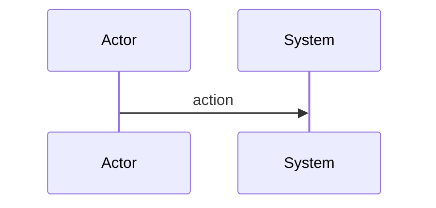

{/* Use <RichText> blocks for major prose sections when a renderer supports them. */}

## Decision context

Why this plan exists and what changed.

## Epic Brief

### Summary

One dense paragraph covering what the feature is, what it integrates with, and the end-to-end behavior it achieves.

### Context & Problem

- **Who's affected** — which developers or users, and the current broken state.
- **Where in the product** — exact file paths, stage names, approximate line numbers.
- **What changes** — the delta only; not a full description of the feature.

## Core Flows

### Flow 1: Name

**Description:** One sentence.

**Trigger:** What initiates this flow.

**Steps:**

1. ...
2. ...



### Artifact Output Structure

```
path/
├── file.md        # what this file does
└── subdir/
    └── file.ts    # what this file does
```

## Tech Plan

### Architectural Approach

Pattern name followed by bullets: what the component sources, exit-code semantics, explicit boundaries.

### Key Architectural Decisions

| Decision | Choice | Rationale |
|----------|--------|-----------|
| X | Y | Z |

### Failure Modes

| Failure | Recovery |
|---------|----------|
| Missing dependency | Stop and tell the user exactly what to install. |

### Data Model

```typescript
// Example shape
interface Example {
  id: string;
}
```

## Implementation Plan

### Preamble

Follow this plan verbatim. Trust the files and references. Explore only when absolutely necessary.

### Approach

1–3 sentences summarizing the implementation strategy.

### Implementation Steps

1. `file:path/to/file.ext` — function + line, exact change.
2. `file:path/to/file.ext` — next change.

### Files Modified

| File | Change |
|------|--------|
| `path/to/file.ext` | Brief description. |

## Plan Audit

| Plan Step | Actual Outcome | Deviation (Yes/No) | Notes |
|-----------|---------------|-------------------|-------|
| 1 | ... | No | |

## Open Questions

Use a bottom `<QuestionForm>` block only when a decision would change architecture, scope, UX, data shape, or rollout.
